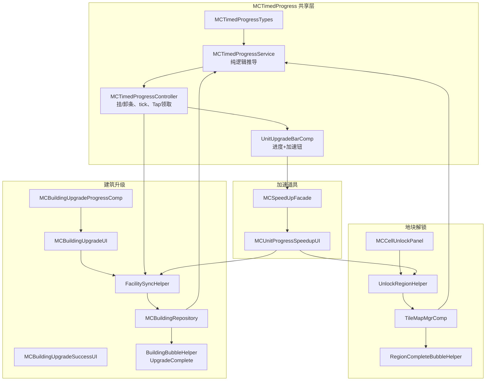
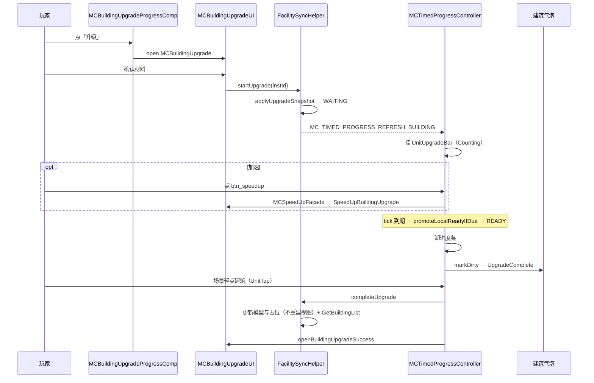
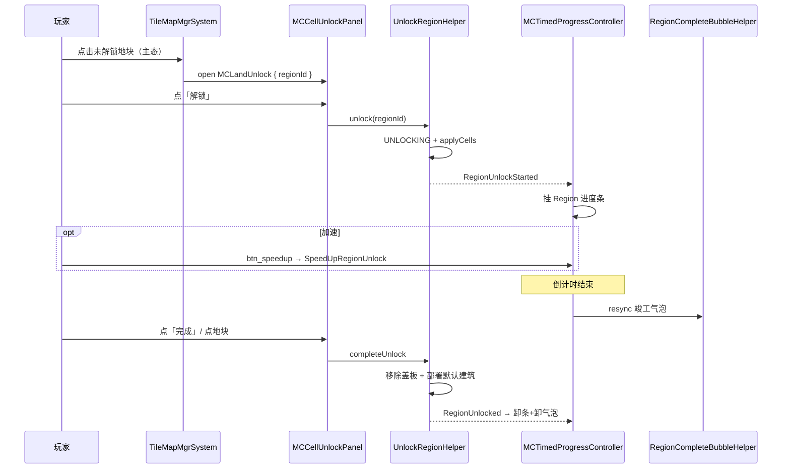
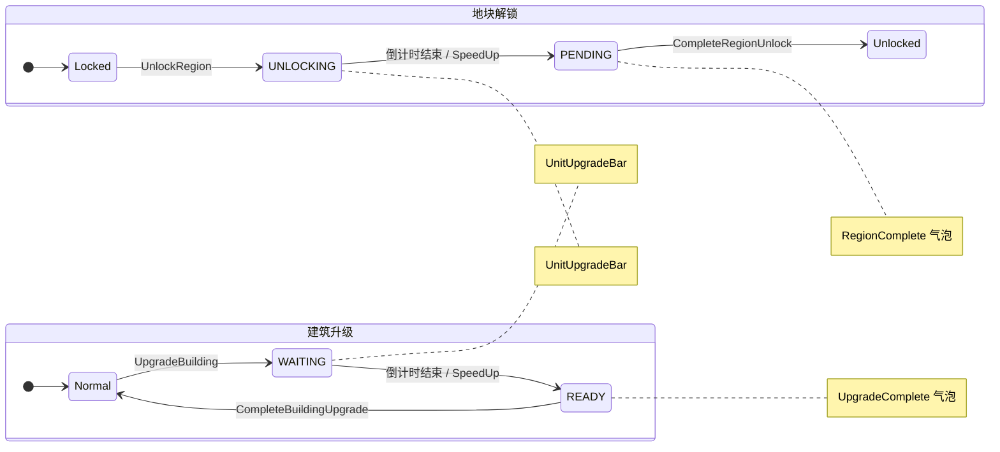

# 建筑升级进度 · 地块解锁进度 · 加速道具 功能文档

> **模块定位**：牧场「耗时玩法」的统一倒计时体系。建筑升级与地块解锁共用 **MCTimedProgress** 场景进度条层；竣工领取分别走**建筑头顶气泡**与**地块竣工气泡**；加速道具经 **MCSpeedUpFacade** 统一弹窗，按「1 道具 = 1 秒」调用各自 SpeedUp RPC。
>
> **核心原则**：RPC 收口在 `FacilitySyncHelper`（建筑）与 `UnlockRegionHelper`（地块）；场景表现由 `MCTimedProgressController` 驱动；面板组件只负责发起 / 展示，**不负责竣工领取**（建筑领取走场景 Tap）。
>
> **最后整理**：2026-09-24

---

## 目录

1. [功能概览](#1-功能概览)
2. [架构与分层](#2-架构与分层)
3. [目录与文件清单](#3-目录与文件清单)
4. [UI 注册与预制体](#4-ui-注册与预制体)
5. [数据模型与状态机](#5-数据模型与状态机)
6. [网络协议与 RPC](#6-网络协议与-rpc)
7. [完整链路（时序）](#7-完整链路时序)
8. [加速道具规则](#8-加速道具规则)
9. [事件与刷新触发](#9-事件与刷新触发)
10. [业务规则](#10-业务规则)
11. [外部联动](#11-外部联动)
12. [与相关系统的边界](#12-与相关系统的边界)
13. [常见问题与调试](#13-常见问题与调试)
14. [扩展指南](#14-扩展指南)

---

## 1. 功能概览

### 1.1 三大能力对照

| 能力 | 发起 UI | 倒计时表现 | 竣工表现 | 领取 / 确认 | 加速入口 |
|---|---|---|---|---|---|
| **建筑升级** | `MCBuildingUpgradeUI` / 面板「升级」 | 场景 `UnitUpgradeBar`（Counting） | 头顶气泡 `UpgradeComplete` | 场景轻点建筑 → Success UI | 场景条 `btn_speedup` |
| **地块解锁** | `MCCellUnlockPanel` | 场景 `UnitUpgradeBar`（Region） | `RegionCompleteBubbleHelper` | 浮窗「完成」/ 点地块 | 场景条 `btn_speedup` |
| **加速道具** | `MCUnitProgressSpeedupUI` | — | — | 确认消耗 | `MCSpeedUpFacade.open()` |

### 1.2 三段式对称设计

建筑与地块均为 **发起 → 可选加速 → 完成确认**：

```
发起 RPC          → WAITING / UNLOCKING（挂倒计时条）
SpeedUp RPC（可选）→ 扣道具，缩短 end_time（可能直接进待确认）
完成 RPC          → 真正生效（建筑升级数据落地 / 地块开放；建筑视图不重建，换装预留给皮肤系统）
```

### 1.3 生命周期入口

```
MCBoot.onLoad  → MCTimedProgressController.init()
MCBoot.onDestroy → dispose()（含 RegionCompleteBubbleHelper）
```

登录数据经 `PastureSceneLoginInitComp` → `MCHomeDataHelper` 写入 `facilities` / `cells` / `regionSpeedUp`，触发 Repository 与 TileMap 落地后 Controller 通过事件 resync。

---

## 2. 架构与分层



### 2.1 职责划分

| 层级 | 类 | 职责 |
|---|---|---|
| **类型 / 纯逻辑** | `MCTimedProgressService` | 从权威数据推导 target、判定 counting / claimable、格式化时间 |
| **场景控制器** | `MCTimedProgressController` | 加载 `UnitUpgradeBar`、批量 tick、聚焦隐藏 Overlay、建筑 Tap 领取 |
| **进度条预制** | `UnitUpgradeBarComp` | 渲染进度 + 加速按钮 → `MCSpeedUpFacade` |
| **建筑 Sync** | `FacilitySyncHelper` | `startUpgrade` / `speedUpUpgrade` / `completeUpgrade` |
| **地块 Sync** | `UnlockRegionHelper` | `unlock` / `speedUp` / `completeUnlock`（文件 `TileUnlockRegionHelper.ts`） |
| **加速门面** | `MCSpeedUpFacade` | 统一打开加速确认弹窗 |
| **加速 UI** | `MCUnitProgressSpeedupUI` | 解析道具持有量 → 调用建筑/地块 SpeedUp RPC |

> **约定**：`MCTimedProgressPhase.Claimable` 类型仍保留，但建筑/地块竣工均已改走**气泡**，不再挂 claimable 进度条。

---

## 3. 目录与文件清单

### 3.1 共享进度层（`scene/common/progress/`）

| 文件 | 职责 |
|---|---|
| `MCTimedProgressTypes.ts` | `MCTimedProgressKind` / `Phase` / `Target` |
| `MCTimedProgressService.ts` | 无 UI 的进度推导与扫描 |
| `MCTimedProgressController.ts` | 场景级 Controller（init/dispose/tick） |
| `UnitUpgradeBarComp.ts` | 进度条预制脚本 |

### 3.2 建筑升级

| 文件 | 职责 |
|---|---|
| `unit/util/FacilitySyncHelper.ts` | 建筑 RPC 收口 |
| `building/data/MCBuildingRepository.ts` | 权威 facilities + buildingItems |
| `building/util/BuildingBubbleHelper.ts` | 升级竣工气泡（最高优先级） |
| `gui/common/buildingupgrade/MCBuildingUpgradeProgressComp.ts` | 面板内三态：升级中 / 升级 / 详情 |
| `gui/common/buildingupgrade/MCBuildingUpgradeUI.ts` | 升级确认（材料校验 → startUpgrade） |
| `gui/common/buildingupgrade/MCBuildingUpgradeSuccessUI.ts` | 竣工成功页 |
| `gui/common/buildingupgrade/McBuildingUpgradeDefines.ts` | 参数接口 + `MCBuildingUpgradeEvent` |

**`MCBuildingUpgradeProgressComp` 挂载点**：`MCMainCityUI`、`MCPastureInteractPanel`、`MCOrderBoardUI`

### 3.3 地块解锁

| 文件 | 职责 |
|---|---|
| `tilemap/util/TileUnlockRegionHelper.ts` | **`UnlockRegionHelper`** 类 |
| `tilemap/util/RegionCompleteBubbleHelper.ts` | 地块竣工气泡 |
| `tilemap/util/TileRegionCoverHelper.ts` | 未解锁盖板 + UpgradeSlot 锚点 |
| `tilemap/TileMapMgrComp.ts` | 网格 + `getRegionUnlockState()` |
| `tilemap/config/TileMapConfig.ts` | `CellStatus` / `RegionUnlockState` |
| `tilemap/config/TileMapEvent.ts` | 地块变更事件 |
| `gui/cell-unlock/MCCellUnlockPanel.ts` | 解锁浮窗 |
| `gui/cell-unlock/MCCellUnlockCostItem.ts` | 条件行 |
| `config/MCCellUnlockConditionHelper.ts` | 配置表 `unlock_need` / `unlock_secs` |

### 3.4 加速道具

| 文件 | 职责 |
|---|---|
| `gui/speedup/MCSpeedUpFacade.ts` | `open({ kind, id })` |
| `gui/speedup/MCUnitProgressSpeedupUI.ts` | 加速确认弹窗 |

---

## 4. UI 注册与预制体

| MCUIID | 数值 | Prefab | 脚本 | 用途 |
|---|---|---|---|---|
| `MCBuildingUpgrade` | 10032 | `gui/prefab/BuildingUpgrade/BuildingUpgradeUI` | `MCBuildingUpgradeUI` | 升级确认 |
| `MCBuildingUpgradeSuccess` | 10039 | `gui/prefab/BuildingUpgrade/BuildingUpgradeSuccess` | `MCBuildingUpgradeSuccessUI` | 竣工成功 |
| `MCMainCityMaxLevel` | 10031 | `gui/prefab/BuildingUpgrade/BuildingUpgradeDoneUI` | — | 满级页 |
| `MCUnitProgressSpeedup` | 10040 | `gui/prefab/building_upgrade/UnitProgessSpeedupUI` | `MCUnitProgressSpeedupUI` | 加速确认 |
| `MCLandUnlock` | 10027 | `gui/prefab/CellUnlock/MCCellUnlockPanel` | `MCCellUnlockPanel` | 地块解锁浮窗 |

**场景预制**（bundle: `mcRes`）：

| 路径 | 用途 |
|---|---|
| `unit/prefab/UnitUpgradeBar` | 倒计时进度条 |
| `unit/prefab/UnitBubble` | 竣工气泡（建筑 + 地块复用） |
| `pasture_scene/Overlay` | 进度条挂载父节点（始终在建筑/盖板之上） |

**锚点**：

| 目标 | 锚点 |
|---|---|
| 建筑 | `BuildingRootComp` → `UpgradeSlot` |
| 地块盖板 | `UpgradeSlot`（无则运行时创建，偏移 `(0,80,0)`） |
| 地块竣工气泡 | 盖板 `Bubble` 锚点（偏移 `(0,100,0)`） |

---

## 5. 数据模型与状态机

### 5.1 MCTimedProgressTarget

```typescript
interface MCTimedProgressTarget {
    kind: MCTimedProgressKind;   // Building | Region
    id: number;                  // instanceId | regionId
    endTimeSec: number;
    totalSecs: number;
    phase?: MCTimedProgressPhase; // 当前仅 Counting 挂条
}
```

### 5.2 建筑升级态（UpgradeState）

| 值 | 枚举 | 客户端表现 |
|---|---|---|
| 0 | `UPGRADE_STATE_UNKNOWN` | 无进度 |
| 1 | `UPGRADE_STATE_WAITING` | 挂倒计时条（Counting） |
| 2 | `UPGRADE_STATE_READY` | 卸条 → 头顶气泡 `UpgradeComplete` |

**关键字段**：`FacilityInfo.upgrade_state`、`upgrade_end_time`、`BuildingUpgradeInfo.target_facility_id`

**兼容逻辑**（`MCTimedProgressService.isBuildingUpgradeCounting`）：
- 正常 WAITING → 计时中
- 回包误标 READY 但 `end_time` 仍在未来 → 仍按计时中展示

**本地 promote**（`promoteLocalReadyIfDue`）：tick 发现 WAITING 且 `end_time <= now` → 本地升 READY + 刷新气泡

### 5.3 地块 CellStatus

| 值 | 枚举 | 含义 |
|---|---|---|
| 1 | `CELL_STATUS_UNLOCKED` | 已开放 |
| 3 | `CELL_STATUS_LOCKED` | 条件未满足 |
| 4 | `CELL_STATUS_UNLOCKABLE` | 可发起解锁 |
| 5 | `CELL_STATUS_UNLOCKING` | 倒计时中 |
| 6 | `CELL_STATUS_PENDING_CONFIRM` | 待主人确认 |

**聚合 `RegionUnlockState`**：`unlocked` / `unlockable` / `unlocking` / `pendingConfirm` / `unlockEndTime` / `unlockSecs`

**权威数据源**：后台 `CellInfo.region_id`；Tiled locked 层 region 仅策划参考。

### 5.4 进度条挂载规则

| 阶段 | 建筑 | 地块 |
|---|---|---|
| 倒计时中 | ✅ `UnitUpgradeBar` | ✅ `UnitUpgradeBar` |
| 待领取 / 待确认 | ❌ 改气泡 | ❌ 改 `RegionCompleteBubbleHelper` |

### 5.5 MCBuildingUpgradeProgressComp 三态

| 状态 | UI |
|---|---|
| 升级计时中 | 面板内进度条 + 剩余时间（**加速钮未接点击**，见 §12） |
| 可升级（材料够、未满级） | 绿色「升级」按钮 |
| 其余 | 「详情」按钮 |

> 注释明确：**竣工领取不在此组件**；场景点击建筑 → Success UI。

---

## 6. 网络协议与 RPC

### 6.1 建筑（mcHomeService）

| RPC | Request | Reply | SyncHelper |
|---|---|---|---|
| `UpgradeBuilding` | `{ inst_id }` | `{ upgrade }` | `startUpgrade` |
| `SpeedUpBuildingUpgrade` | `{ inst_id, item_id, count }` | `{ upgrade, consumed[] }` | `speedUpUpgrade` |
| `CompleteBuildingUpgrade` | `{ inst_id }` | `{ facility? \| item? }` | `completeUpgrade` |
| `GetBuildingList` | `{}` | `{ items[], has_ready_upgrade }` | 领取后刷新 |

**错误码**（FacilitySyncHelper）：

| 码 | 含义 |
|---|---|
| 10441121 | HomesteadUpgrading |
| 10441122 | HomesteadUpgradeNotReady |
| 10441125 | 加速道具数量过多 |
| 10441117 | 已达最高等级 |

### 6.2 地块（mcHomeService）

| RPC | 阶段 | SyncHelper |
|---|---|---|
| `UnlockRegion` | 发起 → UNLOCKING | `unlock` |
| `SpeedUpRegionUnlock` | 加速（可能 → PENDING_CONFIRM） | `speedUp` |
| `CompleteRegionUnlock` | 确认 → 真正开放 | `completeUnlock` |
| `RefreshCells` / `AllCells` | 增量 / 全量 | 登录 / 校准 |

**Reply 附带**：`region_occupied_count` / `region_quota_count`（发起即计入 occupied）

### 6.3 加速相关协议结构

```typescript
interface SpeedUpInfo {
    item_id: number;       // SpeedUpItemConfig 配置行
    own_count: number;     // 快照（客户端以背包为准）
    secs_per_item: number; // 单道具加速秒数（注释：弹窗滑条数据源）
}
```

登录 `AllCellsReply.region_speed_up` → `MCHomeDataComp.regionSpeedUp`

---

## 7. 完整链路（时序）

### 7.1 建筑升级



### 7.2 地块解锁



### 7.3 加速确认弹窗

```
UnitUpgradeBarComp.btn_speedup
  → MCSpeedUpFacade.open({ kind, id })
  → MCUnitProgressSpeedupUI
      → resolveRemainSec()（读 MCTimedProgressService）
      → resolveSpeedUpItem()（region_speed_up 或背包 TIME_SPEEDUP）
      → count = min(remain, own)   // 1 道具 = 1 秒
      → Building: FacilitySyncHelper.speedUpUpgrade
      → Region: UnlockRegionHelper.speedUp
      → applyServerItems([], consumed)
```

---

## 8. 加速道具规则

### 8.1 道具解析（MCUnitProgressSpeedupUI）

1. **优先** `MCHomeDataComp.regionSpeedUp.item_id`（登录 AllCells 下发）
2. **否则** 背包中 `mcItemType.TIME_SPEEDUP`（**112**）第一件
3. **持有量**：`max(按类型汇总, getItemAllCount(itemId))`（不以快照 own_count 为准）

### 8.2 消耗规则

```typescript
count = Math.min(remainSec, ownCount);  // 「1 道具 = 1 秒」
```

- `remainSec`：从 `buildingWaitingTarget` / `regionUnlockingTarget` 计算
- RPC 要求 `item_id` 在 **SpeedUpItemConfig** 配置中
- 错误 `10441125`：道具数量超过剩余时长允许上限

### 8.3 触发入口（当前 wired）

| 入口 | 状态 |
|---|---|
| 场景 `UnitUpgradeBar.btn_speedup` | ✅ 已接 `MCSpeedUpFacade` |
| 面板 `MCBuildingUpgradeProgressComp.btnSpeedUpProgress` | ⚠️ 仅有 interactable，**未绑点击** |
| 仓库 `MCWarehouseUse` | ❌ 通用 Use，**不直接**接入本链路 |

### 8.4 客态加速

- 场景进度条：客态**可见**倒计时，**隐藏**加速按钮（`MCWorldEnterHelper.isAtSelfHome()`）
- 建筑领取：需主态（`onUnitTap` 门控）
- 地块解锁：访客不解锁（地图点击门控）

### 8.5 独立加速系统（勿混淆）

| 系统 | 入口 | 说明 |
|---|---|---|
| 栏舍罐头桶 | `MCPastureUseFeedBucketOp` | 动物加速，不走 MCTimedProgress |
| 动物研究所 | `ALSpeedUpResearchUI` (10038) | 独立研究加速 |
| 散装罐头 | `MCPastureUseCanOp` | 已由 FeedBucket 替代 |

---

## 9. 事件与刷新触发

### 9.1 MCTimedProgressController 监听

| 事件 | 行为 |
|---|---|
| `MCBuildingRepositoryEvent.Changed` | `resyncBuildings()` |
| `MCBuildingRepositoryEvent.FullSnapshotApplied` | `resyncAll()` |
| `TileMapEvent.CellsChanged` | `resyncRegions()` |
| `TileMapEvent.RegionUnlockStarted` | `refreshRegion` + 气泡 resync |
| `TileMapEvent.RegionUnlocked` | 卸 region 条 + 移除气泡 |
| `UnitEvent.UnitTap` | 建筑 READY → `completeUpgrade` |
| `UnitEvent.UnitViewLoaded` | `refreshBuilding` |
| `UnitEvent.UnitEnterFocus` / `ExitFocus` | 隐藏/恢复 Overlay + 地块气泡 |
| `MC_REGION_COVER_READY` | 盖板就绪后 resync |
| `MC_TIMED_PROGRESS_REFRESH_BUILDING` | 单建筑强制 `refreshBuilding` |

### 9.2 建筑升级相关

| 事件 | 来源 | 效果 |
|---|---|---|
| `MCBuildingUpgradeEvent.MCBuildingUpgradeStarted` | 升级 UI 成功 | 各面板 `refresh()` |
| `FacilitySyncHelper.applyUpgradeSnapshot` | RPC 回包 | 写 Repository + 投影 + 派发 REFRESH_BUILDING |
| `promoteLocalReadyIfDue` | tick 到期 | WAITING→READY + 气泡 markDirty |

### 9.3 地块相关

| 事件 | payload | 说明 |
|---|---|---|
| `TileMapEvent.CellsChanged` | `cells, CellsChangedReason` | Unlock / Refresh / Notify / SpeedUp |
| `TileMapEvent.RegionUnlockStarted` | `regionId` | 挂 region 条 |
| `TileMapEvent.RegionUnlocked` | `regionId, cells` | 卸条 + 卸气泡 |
| `GameEvent.BasicInfoChanged` | — | `MCCellUnlockPanel` 重拉 region 数据 |

### 9.4 常量

| 常量 | 值 |
|---|---|
| `TICK_INTERVAL_SEC` | 0.25（批量刷新） |
| `UPGRADE_BAR_PREFAB` | `unit/prefab/UnitUpgradeBar` |
| `OVERLAY_NODE_NAME` | `"Overlay"` |
| `mcItemType.TIME_SPEEDUP` | 112 |
| `BUBBLE_ICON_COMPLETE` | 建筑 + 地块竣工共用 |

---

## 10. 业务规则

### 10.1 建筑升级

- 发起前：`MCItemManager.checkItemsEnough(upgradeCost)`
- 配置：`MCFacilityConfigHelper.getUpgradeSecs()` → 进度条 totalSecs
- 领取后：`UnitHelper.applyFacilityUpgrade` 只更新模型与占位（不重建视图，换装走预留的 `UnitHelper.rebuildUnitView`）+ `openBuildingUpgradeSuccess`
- 离场建筑（背包条目）同样带 `upgrade_state`，进度条从 Repository 推导
- `has_ready_upgrade`：领取后强制 `GetBuildingList` 刷新

### 10.2 地块解锁

- **配额**：`region_occupied_count / region_quota_count`；发起即占配额
- **邻接 / 条件**：服务端校验；客户端预检 `unlockable` / `affordable`
- **按钮三态**（MCCellUnlockPanel）：
  - `pendingConfirm` → 「完成」（消耗已在发起时扣）
  - `unlockable && affordable` → 「解锁」
  - `unlocking` → 「解锁中…」置灰
- **PENDING_CONFIRM 自动完成**：`unlock()` 若已是 pendingConfirm → 转调 `completeUnlock`
- **加速后**：可能跳过倒计时直接进入 PENDING_CONFIRM

### 10.3 聚焦态压制

| 元素 | 聚焦中 |
|---|---|
| Overlay 进度条 | 隐藏 |
| 地块竣工气泡 | 隐藏（不销毁，退出恢复） |
| 建筑 UpgradeComplete 气泡 | `UnitBubbleViewSystem` 压制 |

### 10.4 MCCellUnlockPanel 交互

- PopUp 层，不拦截其它触摸；打开时按地块组中心摆位
- 点同一 region toggle 关闭；点其它区域由地图 deselect
- 仅主态可发起（`isAtSelfHome()` 门控在地图层）

---

## 11. 外部联动

| 模块 | 联动方式 | 文档 |
|---|---|---|
| **仓库** | 升级材料校验；加速扣 `applyServerItems([], consumed)` | [牧场仓库.md](./牧场仓库.md) |
| **商店** | 可购买 TIME_SPEEDUP(112) 类道具 | [牧场商店.md](./牧场商店.md) |
| **建筑气泡** | READY → `UpgradeComplete`（不受显示开关限制） | [建筑与动物气泡.md](./建筑与动物气泡.md) |
| **栏舍面板** | 挂载 `MCBuildingUpgradeProgressComp` | [栏舍动物交互.md](./栏舍动物交互.md) |
| **FacilityNotifyHelper** | `CompleteRegionUnlock` 后延迟部署建筑 |
| **建筑编辑** | Place/Move/Remove；背包升级态放置前 completeUpgrade | [建筑编辑与收纳.md](./建筑编辑与收纳.md) | — |
| **MCMainCityManager** | Success UI 展示地块配额变化 | — |

---

## 12. 与相关系统的边界

| 对比项 | 本体系 | 其它 |
|---|---|---|
| 倒计时条 | `UnitUpgradeBar` on Overlay | 面板内 `MCBuildingUpgradeProgressComp` 条（仅 UI 层） |
| 竣工领取 | 建筑：场景 Tap；地块：浮窗/点地 | 面板进度组件**不负责**领取 |
| 加速入口 | 场景条 btn_speedup | 面板 btnSpeedUpProgress **未接线** |
| 类名 vs 文件 | `UnlockRegionHelper` | 文件 `TileUnlockRegionHelper.ts` |
| Claimable 相位 | 类型保留 | 表现已改气泡，不再挂 claimable 条 |
| 设施商店 | `MCFacilityShopConfig` | 购买建筑预制，与升级进度无关 |

---

## 13. 常见问题与调试

### 13.1 进度条不显示

1. 查 `MCTimedProgressController.init()` 是否在 `MCBoot.onLoad` 调用
2. 查 `MCBuildingRepository` / `TileMapMgrComp` 是否有权威数据
3. 查 `UpgradeSlot` / 盖板锚点是否存在
4. 查是否处于聚焦态（Overlay 被隐藏）
5. 日志：`[MCTimedProgress] refreshBuilding 挂条/卸条`

### 13.2 建筑到期无气泡

- 查 `promoteLocalReadyIfDue` 是否执行（state 须仍为 WAITING）
- 查 `UnitBubbleViewComp` 是否挂载 + `BuildingBubbleHelper.resolve`
- 查 `MCBuildingBubbleSetting` 开关（UpgradeComplete 不受限）

### 13.3 地块解锁 region 不存在

- 最常见：**后台 cells 的 region_id 全为 0**，与 Tiled locked 层策划编号不对齐
- 日志会打印可用 region 列表
- GM：「校验 region 配置对齐」

### 13.4 加速失败

- 道具不足 / item_id 未配置 SpeedUpItemConfig
- 不在 unlocking / counting 态
- 错误 10441125：count 超过允许上限
- 日志：`[FacilitySync] SpeedUpBuildingUpgrade` / `[UnlockRegion] speedUp`

### 13.5 面板内加速按钮无效

- **预期行为**：`MCBuildingUpgradeProgressComp.btnSpeedUpProgress` 当前未绑点击
- 请使用场景 `UnitUpgradeBar` 上的加速钮

### 13.6 调试日志关键字

```
[MCTimedProgress] Controller.init / onTick / promoteLocalReadyIfDue
[FacilitySync] applyUpgradeSnapshot / UpgradeBuilding / SpeedUp / Complete
[UnlockRegion] unlock / speedUp / completeUnlock
[MCUnitProgressSpeedupUI] 缺少 openParam
[RegionCompleteBubble] resync
```

---

## 14. 扩展指南

### 14.1 新增一种「耗时玩法」挂进度条

1. 在 `MCTimedProgressKind` 增加枚举（若与 Building/Region 不同）
2. 在 `MCTimedProgressService` 增加 `xxxTarget()` 推导
3. 在 `MCTimedProgressController` 增加 resync / refresh / anchor 解析
4. 加速：在 `MCUnitProgressSpeedupUI.onClickOk` 增加 RPC 分支
5. 竣工表现：决定走气泡还是独立 UI

### 14.2 接入面板内加速按钮

在 `MCBuildingUpgradeProgressComp.onLoad` 为 `btnSpeedUpProgress` 绑点击：

```typescript
MCSpeedUpFacade.open({
    kind: MCTimedProgressKind.Building,
    id: this.info.instId,
});
```

### 14.3 新增加速道具类型

1. 服务端 SpeedUpItemConfig 配置 `item_id` + `secs_per_item`
2. 客户端 `mcItemType.TIME_SPEEDUP` 或扩展解析逻辑
3. 确保 `SpeedUpBuildingUpgrade` / `SpeedUpRegionUnlock` 接受该 id

### 14.4 原则

- RPC 只加在 `FacilitySyncHelper` / `UnlockRegionHelper`
- 进度条逻辑只改 `MCTimedProgress*` 层
- 竣工领取与倒计时展示分离（气泡 / Success UI）

---

## 附录：核心类速查

```typescript
// 生命周期
MCTimedProgressController.init() / dispose()
MCTimedProgressController.refreshBuilding(instId)
MCTimedProgressController.refreshRegion(regionId)

// 推导
MCTimedProgressService.buildingWaitingTarget(instId)
MCTimedProgressService.regionUnlockingTarget(regionId)
MCTimedProgressService.isBuildingUpgradeClaimable(state, endTime)
MCTimedProgressService.isRegionUnlockClaimable(regionId)

// 建筑 RPC
FacilitySyncHelper.startUpgrade(instId)
FacilitySyncHelper.speedUpUpgrade(instId, count, itemId)
FacilitySyncHelper.completeUpgrade(instId)

// 地块 RPC
UnlockRegionHelper.unlock(scene, regionId)
UnlockRegionHelper.speedUp(scene, regionId, itemId, count)
UnlockRegionHelper.completeUnlock(scene, regionId)

// 加速 UI
MCSpeedUpFacade.open({ kind, id })
oops.gui.open(MCUIID.MCUnitProgressSpeedup, { kind, id })

// 打开 UI
oops.gui.open(MCUIID.MCBuildingUpgrade, param)
oops.gui.open(MCUIID.MCLandUnlock, { regionId })
openBuildingUpgradeSuccess(...)
```

---

## 附录：状态流转总图


