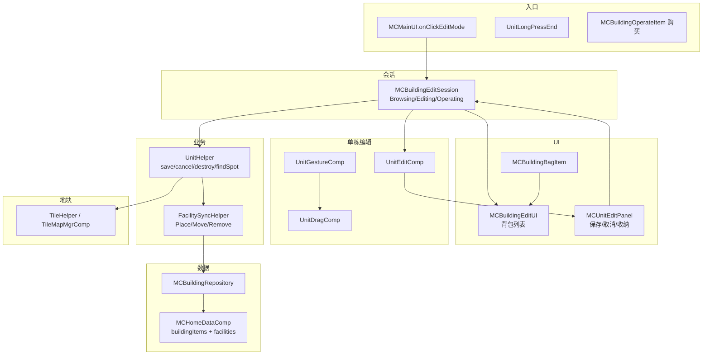
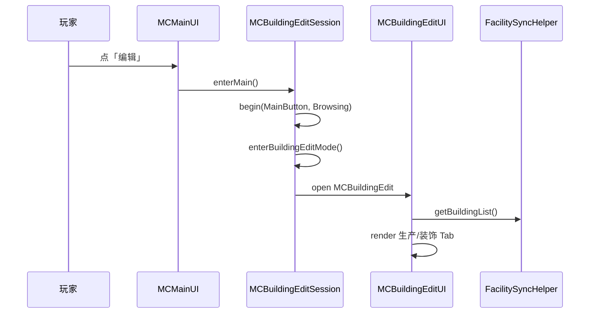
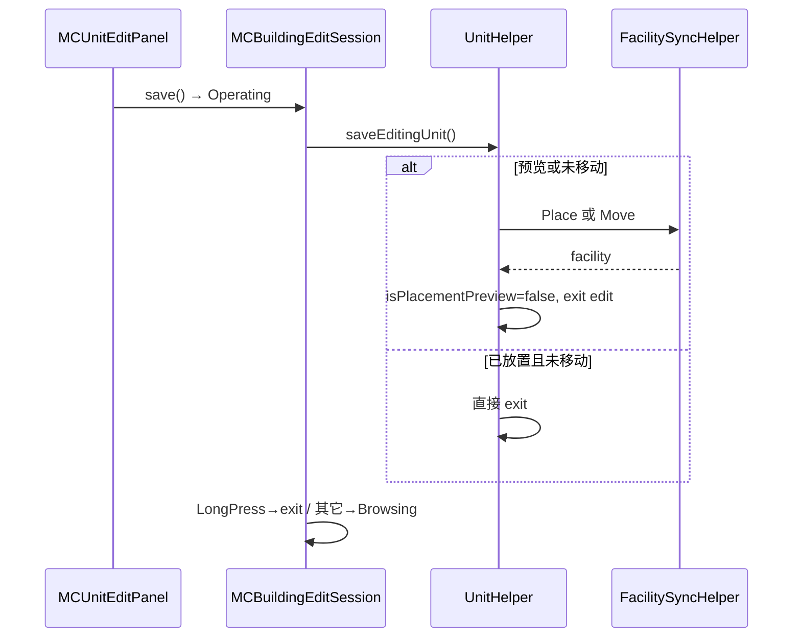
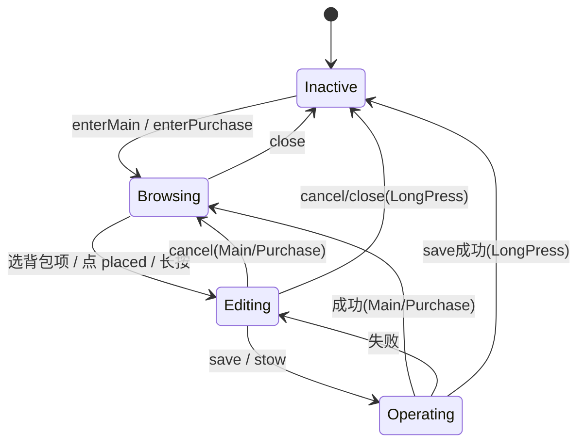

# 建筑编辑与收纳 功能文档

> **模块定位**：主态玩家在牧场内**摆放 / 移动 / 收纳**建筑。未放置的建筑实例存放在 **建筑背包**（homesteadpb `BuildingItemInfo`），与道具仓库（`MCWarehouse`）是两套系统。
>
> **核心原则**：放置/移动/收纳 RPC 只走 `FacilitySyncHelper`；权威数据经 `MCBuildingRepository` 读写；编辑会话由 `MCBuildingEditSession` 管理，单栋选中与高亮由 `UnitEditComp` 管理。
>
> **最后整理**：2026-09-24

---

## 目录

1. [功能概览](#1-功能概览)
2. [架构与分层](#2-架构与分层)
3. [目录与文件清单](#3-目录与文件清单)
4. [UI 注册与预制体](#4-ui-注册与预制体)
5. [数据模型](#5-数据模型)
6. [网络协议与 RPC](#6-网络协议与-rpc)
7. [完整链路（时序）](#7-完整链路时序)
8. [编辑会话状态机](#8-编辑会话状态机)
9. [业务规则](#9-业务规则)
10. [事件与刷新触发](#10-事件与刷新触发)
11. [外部联动](#11-外部联动)
12. [与道具仓库的边界](#12-与道具仓库的边界)
13. [常见问题与调试](#13-常见问题与调试)
14. [扩展指南](#14-扩展指南)

---

## 1. 功能概览

### 1.1 玩家可见能力

| 能力 | 说明 |
|---|---|
| **进入编辑模式** | 主界面「编辑」按钮 → 打开建筑背包面板 |
| **浏览背包** | 生产 / 装饰 Tab；展示未放置建筑列表 |
| **取出放置** | 点击背包项 → 场景预览 → 拖拽调整 → 保存 |
| **移动建筑** | 编辑模式下轻点已放置建筑，或长按快捷进入 |
| **收纳** | 编辑工具栏「收纳」→ 已放置建筑回背包 |
| **取消** | 还原到进入编辑时的位置；预览未 Place 则销毁本地实体 |
| **地块辅助** | 编辑/拖拽时全显网格；绿/红占位预览；冲突建筑半透明 |

### 1.2 三种入口

| 入口 | 枚举 | 保存/取消后 |
|---|---|---|
| **主界面编辑按钮** | `MCBuildingEditEntry.MainButton` | 回到背包浏览（Browsing） |
| **长按已放置建筑** | `MCBuildingEditEntry.LongPress` | 直接退出编辑（exit） |
| **主城购买后** | `MCBuildingEditEntry.Purchase` | 同 MainButton |

### 1.3 主态 vs 客态

| 能力 | 主态 | 客态 |
|---|---|---|
| 进入编辑 | ✅ | ❌ toast「不能编辑好友牧场」 |
| 长按进编辑 | ✅ | ❌ 禁用手势 |
| 放置/移动/收纳 | ✅ | ❌ |
| 轻点建筑 | 编辑模式下选中 | 走正常聚焦/开面板 |

---

## 2. 架构与分层



### 2.1 职责划分

| 层级 | 类 | 职责 |
|---|---|---|
| **会话** | `MCBuildingEditSession` | 入口、阶段、保存/取消/收纳后的去向 |
| **背包 UI** | `MCBuildingEditUI` | Tab 列表、提示区、beginPlacement |
| **工具栏** | `MCUnitEditPanel` | 跟随建筑的保存/取消/收纳按钮 |
| **单栋编辑** | `UnitEditComp` | 全局编辑模式、选中、原点快照、高亮 |
| **手势** | `UnitGestureComp` / `UnitDragComp` | 轻点选中、拖拽、落座预览 |
| **业务** | `UnitHelper` | findSpot、save、cancel、destroy、门控 |
| **RPC** | `FacilitySyncHelper` | Place / Move / Remove / GetBuildingList |
| **权威数据** | `MCBuildingRepository` | 背包条目 + 已落座 facilities |

> **悲观更新**：Place/Move/Remove **后台成功后才**改本地权威数据或销毁实体；失败保持当前编辑态与位置。

---

## 3. 目录与文件清单

### 3.1 会话与入口

| 文件 | 职责 |
|---|---|
| `scene/building/bll/MCBuildingEditSession.ts` | 编辑会话唯一状态机 |
| `scene/building/bll/MCBuildingEditModeHelper.ts` | `open()` / `openPurchased()` 主态门控 |

### 3.2 背包 UI

| 文件 | 职责 |
|---|---|
| `gui/building-edit/MCBuildingEditUI.ts` | 背包主面板 |
| `gui/building-bag/MCBuildingBagItem.ts` | 单条背包项 |
| `gui/building-bag/MCBuildingBagEvent.ts` | `ItemSelected` 事件 |

### 3.3 单栋编辑

| 文件 | 职责 |
|---|---|
| `scene/unit/bll/UnitEditComp.ts` | 编辑选中、全局 buildingEditMode |
| `scene/unit/bll/MCUnitEditPanel.ts` | 浮动工具栏 Controller |
| `scene/unit/bll/UnitGestureComp.ts` | 手势路由 |
| `scene/unit/bll/UnitDragComp.ts` | 拖拽执行 |
| `scene/unit/util/UnitHelper.ts` | save/cancel/destroy/findSpot |

### 3.4 RPC 与数据

| 文件 | 职责 |
|---|---|
| `scene/unit/util/FacilitySyncHelper.ts` | Place/Move/Remove/GetBuildingList |
| `scene/building/data/MCBuildingRepository.ts` | 权威读写门面 |
| `core/model/MCWorldModelComp.ts` | `MCHomeDataComp.buildingItems` / `facilities` |
| `scene/unit/util/FacilityNotifyHelper.ts` | FacilitiesNotify 落地（主态） |
| `service/MCNotifyService.ts` | `BuildingListChangedNotify` |

### 3.5 地块与表现

| 文件 | 职责 |
|---|---|
| `scene/tilemap/TileMapMgrComp.ts` | 编辑态全显格；编辑中屏蔽地块解锁点击 |
| `scene/tilemap/util/TileHelper.ts` | findPlaceableArea、occupation、预览 |
| `scene/building/bll/BuildingRootComp.ts` | 编辑浮动动画、冲突压暗 |
| `scene/building/bll/MCBuildingDragConflictVisual.ts` | 拖拽冲突半透明 |
| `scene/building/util/MCBuildingCameraHelper.ts` | 放置后镜头居中 |

### 3.6 生命周期

| 文件 | 职责 |
|---|---|
| `core/view/MCBoot.ts` | `MCBuildingEditSession.init/dispose` |
| `scene/login/PastureSceneLoginInitComp.ts` | 登录 `getBuildingList()` |
| `preload/PasturePreload.ts` | 预加载 `MCBuildingEdit` |

---

## 4. UI 注册与预制体

| MCUIID | 数值 | Prefab | Layer | 说明 |
|---|---|---|---|---|
| `MCBuildingEdit` | **10028** | `gui/prefab/building_edit/MCBuildingEditUI` | PopUp, mask=false | 背包 + 编辑主面板 |
| `MCUnitEditPanel` | **10003** | `gui/prefab/mcUnitEditPanel` | UI | 保存/取消/收纳工具栏 |
| `MCBuildPanel` | 10006 | `gui/prefab/building/BuildingPanel` | PopUp | 建筑管理（**与编辑收纳不同 UIID**） |

**子预制**：

| 路径 | 说明 |
|---|---|
| `gui/prefab/building_edit/MCBuildingBagItem.prefab` | 背包列表项 |
| `gui/prefab/building_edit/MCBuildingEditUI.prefab` | 含 nodeBag / nodeTips / Tab |

---

## 5. 数据模型

### 5.1 BuildingItemInfo（建筑背包条目）

协议：`homesteadpb.BuildingItemInfo`

| 字段 | 说明 |
|---|---|
| `inst_id` | 建筑实例 id（与在场 `instance_id` **同一 ID 空间**） |
| `facility_id` | 配置 id（等级行） |
| `level` | 等级 |
| `upgrade_state` / `upgrade_end_time` | 升级态（背包内也可升级） |
| `added_at` | 获得时间（UI「新」角标参考） |
| `is_new` | 协议字段（**MarkBuildingKnown 暂未调用**） |

> 同类型不同等级为**独立条目**，不合并数量。

### 5.2 FacilityInfo（已放置建筑）

| 字段 | 说明 |
|---|---|
| `instance_id` | 在场实例 id |
| `facility_id` | 配置 id |
| `position_x` / `position_y` | **左上角** tile 坐标 |
| `rotation` | 旋转 |
| `upgrade_state` / `upgrade_end_time` | 升级态 |

### 5.3 MCBuildingRepository

| 存储 | 说明 |
|---|---|
| `buildingItems: Map<inst_id, BuildingItemInfo>` | 未放置 |
| `facilities: Map<instance_id, FacilityInfo>` | 已放置 |
| `hasReadyUpgrade` | 是否有竣工可领 |

**预览实体**：`PlaceFacility` 成功前，本地预览 unit **不入** facilities 权威表。

### 5.4 UnitModelComp 编辑相关

| 字段 | 说明 |
|---|---|
| `isPlacementPreview` | true = 背包预览，保存时走 Place |
| `instanceId` | 背包 inst_id 或在场 instance_id |
| `x` / `y` | 当前 tile 左上角坐标 |

### 5.5 背包 UI 分类（本地）

```typescript
enum BuildingBagCategory {
    Production = "production",   // 非装饰/道路
    Decoration = "decoration", // MODULE_TYPE_DECORATION | MODULE_TYPE_ROAD
}
```

---

## 6. 网络协议与 RPC

**Service**：`mcHomeService`（homesteadpb）

| RPC | Request | Reply | 调用时机 |
|---|---|---|---|
| `PlaceFacility` | `inst_id, position_x/y, rotation` | `facility` | 背包预览首次保存 |
| `MoveFacility` | `instance_id, new_position_x/y, new_rotation` | `facility` | 已放置建筑移动后保存 |
| `RemoveFacility` | `instance_id` | `item: BuildingItemInfo` | 收纳 |
| `GetBuildingList` | `{}` | `items[], has_ready_upgrade` | 登录、打开背包、失败校准 |
| `CompleteBuildingUpgrade` | `inst_id` | `facility?` / `item?` | 背包项 READY 时放置前领取 |

**推送**：

| Notify | 落地 |
|---|---|
| `BuildingListChangedNotify` | `added[]` + `removed_inst_ids[]` → Repository |
| `FacilitiesNotify` | `FacilityNotifyHelper`（主态写 Repository） |

**Place/Move 成功后 Repository**：

- Place：`removeInventoryItem(instId)` + `upsertFacility(facility)`
- Remove：`removeFacility(instanceId)` + `upsertInventoryItem(item)`

**坐标口径**：客户端 `(x,y)` = 协议 `position_x/position_y` = 占位区域**左上角**，无 row 换算。

**错误码（部分）**：

| 码 | Toast |
|---|---|
| 10441116 | 没有足够的放置空间 |
| 10441119 | 该建筑无法收纳 |
| 10441121 | 建筑正在升级中 |
| 10441126 | 建筑背包中不存在该实例 |

失败时 `reconcileBuildingState()` → `GetBuildingList` + `AllCells` 全量校准。

---

## 7. 完整链路（时序）

### 7.1 进入编辑 → 浏览背包



### 7.2 背包取出 → 放置

```
MCBuildingBagItem 点击
  → MCBuildingBagEvent.ItemSelected(instId)
  → MCBuildingEditUI.beginPlacement(instId)
      → 主态检查 / phase===Browsing
      → 升级中：WAITING toast 或 completeUpgrade(READY)
      → UnitHelper.findSpotByConfig → addUnitByConfig
      → model.isPlacementPreview = true
      → MCBuildingEditSession.editInventoryPreview(unit)
          → phase=Editing, 隐藏 nodeBag
          → UnitEditComp.enter → MCUnitEditPanel
      → MCBuildingCameraHelper.centerOnUnit
```

### 7.3 拖拽移动

```
编辑态按住建筑
  → UnitDragBegin/Move/End
  → 释放原占位 → 跟手 → Operation 层绿/红预览
  → MCBuildingDragConflictVisual 冲突半透明
  → 落座：更新 model.x/y + occupationGrid
  → UnitEditComp.showEditHighlight
```

> 拖拽为**纯本地**中间态；**保存时才 RPC**。

### 7.4 保存



### 7.5 取消

```
MCUnitEditPanel 取消 / MCBuildingEditUI.commonClose
  → MCBuildingEditSession.cancel() / close()
  → UnitHelper.cancelEditMode → restoreUnitToOrigin
  → 预览未 Place：MCUnitEditPanelController.removeIfUnsaved
  → close() → exit() 关 MCBuildingEdit
```

### 7.6 收纳

```
MCUnitEditPanel 收纳
  → MCBuildingEditSession.stow()
  → UnitHelper.destroyEditingUnit()
      → 预览 → toast「背包建筑尚未放置」
      → getEditingUnitStowState 门控
      → FacilitySyncHelper.remove(instanceId)
      → exit + removeUnit
  → toBrowsing(); entry 改 MainButton
```

### 7.7 长按快捷编辑

```
UnitLongPressEnd（非 active 会话）
  → begin(LongPress, Editing) + editPlacedUnit
  → open MCBuildingEdit（bag 可能隐藏）
  → 保存/取消/收纳成功 → exit()（不回 Browsing）
```

---

## 8. 编辑会话状态机

### 8.1 Phase

| Phase | 说明 | 背包 UI | 工具栏 |
|---|---|---|---|
| `Inactive` | 未进入编辑 | 关 | 关 |
| `Browsing` | 浏览背包 | 显示 nodeBag | 关 |
| `Editing` | 编辑单栋 | 隐藏 nodeBag，显示 nodeTips | 开 |
| `Operating` | RPC 进行中 | — | 锁手势 |

### 8.2 TargetKind

| Kind | 说明 |
|---|---|
| `InventoryPreview` | 从背包取出，未 Place |
| `Placed` | 已落座建筑移动 |
| `None` | Browsing 态 |

### 8.3 保存/取消/收纳后的去向

| 操作 | MainButton / Purchase | LongPress |
|---|---|---|
| save 成功 | → Browsing | → exit |
| cancel | → Browsing | → exit |
| stow 成功 | → Browsing（entry 强制 MainButton） | — |
| close | → exit | → exit |

---

## 9. 业务规则

### 9.1 放置前检查（beginPlacement）

- 仅主态（`MCWorldEnterHelper.isAtSelfHome()`）
- `phase === Browsing`
- 升级 `WAITING` 且未到期 → toast 剩余时间
- `READY` 或到期 `WAITING` → 先 `completeUpgrade(instId)`
- `findSpotByConfig` 找不到空位 → toast

### 9.2 保存逻辑（saveEditingUnit）

| 情况 | RPC | 失败行为 |
|---|---|---|
| 背包预览 | `PlaceFacility` | 保持编辑态与当前位置 |
| 已放置且位置变化 | `MoveFacility` | 同上 |
| 已放置且未移动 | 无 | 直接 exit |

### 9.3 收纳门控（getEditingUnitStowState）

| 条件 | 结果 |
|---|---|
| 背包预览 | 拒绝「背包建筑尚未放置」 |
| 栏舍有动物 | 拒绝「把动物们养大再收纳起来吧」 |
| `can_stow !== true` | 拒绝「该建筑无法收纳」 |
| 通过 | 允许 RemoveFacility |

### 9.4 编辑互斥

- 全局编辑模式下轻点 → `UnitEditComp.enter(unit)`
- 正在编辑 A 时，不能操作 B
- `Operating` 阶段 `setEditOperationLocked(true)` + `finishActiveGesture()`

### 9.5 编辑态副作用

| 系统 | 行为 |
|---|---|
| `TileMapMgrSystem` | `setGridRevealed(true)` 全显格 |
| 地块解锁点击 | 编辑中早退，不弹解锁面板 |
| `UnitBubbleViewSystem` | 隐藏建筑气泡 |
| `MCMainUI` | 编辑/聚焦时隐藏部分 UI |

### 9.6 MarkBuildingKnown

协议已生成，**mcboot 内暂无调用**；「新」角标目前用 `added_at > 0` 等 UI 逻辑。

---

## 10. 事件与刷新触发

| 事件 | 派发方 | 效果 |
|---|---|---|
| `MCBuildingEditSessionEvent.Changed` | Session | EditUI 切换 bag/tips |
| `MCBuildingRepositoryEvent.Changed` | Repository | EditUI.render() |
| `MCBuildingBagEvent.ItemSelected` | BagItem | beginPlacement |
| `UnitEvent.BuildingEditModeEnter/Exit` | UnitEditComp | 全显格、主 UI、气泡 |
| `UnitEvent.UnitEnterEditMode/ExitEditMode` | UnitEditComp | 工具栏、建筑浮动 |
| `UnitEvent.UnitDragBegin/End` | Gesture | 地块预览、冲突视觉 |
| `UnitEvent.UnitLongPressEnd` | Gesture | 长按入口 |

**登录**：`FacilitySyncHelper.getBuildingList()` 补全 `building_items`（登录包可能缺失）。

**打开背包**：`MCBuildingEditUI.onAdded` → `refreshFromServer()` → `getBuildingList()`。

---

## 11. 外部联动

| 模块 | 联动 | 文档 |
|---|---|---|
| **建筑升级** | 背包项升级态；放置前 completeUpgrade；Remove 后 item 回背包 | [建筑升级地块解锁与加速.md](./建筑升级地块解锁与加速.md) |
| **地块 / TileMap** | findPlaceableArea、occupation、编辑压制解锁 | 同上 |
| **主城购买** | `MCBuildingOperateItem` → `openPurchased(instId)` | — |
| **栏舍** | 收纳门控：栏舍有动物不可收纳 | [栏舍动物交互.md](./栏舍动物交互.md) |
| **任务** | goto 建造/升级 → 主城；无直接编辑 API | [牧场任务系统.md](./牧场任务系统.md) |
| **气泡** | 编辑模式隐藏 UpgradeComplete 等 | [建筑与动物气泡.md](./建筑与动物气泡.md) |

---

## 12. 与道具仓库的边界

| 维度 | 建筑背包（本文档） | 道具仓库 MCWarehouse |
|---|---|---|
| 协议 | homesteadpb `BuildingItemInfo` | ItemService `GetBag` |
| 数据 | `MCBuildingRepository` / `buildingItems` | `MCItemManager` |
| UI | `MCBuildingEdit` (10028) | `MCWarehouse` (10007) |
| 内容 | 未放置的**建筑实例** | 产物、幼崽、饲料、道具 |
| 操作 | Place / Remove（收纳） | 出售 / 使用 / 锁定 |

详见 [牧场仓库.md](./牧场仓库.md) §12。

场景 `Warehouse_1~3.prefab` 仅为仓库**建筑展示**，与建筑背包无关。

---

## 13. 常见问题与调试

### 13.1 无法进入编辑

- 查 `MCWorldEnterHelper.isAtSelfHome()`
- 查 `MCBuildingEditModeHelper.open()` 门控

### 13.2 背包为空

- 查登录 `GetBuildingList` 是否成功
- 查 `MCBuildingRepository.getInventoryItems()`

### 13.3 放置失败

- 查 `findSpotByConfig` 是否有空位
- 查错误码 10441116 空间不足
- 查 `reconcileBuildingState` 是否触发校准

### 13.4 保存后建筑消失/错位

- Place 失败应保持预览实体（悲观更新）
- 查 `applyServerFacility` 是否执行
- 查 occupationGrid 与 facility 位置是否一致

### 13.5 无法收纳

- 是否预览态
- 栏舍是否有动物
- `MCFacilityConfig.can_stow` 是否为 true
- 错误 10441119

### 13.6 调试日志

```
[FacilitySync] PlaceFacility / MoveFacility / RemoveFacility
[UnitHelper] saveEditingUnit / destroyEditingUnit / restoreUnitToOrigin
[MCBuildingEditUI] beginPlacement
[UnlockRegion]（勿与编辑混淆）
```

---

## 14. 扩展指南

### 14.1 新增背包分类 Tab

在 `MCBuildingEditUI` 扩展 `BuildingBagCategory` 与 Tab 配置，filter 逻辑读 `MCFacilityConfig.module_type`。

### 14.2 新增放置门控

在 `beginPlacement` 或 `UnitHelper.saveEditingUnit` 前增加校验；**不要**在 UI 直打 RPC。

### 14.3 接入 MarkBuildingKnown

点击背包项后调用对应 RPC，清除 `is_new`，刷新 BagItem 角标。

### 14.4 原则

- RPC 只加在 `FacilitySyncHelper`
- 会话状态只改 `MCBuildingEditSession`
- 预览实体 Place 成功前不入 `facilities` 权威表
- 坐标始终用**左上角** tile，与 TileHelper 一致

---

## 附录：核心类速查

```typescript
// 入口
MCBuildingEditModeHelper.open()
MCBuildingEditModeHelper.openPurchased(instId)
MCBuildingEditSession.enterMain() / close() / save() / cancel() / stow()

// RPC
FacilitySyncHelper.place(instId, col, row, rotation)
FacilitySyncHelper.move(instanceId, col, row, rotation)
FacilitySyncHelper.remove(instanceId)
FacilitySyncHelper.getBuildingList()

// 编辑
UnitHelper.findSpotByConfig(scene, configId)
UnitHelper.saveEditingUnit(scene)
UnitHelper.cancelEditMode(scene)
UnitHelper.destroyEditingUnit(scene)
UnitHelper.getEditingUnitStowState()

UnitEditComp.enterBuildingEditMode() / exitBuildingEditMode()
UnitEditComp.enter(unit) / exit(unit)
UnitEditComp.isBuildingEditMode()

// 数据
MCBuildingRepository.getInventoryItems()
MCBuildingRepository.getFacility(instanceId)

// UI
oops.gui.open(MCUIID.MCBuildingEdit)
oops.gui.open(MCUIID.MCUnitEditPanel)  // 由 Controller 管理
```

---

## 附录：会话状态图


