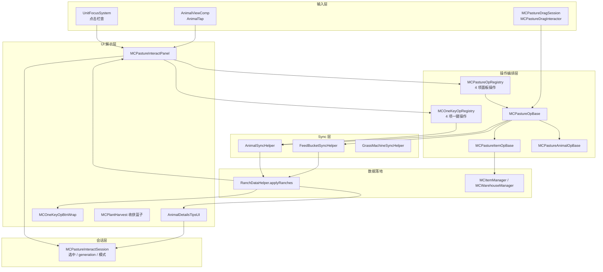
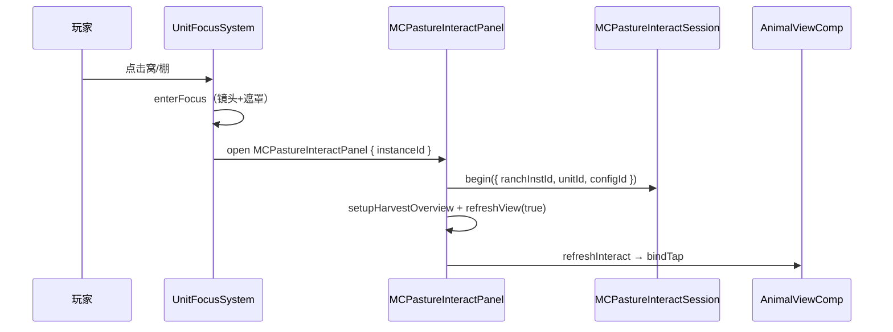
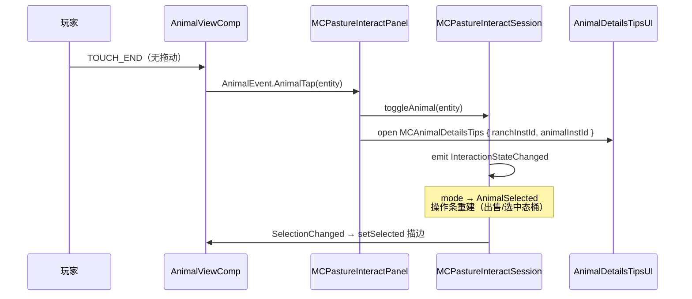

# 栏舍动物交互界面 功能文档

> **模块定位**：玩家聚焦栏舍（窝 / 棚）后的核心交互界面，包含 **MCPastureInteractPanel**（栏舍主面板）、**AnimalDetailsTipsUI**（动物详情气泡）、操作条拖拽 / 点击、一键收获 / 生产 / 偷取 / 清理，以及与背包 / 商店 / 牧草机 / 罐头桶的联动。
>
> **核心原则**：面板只负责接线与展示；玩法判定在 `MCPastureOp*` / `MCOneKeyOp*`；RPC 只走 `*SyncHelper`；数据落地只走 `RanchDataHelper`。
>
> **最后整理**：2026-09-24

---

## 目录

1. [功能概览](#1-功能概览)
2. [架构与分层](#2-架构与分层)
3. [目录与文件清单](#3-目录与文件清单)
4. [UI 注册与预制体](#4-ui-注册与预制体)
5. [会话状态与数据模型](#5-会话状态与数据模型)
6. [网络协议与 RPC](#6-网络协议与-rpc)
7. [完整链路（时序）](#7-完整链路时序)
8. [事件总线](#8-事件总线)
9. [业务规则](#9-业务规则)
10. [操作注册与扩展点](#10-操作注册与扩展点)
11. [外部联动](#11-外部联动)
12. [与相关系统的边界](#12-与相关系统的边界)
13. [常见问题与调试](#13-常见问题与调试)
14. [扩展指南](#14-扩展指南)

---

## 1. 功能概览

### 1.1 玩家可见能力

| 能力 | 说明 |
|---|---|
| **聚焦栏舍** | 点击窝 / 棚 → 镜头推近 + 打开交互面板 + 动物可点击 |
| **动物选中** | 点击动物 → 描边选中 + 打开头顶详情气泡 |
| **操作条** | 底部横向列表（每页 5 条）：罐头桶、出售、放蚊子、幼崽入栏 |
| **拖拽操作** | 从操作条拖出图标 → 划过栏舍 / 动物连续触发（400ms 节流） |
| **一键操作** | 面板内 / 主界面：一键收获、生产、偷取、清理 |
| **产物条** | 栏舍副产物架展示（`node_product`，最多 5 槽 + more） |
| **牧草机 HUD** | 左下角图标 + 剩余时间条，点击打开加草弹窗 |
| **收获篮子** | 面板内 `MCPlantHarvest` 累加本次聚焦收获总览 |
| **栏舍升级** | 面板内 `MCBuildingUpgradeProgressComp` |
| **去商店** | 材料不足等场景跳转饲料 / 幼崽商店 |

### 1.2 入口

| 入口 | 代码位置 | 说明 |
|---|---|---|
| **点击栏舍建筑** | `UnitFocusSystem` → `MCUIID.MCPastureInteractPanel` | **主入口** |
| **栏舍左右切换** | `MCUnitFocusSwitchUI` + `RanchFocusSwitchHelper` | 聚焦态切换相邻栏舍 |
| **任务跳转** | `MCTaskManager` → `ADD_ANIMAL_FEED_SELF(108)` | 聚焦牧草机（非本面板，但同属栏舍交互链路） |
| **动物点击** | `AnimalViewComp` → `AnimalEvent.AnimalTap` | 打开详情 + 切换选中 |
| **预加载** | `PasturePreload` | 预热面板 / 详情预制 |

### 1.3 面板操作 vs 一键操作（重要）

| 类别 | 注册处 | 当前条目 | 触发方式 |
|---|---|---|---|
| **面板操作条** | `MCPastureOpRegistry` | 罐头桶、出售、放蚊子、幼崽入栏 | 点击 / 拖拽 |
| **一键操作** | `MCOneKeyOpRegistry` | 收获、生产、偷取、清理 | 按钮点击 |

> 收获 / 生产 / 偷取 / 清理的 **SubOp 类仍保留**（供特效分派、复合路由），但**不在面板操作条展示**；注释见 `MCPastureOpRegistry.ts`。

### 1.4 主态 vs 客态

| 能力 | 主态 (hostGid=0) | 客态 (hostGid>0) |
|---|---|---|
| 幼崽入栏 | ✅ | ❌ |
| 罐头桶喂动物 | ✅ | ❌ |
| 出售动物 | ✅ | ❌ |
| 放蚊子 | ❌ | ✅ |
| 帮开生产轮 | ✅ | ✅ |
| 偷取产物 | ❌ | ✅ |
| 清理 hazard | ✅（全场） | ✅（仅自己放的蚊子） |
| 一键收获 | ✅ | ❌ |

---

## 2. 架构与分层



### 2.1 职责划分

| 层级 | 类 | 职责 |
|---|---|---|
| **会话状态** | `MCPastureInteractSession` | 栏舍 id、选中动物、generation、Ranch / AnimalSelected 模式 |
| **栏舍面板** | `MCPastureInteractPanel` | 头部摘要、产物条、操作条分页、拖拽引导、事件订阅刷新 |
| **动物详情** | `AnimalDetailsTipsUI` | 精简 / 完整态、阶段进度、收益展示（PopUp，非头顶 UnitBubble） |
| **操作注册** | `MCPastureOpRegistry` | 面板操作唯一登记入口 |
| **一键注册** | `MCOneKeyOpRegistry` | 一键操作唯一登记入口 |
| **操作基类** | `MCPastureOpBase` | 模板方法 run：门控 → checkBefore → doExecute → 特效 → afterSucceeded |
| **RPC 封装** | `AnimalSyncHelper` 等 | 唯一打 service 的入口；在途去重 |
| **数据落地** | `RanchDataHelper` | 栏舍 / 动物 ECS 投影；派发 `AnimalEvent.RanchDataApplied` |

> **约定**：新增面板操作只在 `MCPastureOpRegistry._ops` 登记一行；**不改面板骨架**。

---

## 3. 目录与文件清单

### 3.1 栏舍聚焦面板（`scene/pasture/view/pasture-panel/`）

| 文件 | 职责 |
|---|---|
| `MCPastureInteractPanel.ts` | 聚焦栏舍主面板 |
| `MCPastureInteractSession.ts` | 交互会话唯一状态源 |
| `MCPastureListItem.ts` | 操作条列表项：图标 / 数量 / Tap / Drag 转发 |
| `MCPastureDragSession.ts` | 拖拽会话：阈值判定、预览跟随、滚动冻结 |
| `MCPastureDragInteractor.ts` | 拖拽连续交互：目标解析、400ms 节流、道具本地扣减 |
| `MCPastureOpPagination.ts` | 操作条翻页（每页 5 条） |

### 3.2 动物交互 GUI（`gui/animalinteractive/`）

| 文件 | 职责 |
|---|---|
| `AnimalDetailsTipsUI.ts` | 点击动物后详情 PopUp（精简 / 完整态） |
| `AnimalStageShow.ts` | 幼崽→成长→生产→成熟 阶段条 |
| `AnimalGainValueItem.ts` | 经验 / 金币收益行 |

### 3.3 操作注册与处理器（`scene/pasture/bll/op/`）

| 文件 | 职责 |
|---|---|
| `MCPastureOpRegistry.ts` | **面板操作唯一注册**（当前 4 项） |
| `BaseOp/MCPastureOpBase.ts` | 操作抽象基类 |
| `BaseOp/MCPastureItemOpBase.ts` | 道具型操作（按背包展开条目） |
| `BaseOp/MCPastureAnimalOpBase.ts` | 动物目标型工具操作 |
| `SubOp/MCPastureUseFeedBucketOp.ts` | 罐头桶加速 |
| `SubOp/MCPasturePlaceAnimalOp.ts` | 幼崽入栏 |
| `SubOp/MCPastureSellAnimalOp.ts` | 出售选中动物（DonateAnimal） |
| `SubOp/MCPasturePutMosquitoOp.ts` | 客态放蚊子 |
| `SubOp/MCPastureHarvest*.ts` 等 | 单操作实现（供 OneKey / 特效，不在 Registry） |

### 3.4 一键操作（`scene/pasture/bll/onekey/`）

| 文件 | 职责 |
|---|---|
| `MCOneKeyOpRegistry.ts` | 一键操作注册（收获 / 生产 / 偷取 / 清理） |
| `MCOneKeyHarvestOp.ts` | → `HarvestRanch` |
| `MCOneKeyTriggerProduceOp.ts` | → 一键开轮 |
| `MCOneKeyStealProduceOp.ts` | → 一键偷取 |
| `MCOneKeyCleanRanchOp.ts` | → 一键清理 |
| `gui/main-ui/components/one-key/MCOneKeyOpBtnWrap.ts` | 一键按钮容器 |

### 3.5 收获与特效

| 文件 | 职责 |
|---|---|
| `bll/harvest/MCPastureHarvestManager.ts` | 收获总览累加（主界面 / 聚焦面板互斥） |
| `view/harvest/MCPlantHarvest.ts` | 面板内收获篮子 UI |
| `view/effect/MCPastureOpEffectBase.ts` | 操作成功特效基类 |
| `view/MCPastureOpEffectHelper.ts` | 按 OpName 分派特效 |

### 3.6 动物场景层（关联）

| 文件 | 职责 |
|---|---|
| `animal/bll/AnimalViewComp.ts` | 聚焦时 bindTap、选中描边、气泡 markDirty |
| `animal/util/AnimalSyncHelper.ts` | 动物 RPC 唯一封装 |
| `animal/util/RanchDataHelper.ts` | 栏舍投影落地 |
| `animal/util/AnimalPickHelper.ts` | 屏幕坐标挑动物 |
| `animal/util/RanchFocusSwitchHelper.ts` | 聚焦栏舍左右切换 |
| `animal/config/AnimalEvent.ts` | 动物 / 栏舍事件 |
| `pasture/config/MCPastureOpConfig.ts` | 操作枚举与上下文类型 |
| `pasture/config/MCPastureEvent.ts` | 拖拽 / 会话事件 |
| `pasture/config/MCOneKeyOpConfig.ts` | 一键操作枚举 |

### 3.7 聚焦基建（关联）

| 文件 | 职责 |
|---|---|
| `unit/bll/UnitFocusSystem.ts` | 聚焦 / 开二级面板 / 退出 |
| `unit/view/MCUnitFocusMaskUI.ts` | 聚焦遮罩 + dismiss 拦截 |
| `unit/view/MCUnitFocusSwitchUI.ts` | 栏舍顶部左右切换 |
| `unit/config/UnitInteractType.ts` | 模块类型 → Focus / OpenPanel 映射 |

---

## 4. UI 注册与预制体

注册于主包 `MCUIConfig.ts`（bundle: `mcRes`）：

| UIID | 数值 | Prefab | Layer | 说明 |
|---|---|---|---|---|
| `MCPastureInteractPanel` | **10015** | `gui/prefab/pasture-panel/MCPastureInteractPanel` | PopUp, mask=false, vacancy=true | 栏舍主面板 |
| `MCAnimalDetailsTips` | **10018** | `gui/prefab/animalinteractive/AnimalDetailsTipsUI` | PopUp, mask=false, vacancy=false | 动物详情 |
| `MCAddGrassUI` | 10016 | `gui/prefab/grassmachine/MCAddGrassUI` | PopUp, mask=true | 牧草机（面板快捷入口） |
| `MCFeedbucketAddUI` | 10025 | `gui/prefab/feedbucket/FeedbucketAddUI` | PopUp | 罐头桶装填 |
| `MCShop` | 10010 | `gui/prefab/shop/MCShopUI` | PopUp | 去商店 |
| `MCWarehouse` | 10007 | `gui/prefab/warehouse/MCWarehouseUI` | PopUp | 仓库 |

### 4.1 打开参数

```typescript
// MCPastureInteractPanel — IMCPastureInteractPanelArgs
{
    unitId?: number;       // 本地 Unit id
    configId?: number;     // 设施配置 id
    instanceId?: number;   // 栏舍设施实例 id（= ranchInstId 权威来源）
}

// AnimalDetailsTipsUI — IAnimalDetailsTipsArgs
{
    ranchInstId?: number;
    animalInstId?: number;
}
```

### 4.2 MCPastureInteractPanel 主要节点

| 节点 | 用途 |
|---|---|
| `actionGroup` / `listItemNodes` | 操作条列表（5 槽 + 分页） |
| `titleLabel` / `subTitle` | 栏舍名称 / 副标题 |
| `nodeBar` / `progressSprite` | 选中动物阶段进度（AnimalSelected 模式） |
| `nodeGrassMachine` | 牧草机 HUD |
| `nodeProduct` / `productItemNodes` | 副产物架展示 |
| `nodeDragArea` | 拖拽引导区 |
| `nodeHarvest` | 收获篮子 |
| `upgradeComp` | 栏舍升级进度 |
| `gotoNode` | 去商店 |

### 4.3 模块 → 面板映射（UnitInteractType）

| module_type | 交互类型 | 打开 UI |
|---|---|---|
| `MODULE_TYPE_RANCH_COOP` | Focus | `MCPastureInteractPanel` |
| `MODULE_TYPE_RANCH_SHED` | Focus | `MCPastureInteractPanel` |
| `MODULE_TYPE_FEED_MACHINE` | OpenPanel | `MCAddGrassUI`（不聚焦） |

---

## 5. 会话状态与数据模型

### 5.1 MCPastureInteractSession

栏舍聚焦期间 UI 交互的**唯一状态源**（不修改栏舍投影）：

| 字段 | 说明 |
|---|---|
| `ranchInstId` | 当前聚焦栏舍设施实例 id |
| `unitId` / `configId` | 打开参数透传 |
| `hostGid` | 0=主态，>0=客态 |
| `selectedAnimal` | 当前选中动物实体 |
| `mode` | `Ranch` / `AnimalSelected` |
| `generation` | 会话代次；异步回包校验，防退出后仍弹 toast |

**关键 API**：

```typescript
MCPastureInteractSession.begin({ ranchInstId, unitId, configId, hostGid? })
MCPastureInteractSession.toggleAnimal(entity)   // 重复点击取消
MCPastureInteractSession.clearSelection()
MCPastureInteractSession.validateSelection()    // 回包后检查选中仍有效
MCPastureInteractSession.isGenerationCurrent(gen)
MCPastureInteractSession.reset()                // 退出聚焦
```

### 5.2 MCPastureRanchContext / MCPastureOpContext

定义于 `MCPastureOpConfig.ts`：

| 类型 | 用途 |
|---|---|
| `MCPastureRanchContext` | 构建操作条条目：栏舍 id、hostGid、mode、selectedAnimal |
| `MCPastureOpContext` | 执行操作：+ trigger、item、targetAnimals、itemBudget |
| `MCPastureOpEntry` | 列表项：op、iconPath、countText、tapTarget、dragTarget、disabled |
| `MCPastureOpResult` | run 结果：succeeded、count |

### 5.3 枚举速查

**MCPastureOpName**（操作名，日志 / 去重 / 特效分派）：

```
PlaceAnimal, UseCan, UseFeedBucket, CollectProduce, HarvestAnimal,
TriggerProduce, StealProduce, Harvest, CleanRanch, PutMosquito, SellAnimal
```

**MCPastureOpTrigger**：`Tap = 1`，`Drag = 2`

**MCPastureInteractMode**：`Ranch`，`AnimalSelected`

**MCPastureTapTarget**：`None`，`Ranch`，`SelectedAnimal`

**MCPastureDragTarget**：`None`，`Ranch`，`Animal`

**MCOneKeyOpName**：`OneKeyHarvest`，`OneKeyTriggerProduce`，`OneKeyStealProduce`，`OneKeyCleanRanch`

**拖拽常量**：

| 常量 | 值 | 说明 |
|---|---|---|
| `MC_PASTURE_DRAG_THRESHOLD_SQ` | 100 | 进入拖拽位移阈值（px²） |
| `MC_PASTURE_DRAG_INTERACT_INTERVAL_MS` | 400 | 同目标连续触发间隔 |
| `MC_PASTURE_DRAG_PREVIEW_SIZE` | 90 | 预览图标边长 |

### 5.4 栏舍 / 动物 ECS 投影（只读）

面板与 Op 只读以下 Comp，**不直接修改**：

| Comp | 关键字段 |
|---|---|
| `RanchModelComp` | capacity、slots、grassAmount、grassEmptyAtMs |
| `AnimalModelComp` | stage、canHarvest、canDeliver、grassBlocked、deliveringUntilMs |
| `GrassMachineModelComp` | status、remainingSecs（HUD 用） |

权威落地：`RanchDataHelper.applyRanches()` → `AnimalEvent.RanchDataApplied`。

---

## 6. 网络协议与 RPC

### 6.1 服务定义

| 服务 | 客户端实例 | 用途 |
|---|---|---|
| `gamepb.animalpb.AnimalService` | `mcAnimalService` | 动物 / 栏舍核心操作 |
| `gamepb.animalpb.RanchService` | `mcRanchService` | PutHazard 等 |
| `FeedMachineService` | `mcGrassMachineService` | 加牧草 |
| `ItemService` | `itemService` | 罐头桶 BatchUse |

**封装入口**：业务只调 `AnimalSyncHelper` / `FeedBucketSyncHelper` / `GrassMachineSyncHelper`。

### 6.2 RPC 一览（动物交互相关）

| 操作 | SyncHelper | RPC | 主/客态 |
|---|---|---|---|
| 幼崽入栏 | `placeAnimals` | `PlaceAnimal` | 主态 |
| 开始生产 | `triggerProduce` | `TriggerProduce` | 主+客 |
| 收取副产品 | `collectProduce` | `CollectProduce` | 主态 |
| 收获出栏 | `harvestAnimal` | `HarvestAnimal` | 主态 |
| 一键收获 | `oneKeyHarvest` | `HarvestRanch` | 主态 |
| 出售动物 | `donateAnimal` | `DonateAnimal` | 主态 |
| 偷取产物 | `stealProduce` / `oneKeyStealProduce` | `StealProduce` | 客态 |
| 清理 hazard | `cleanRanch` / `oneKeyCleanRanch` | `CleanRanch` / `CleanAllRanch` | 主+客 |
| 放蚊子 | `putHazard` | `PutHazard` | 客态 |
| 栏舍详情 | `getRanchDetail` | `GetRanchDetail` | 主+客 |
| 使坏次数 | `getRanchOpTimes` | `GetRanchOpTimes` | — |
| 喂罐头桶 | `FeedBucketSyncHelper.useOnAnimal` | `FeedAnimal` | 主态 |
| 装填桶 | `FeedBucketSyncHelper.fill` | `BatchUse` | 主态 |
| 加牧草 | `GrassMachineSyncHelper.addGrass` | `AddFeed` | 主+客 |

### 6.3 数据流（单向）

```
用户操作
  → Op.run() / OneKeyOp.run()
  → *SyncHelper（_pending 去重）
  → mcAnimalService / ...
  → RanchDataHelper.applyRanches()
  → AnimalEvent.RanchDataApplied
  → MCPastureInteractPanel.refreshView()
  → AnimalDetailsTipsUI 刷新（若打开）
  → UnitBubbleViewComp.markDirty()（气泡）
```

### 6.4 在途去重

| 层级 | 机制 |
|---|---|
| `AnimalSyncHelper._pending` | 键：`操作名:栏舍:动物`；入栏为请求级单键 `place:all` |
| `MCPastureOpBase._pending` | 键：`操作名:栏舍:栏位组` |
| `generation` | 切栏 / 选中 / reset 递增；回包后 `isGenerationCurrent` 校验 |

### 6.5 host_gid 与纪元号

- `host_gid`：0=主态，>0=客态帮好友操作
- `RanchDataHelper.getEpoch()` / `bumpEpoch()`：家园切换时丢弃过期回包
- **客态不回写** `MCHomeDataComp`

---

## 7. 完整链路（时序）

### 7.1 聚焦栏舍 → 打开面板



### 7.2 动物点击 → 选中 → 详情气泡



### 7.3 操作条：点击（Tap）

```
MCPastureListItem.execTap
  → entry.op.run({ trigger: Tap, tapTarget 注入 targetAnimals })
  → MCPastureOpBase.run
      → availableIn / checkBefore
      → doExecute → *SyncHelper
      → MCPastureOpEffectHelper 播特效
      → afterSucceeded（Tap 时 requestFullBag）
```

### 7.4 操作条：拖拽（Drag）

```
TOUCH_START → MCPastureDragSession.start + DragInteractor 创建
越过阈值(100px²) → DragSessionStart → 显示 nodeDragArea 引导
MOVE → interactor.attempt(screenPos)
  → AnimalPickHelper.pickAnimalsAtScreen / hitRanchArea
  → 400ms 节流 → op.run({ trigger: Drag, itemBudget })
TOUCH_END → interactor.finish → flushBag → DragSessionEnd
  → refreshPending 补刷操作条
```

### 7.5 一键收获

```
MCOneKeyOpBtnWrap（followFocus=true 嵌面板）
  → MCOneKeyOpRegistry.buildEntries(hostGid, ranchInstId)
  → MCOneKeyHarvestOp.run()
  → AnimalSyncHelper.oneKeyHarvest({ ranchInstId? })
  → MCPastureHarvestManager 累加 → 飞行动画
```

### 7.6 取消选中 / 退出聚焦

| 动作 | 行为 |
|---|---|
| 再次点击同一只动物 | `toggleAnimal` → 取消选中 |
| 点击栏舍空白 | `BlockTouchArea` TOUCH_END，位移 < 8px → `clearSelection` |
| 聚焦遮罩 dismiss | `MCUnitFocusMaskUI.setDismissInterceptor` → 先清选中 |
| 关闭按钮 | 有选中 → 清选中；无选中 → `exitFocus` |
| `UnitExitFocus` | `Session.reset()` + 关详情气泡 |

---

## 8. 事件总线

### 8.1 AnimalEvent

| 事件 | Payload | 订阅者 |
|---|---|---|
| `RanchDataApplied` | `ranchInstIds[], hostGid` | 面板、详情、OneKey、气泡 |
| `AnimalStageChanged` | `entity, newStage, oldStage` | 详情气泡 |
| `GrassChanged` | `amount, emptyAtMs` | 面板牧草条 |
| `AnimalTap` | `entity` | 面板 |
| `SelectionChanged` | `entity \| null` | AnimalViewComp 描边 |
| `HarvestSucceeded` | `animalIds[]` | 图鉴等后置 |
| `DonateSucceeded` | `animalIds[]` | 面板清选中 |

### 8.2 MCPastureEvent

| 事件 | 用途 |
|---|---|
| `InteractionStateChanged` | 面板 `refreshView(true)` |
| `DragSessionStart` | 显示拖拽引导、禁用栏舍切换 |
| `DragSessionMove` | 更新预览位置 |
| `DragSessionEnd` | 补刷挂起的 `refreshPending` |

### 8.3 其他关联事件

| 事件 | 订阅方 | 说明 |
|---|---|---|
| `MCItemEvent.ItemsChanged` | 面板 | 幼崽 / 罐头数量变化 → 重建操作条 |
| `FeedBucketEvent.Changed` | 面板 | 桶秒数变化 |
| `GrassMachineEvent.GrassChanged` | 面板 | 牧草机 HUD |
| `RanchHazardEvent.HazardsChanged` | 面板、OneKey | 蚊子 / 便便 |
| `UnitEvent.UnitExitFocus` | 面板 | reset 会话 |

---

## 9. 业务规则

### 9.1 面板操作条当前 4 项

| 顺序 | Op | 主/客 | 模式 | 触发 |
|---|---|---|---|---|
| 1 | `UseFeedBucketOp` | 主态 | Ranch：拖动物；Selected：点选中动物 | Tap / Drag |
| 2 | `SellAnimalOp` | 主态 | 仅 AnimalSelected | Tap |
| 3 | `PutMosquitoOp` | 客态 | 仅 Ranch | Tap / Drag |
| 4 | `PlaceAnimalOp` | 主态 | 仅 Ranch（选中模式隐藏） | Drag 到栏舍 |

### 9.2 幼崽入栏规则

- 按背包幼崽展开，每种一条
- 过滤：栏舍类型（窝 / 棚）匹配 + 有空栏位
- 栏舍满 → 不出条目
- 一次触发放一只；拖拽连续触发
- RPC：`PlaceAnimal`；成功后 `requestFullBag()`

### 9.3 罐头桶规则

- 无机 / 有机两桶虚拟条目，显示剩余秒数
- 桶空 + 背包有罐头 → 置灰仍可点 → 开 `MCFeedbucketAddUI`
- 桶空 + 无罐头 → 引导商店
- 选中动物模式：点击直接喂选中动物，禁止拖拽
- 无机罐头每阶段限用一次（`limitedCanUsed`）

### 9.4 出售动物

- 仅 `AnimalSelected` 模式出现
- 需 `canDonate`；协议 `DonateAnimal`
- 确认框二次确认
- 详情气泡内捐赠按钮已移除（`donateBtnNode.active = false`），统一到面板

### 9.5 一键操作规则

| Op | 主态 | 客态 | 范围 |
|---|---|---|---|
| OneKeyHarvest | ✅ | ❌ | ranchInstId=0 全场 / >0 单舍 |
| OneKeyTriggerProduce | ✅ | ✅ 帮开轮 | 同上 |
| OneKeyStealProduce | ❌ | ✅ | 同上 |
| OneKeyCleanRanch | ✅ | ✅ 仅自放蚊子 | 同上 |

无可操作内容时**按钮直接隐藏**（不置灰）。

### 9.6 面板刷新策略

`MCPastureInteractPanel.refreshView(force?)`：

| 触发 | force | 说明 |
|---|---|---|
| onAdded / InteractionStateChanged | true | 强制重建操作条 |
| RanchDataApplied / ItemsChanged 等 | false | 差量：entriesSign 未变则跳过 |
| 拖拽中 | — | 设 refreshPending，DragSessionEnd 补刷 |

**每秒 tick**：`onHeaderTick` → 选中动物进度 + 牧草机倒计时。

### 9.7 缺草展示

- `AnimalHelper.isHungry`：`grassBlocked && 牧草池耗尽`
- 面板进度 / 详情气泡显示「缺草」

---

## 10. 操作注册与扩展点

### 10.1 新增面板操作

1. 继承 `MCPastureOpBase` / `MCPastureItemOpBase` / `MCPastureAnimalOpBase`
2. 实现 `name`、`buildEntries`、`doExecute`
3. 在 `MCPastureOpRegistry._ops` 追加实例
4. 如需特效，在 `MCPastureOpEffectHelper` 登记
5. **不要**改 `MCPastureInteractPanel` 骨架

### 10.2 新增一键操作

1. 继承 `MCOneKeyOpBase`
2. 在 `MCOneKeyOpRegistry._ops` 登记
3. 配置 `MC_ONEKEY_OP_TEXTS` / `MC_ONEKEY_OP_ICON_PATHS`

### 10.3 Op 模板方法（MCPastureOpBase.run）

```
在途去重 → generation 校验 → availableIn 主客态
→ checkBefore → doExecute → 特效
→ afterSucceeded（ItemOp：Tap 时 requestFullBag）
```

子类可覆写：`allowGuest`、`guestOnly`、`needAnimalTarget`、`dragShowsItemCount`、`buildEntries`。

---

## 11. 外部联动

| 场景 | 跳转 / 调用 | 文档 |
|---|---|---|
| 面板去商店 | 关面板 → `MCShop` | [牧场商店.md](./牧场商店.md) |
| 牧草机 HUD | `MCAddGrassUI` | [牧场牧草机.md](./牧场牧草机.md) |
| 罐头桶装填 | `MCFeedbucketAddUI` | 本文档 §9.3 |
| 道具消耗后 | `MCWarehouseManager.requestFullBag()` | [牧场仓库.md](./牧场仓库.md) |
| 商店 auto_add 饲料 | 服务端直投牧草机，不经 AddFeed | 牧草机文档 §7.4 |
| 动物头顶状态气泡 | `UnitBubbleViewComp` | [建筑与动物气泡.md](./建筑与动物气泡.md) |
| 栏舍切换 | `RanchFocusSwitchHelper` | 聚焦基建 |

---

## 12. 与相关系统的边界

| 系统 | 关系 |
|---|---|
| **UnitBubble（头顶气泡）** | 纯展示；交互走 Tap / 面板，见气泡文档 |
| **AnimalDetailsTipsUI** | PopUp 详情，**不是** UnitBubble |
| **MCPastureHarvestOp 等 SubOp** | 保留供 OneKey / 特效，不在面板 Registry |
| **MCPastureUseCanOp** | 散装罐头，已由 FeedBucket 替代 |
| **建筑仓库** | homesteadpb 放置前列表，与栏舍交互无关 |
| **农场 Pasture 种植** | `scene/farm/**` 独立玩法，勿混 import |

---

## 13. 常见问题与调试

### 13.1 面板打开但操作条为空

- 查 `hostGid`：客态不出幼崽 / 罐头桶 / 出售
- 查背包：`MCItemManager.initialized`
- 查栏舍：是否已满（幼崽）、是否有动物（罐头桶）
- 日志：`MCPastureOpRegistry.buildEntries` 各 Op 返回

### 13.2 点击动物无反应

- 栏舍是否处于聚焦态（`AnimalViewComp.refreshInteract` 是否 bindTap）
- 是否被判定为拖动（拖动后的 TOUCH_END 不派发 AnimalTap）
- 查 `MCPastureInteractPanel.onAnimalTap` 是否订阅

### 13.3 拖拽无连续触发

- 是否越过 `MC_PASTURE_DRAG_THRESHOLD_SQ`
- 查 `MCPastureDragInteractor` 400ms 节流
- 查 `itemBudget` 是否耗尽

### 13.4 退出聚焦后仍弹 toast / 特效

- 查 `generation`：`isGenerationCurrent` 应拦截旧回包
- 查 `Session.reset()` 是否在 `UnitExitFocus` 调用

### 13.5 出售 / 入栏后背包未更新

- Tap 路径：`MCPastureItemOpBase.afterSucceeded` → `requestFullBag`
- Drag 路径：会话结束 `MCPastureDragInteractor.flushBag` 统一拉包

### 13.6 调试日志关键字

```
[AnimalSync] PlaceAnimal / TriggerProduce / HarvestRanch ...
[MCPastureOp:PlaceAnimal] / [MCPastureOp:UseFeedBucket] ...
[MCPastureInteractPanel] refreshView / entriesSign
[MCPastureDragInteractor] attempt / flushBag
[RanchData] applyRanches
```

---

## 14. 扩展指南

### 14.1 新增「拖到动物上」的道具操作

1. 继承 `MCPastureItemOpBase`，设 `itemType`
2. `dragTarget = Animal`，`needAnimalTarget = true`
3. `doExecute` 调对应 SyncHelper
4. 登记到 `MCPastureOpRegistry`

### 14.2 新增「点击即生效」工具操作

1. 继承 `MCPastureOpBase`
2. `buildEntries` 返回单条，`tapTarget = Ranch` 或 `SelectedAnimal`
3. `dragTarget = None` 禁止拖拽

### 14.3 详情气泡新增按钮

- 修改 `AnimalDetailsTipsUI`；**捐赠类操作应走面板 Op**，避免双入口
- 操作仍通过 SyncHelper，不在 UI 直打 RPC

### 14.4 接入任务 122（好友赠送牧草）

- 枚举已定义 `GIFT_ANIMAL_FEED_FRIEND(122)`
- 需在 `MCTaskManager` 增加 handler → 客态拜访后打开 `MCAddGrassUI`
- 见 [牧场牧草机.md](./牧场牧草机.md) §14.3

---

## 附录：核心类速查

```typescript
// 会话
MCPastureInteractSession.begin / toggleAnimal / clearSelection / reset
MCPastureInteractSession.snapshot / isGenerationCurrent

// 面板
oops.gui.open(MCUIID.MCPastureInteractPanel, { instanceId, unitId, configId })
oops.gui.open(MCUIID.MCAnimalDetailsTips, { ranchInstId, animalInstId })

// 操作注册
MCPastureOpRegistry.buildEntries(ctx)
MCOneKeyOpRegistry.buildEntries(hostGid, ranchInstId)

// RPC（勿直调 service）
AnimalSyncHelper.placeAnimals / triggerProduce / harvestAnimal / donateAnimal
AnimalSyncHelper.oneKeyHarvest / oneKeyTriggerProduce / oneKeyStealProduce / oneKeyCleanRanch
AnimalSyncHelper.putHazard / cleanRanch / stealProduce
FeedBucketSyncHelper.useOnAnimal / fill

// 数据
RanchDataHelper.applyRanches({ ranches, hostGid, requestSeq })
RanchDataHelper.getCurrentHostGid() / getEpoch()

// 聚焦
UnitFocusHelper.enterFocus / exitFocus
```

---

## 附录：交互态切换图

```mermaid
stateDiagram-v2
    [*] --> Unfocused: 进入牧场
    Unfocused --> RanchFocused: 点击栏舍
    RanchFocused --> AnimalSelected: 点击动物
    AnimalSelected --> RanchFocused: 取消选中
    RanchFocused --> Unfocused: 关闭/退出聚焦

    state RanchFocused {
        note right: 操作条：桶+放蚊+幼崽\nOneKey：收获/生产/偷/清理
    }

    state AnimalSelected {
        note right: 操作条：桶(点选)+出售\n详情气泡打开
    }
```
