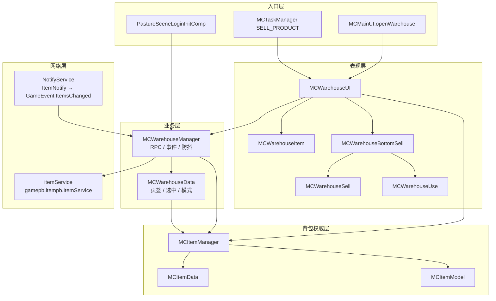
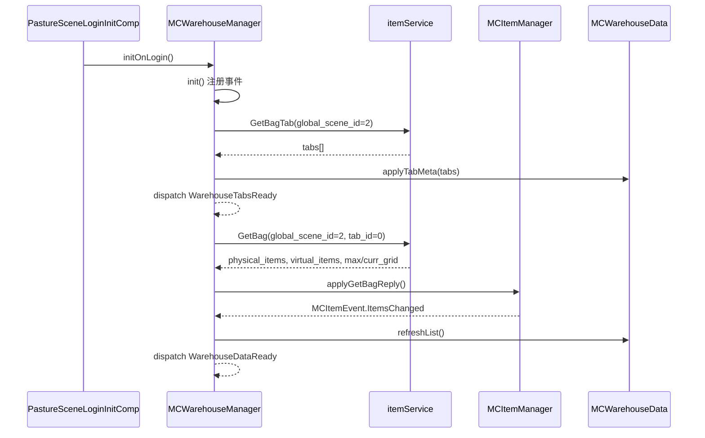
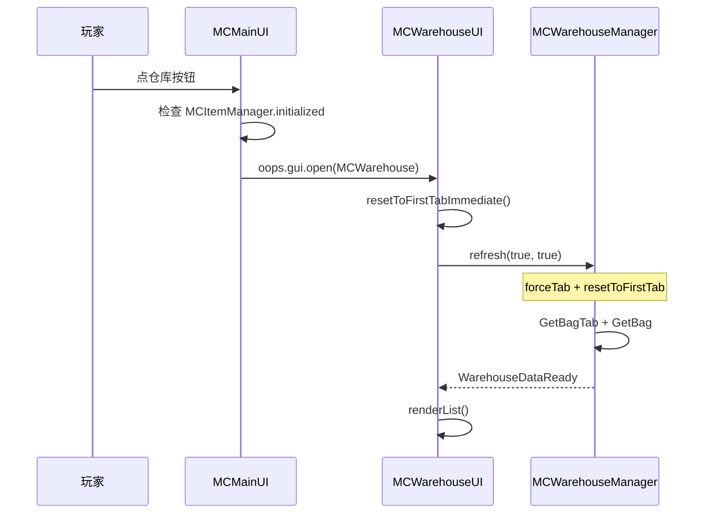
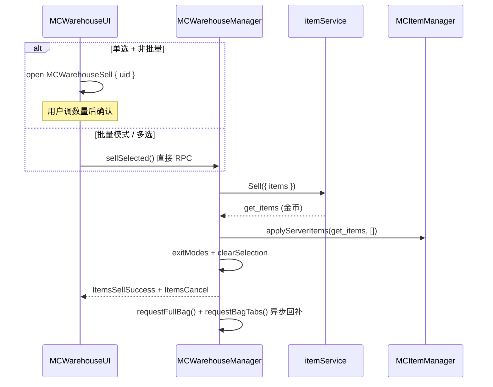

# 牧场仓库（MC Warehouse）功能文档

> **模块定位**：牧场道具背包（产物 / 幼崽 / 饲料 / 道具等），与农场仓库（`client/assets/script/game/warehouse/**`）**完全独立实现**，与 homesteadpb 的**建筑仓库**（放置前建筑列表）也是两套系统。
>
> **场景 ID**：`GLOBAL_SCENE_ID_BIG_FARM = 2`（大农场 / 新家园）
>
> **最后整理**：2026-09-24

---

## 目录

1. [功能概览](#1-功能概览)
2. [架构与分层](#2-架构与分层)
3. [目录与文件清单](#3-目录与文件清单)
4. [UI 注册与预制体](#4-ui-注册与预制体)
5. [数据模型](#5-数据模型)
6. [网络协议与 RPC](#6-网络协议与-rpc)
7. [完整链路（时序）](#7-完整链路时序)
8. [事件总线](#8-事件总线)
9. [业务规则](#9-业务规则)
10. [配置表](#10-配置表)
11. [外部联动](#11-外部联动)
12. [与农场仓库的隔离](#12-与农场仓库的隔离)
13. [常见问题与调试](#13-常见问题与调试)
14. [扩展指南](#14-扩展指南)

---

## 1. 功能概览

### 1.1 玩家可见能力

| 能力 | 说明 |
|---|---|
| **分页浏览** | 页签结构 / 名称 / 格子数 / 红点由服务端 `GetBagTab` 下发 |
| **容量显示** | 顶部 `curNum/maxNum`，来自 `GetBag` 的 `curr_grid_num` / `max_grid_num` |
| **单选查看** | 点击格子选中，底部展示详情 / 单价 / 出售 / 使用 |
| **批量出售** | 产物 / 副产品 / 恶作剧道具页签支持「一键选择」批量勾选出售 |
| **单件出售弹窗** | 单选可售道具时弹 `MCWarehouseSell`，可调数量 |
| **使用道具** | 可 `Use` 的道具弹 `MCWarehouseUse`；罐头类走 `MCFeedbucketAddUI` |
| **锁定 / 解锁** | 产物 / 幼崽页签支持锁定模式，调用 `LockItems` / `UnlockItems` |
| **新道具红点** | 格子 `is_new` + 页签红点；点击后 `CannelNew` |
| **空态跳转** | 当前页签无道具时提示「去商店」 |

### 1.2 入口

| 入口 | 代码位置 | 说明 |
|---|---|---|
| **主界面按钮** | `MCMainUI.openWarehouse()` | 当前**主入口**；需 `MCItemManager.initialized` |
| **任务跳转** | `MCTaskManager` → `mcTaskCondType.SELL_PRODUCT` | 直接 `oops.gui.open(MCUIID.MCWarehouse)` |
| **点击仓库建筑** | `UnitInteractType.ts` | **已注释**，不再从场景建筑打开 |
| **预加载** | `PasturePreload` | 预加载 `MCUIID.MCWarehouse` 预制 |

### 1.3 生命周期

```
进入牧场登录
  → PastureSceneLoginInitComp: MCWarehouseManager.initOnLogin()
  → GetBagTab + GetBag(全量) 灌入 MCItemManager

打开仓库 UI
  → MCWarehouseUI.onEnable: refresh(true, true)

离开牧场
  → MCBoot.onDestroy: MCWarehouseManager.leave()
  → 清理事件 / 数据 / MCItemManager.clear()
```

---

## 2. 架构与分层



### 2.1 职责划分（重要）

| 层级 | 类 | 职责 |
|---|---|---|
| **背包权威** | `MCItemManager` | 全量 / 增量道具落地、容量、钱包、按 `tab_id` 查询 |
| **仓库 UI 状态** | `MCWarehouseData` | 当前页签、选中集、批量 / 锁定模式、列表过滤排序 |
| **仓库业务** | `MCWarehouseManager` | 所有 ItemService RPC、登录初始化、ItemNotify 防抖回补 |
| **仓库表现** | `MCWarehouseUI` 等 View | 只读 Manager/Data，通过事件刷新，**不直接打 RPC** |

> **约定**：仓库模块**没有**独立的 `*SyncHelper`；网络同步集中在 `MCWarehouseManager` + `MCItemManager`。栏舍道具操作成功后由 `MCPastureItemOpBase.afterSucceeded()` 间接触发 `requestFullBag()`。

---

## 3. 目录与文件清单

### 3.1 核心代码（本目录）

```
gui/warehouse/
├── MCWarehouseManager.ts              # 业务中枢（RPC / 事件 / 生命周期）
├── model/
│   ├── MCWarehouseData.ts             # UI 运行时状态
│   └── MCWarehouseEnum.ts             # 事件枚举 / 页签类型 / 业务规则常量
└── view/
    ├── MCWarehouseUI.ts               # 主界面
    ├── MCWarehouseItem.ts             # 列表格子
    ├── MCWarehouseBottomSell.ts       # 底部条（空态 / 单选 / 批量）
    ├── MCWarehouseBottomOneSell.ts    # 单选底部详情
    ├── MCWarehouseBottomOneCubSell.ts # 幼崽专用底部
    ├── MCWarehouseSell.ts             # 出售确认弹窗
    ├── MCWarehouseUse.ts              # 使用道具弹窗
    ├── MCWarehouseOnePrice.ts         # 弹窗内金币价格
    ├── MCWarehouseBottomOnePrice.ts   # 底部单选价格
    └── MCWarehousePriceHelper.ts      # applyGoldPrice() 复用
```

### 3.2 关联代码（背包数据层）

| 路径 | 职责 |
|---|---|
| `gui/item/MCItemManager.ts` | 背包权威 Manager |
| `gui/item/model/MCItemData.ts` | Map 存储、容量 `maxNum/curNum`、钱包 |
| `gui/item/model/MCItemModel.ts` | 单道具模型（canSell / isUsable / tabId 等） |
| `gui/item/model/MCItemEvent.ts` | `ItemsReady` / `ItemsChanged` / `WalletChanged` |
| `gui/item/model/MCItemEnum.ts` | `MCItemType` 枚举 |
| `gui/item/MCIconLoader.ts` | 图标异步加载与回收 |

### 3.3 配置辅助

| 路径 | 职责 |
|---|---|
| `config/MCWarehouseConfigHelper.ts` | 页签读取、出售单价、可使用判定 |
| `config/MCItemConfigHelper.ts` | 道具表读取、图标路径解析 |
| `script/mcconfig/MCItemInfoConfig.ts` | 道具表 TypeScript 定义 |
| `script/mcconfig/MCItemTabConfig.ts` | 页签表定义（**运行时以 GetBagTab 为准**） |

### 3.4 协议

| 路径 | 职责 |
|---|---|
| `service/protocol/.../itempb/itemsys.ts` | ItemService RPC 定义 |
| `service/protocol/.../corepb/common.ts` | `Item` / `ItemBag` 结构 |
| `service/protocol/.../globalscenepb/global_scene.ts` | `GlobalSceneId` |
| `service/index.ts` | 导出 `itemService = ItemServiceClientImpl` |

### 3.5 主包桥接（共享层最小侵入）

| 路径 | 职责 |
|---|---|
| `script/mc/MCUIConfig.ts` | UIID 10007~10009 + prefab 路径 |
| `script/network/service/impl/NotifyService.ts` | decode `ItemNotify` → 派发 `GameEvent.ItemsChanged` |

### 3.6 资源

| 路径 | 内容 |
|---|---|
| `mcRes/gui/prefab/warehouse/MCWarehouseUI.prefab` | 主界面 |
| `mcRes/gui/prefab/warehouse/MCWarehouseSell.prefab` | 出售弹窗 |
| `mcRes/gui/prefab/warehouse/MCWarehouseUse.prefab` | 使用弹窗 |
| `mcRes/gui/prefab/warehouse/MCWarehouseItem.prefab` | 列表项 |
| `mcRes/gui/texture/warehouse/` | 背景、页签、稀有度框等 |
| `mcRes/unit/prefab/buildings/Warehouse_1~3.prefab` | 场景仓库建筑（仅展示，点击开面板已下线） |
| `remote/audio/mcAudio/sfx/sfx_ui_intowarehouse.mp3` | 入仓音效（栏舍收获特效用） |
| `remote/audio/mcAudio/sfx/sfx_ui_windowwarehouse_close.mp3` | 关窗音效 |

---

## 4. UI 注册与预制体

注册于主包 `MCUIConfig.ts`（bundle 均为 `mcRes`）：

| UIID | 枚举值 | Prefab | Layer |
|---|---|---|---|
| `MCWarehouse` | 10007 | `gui/prefab/warehouse/MCWarehouseUI` | PopUp + mask |
| `MCWarehouseSell` | 10008 | `gui/prefab/warehouse/MCWarehouseSell` | Dialog + mask |
| `MCWarehouseUse` | 10009 | `gui/prefab/warehouse/MCWarehouseUse` | Dialog + mask |

> `MCPastureMachineDetail`（10014）**复用** `MCWarehouseUI` 预制，与仓库主界面共用同一套 UI 脚本。

### 4.1 MCWarehouseUI 主要节点

| 节点 / 组件 | 用途 |
|---|---|
| `itemList` (ListComp) | 道具网格，最少 20 格（`LIST_MIN_SLOTS`） |
| `tabComp` (TabComp) | 页签切换 |
| `txtLimit` | 容量 `curNum/maxNum` |
| `btnOnekey` | 进入 / 退出批量出售 |
| `btnLocks` / `btnExitLock` | 锁定模式 |
| `btnSell` / `btnUse` | 与底部 OneSell 共用节点 |
| `bottomSell` | 底部条容器 |
| `btnUpgrade` | **已废弃**，始终隐藏 |

### 4.2 打开参数

```typescript
// MCWarehouseUI.onAdded(args?)
{
    unitId?: number;      // 点仓库建筑打开时带入（当前入口已注释）
    configId?: number;
    instanceId?: number;
}

// MCWarehouseSell / MCWarehouseUse
{ uid: string }           // 道具格子 uid
```

---

## 5. 数据模型

### 5.1 MCItemModel（单道具）

来源：`gui/item/model/MCItemModel.ts`

| 字段 | 来源 | 说明 |
|---|---|---|
| `uid` | 协议 `Item.uid` | 实体道具 `String(uid)`；虚拟道具 `mc-v-{id}` |
| `id` | 协议 + 配置 | 道具配置 id |
| `count` | 协议 | 堆叠数量 |
| `type` | MCItemInfo | 道具类型（见 MCItemType） |
| `tabId` | 协议 `Item.tab_id` | **页签过滤权威字段** |
| `isLock` | 协议 `Item.is_locked` | 锁定态 |
| `isNew` | 协议 `Item.is_new` | 新获得标记 |
| `isSelected` | 本地 | 展示用；权威在 `MCWarehouseData.selectedUidSet` |
| `sellPrice` | 协议 `show.sells` 或配置表 | 金币出售单价 |
| `wareScale` | 配置 `ware_scale` | 列表图标缩放 |
| `name/desc/level/layer/rarity` | MCItemInfo | 展示字段 |

**关键方法**：

```typescript
canSell(): boolean {
    // 锁定 / 数量<=0 → false
    // 有金币单价 → true
    // 幼崽（MCItemType.Cub）即使单价为 0 也可发起出售（以服务端为准）
}

get isUsable(): boolean {
    // 未锁定 && (配置 can_use || interactionType === "use")
}
```

### 5.2 MCItemData / MCItemManager（背包权威）

- `items: Map<string, MCItemModel>` — 实体道具（占格子）
- `maxNum` — 仓库总容量上限
- `curNum` — 当前已占格子数
- `walletBalance` — 金币（虚拟道具 id=1001）
- `ready: boolean` — 是否已完成首次 GetBag 灌入

**核心 API**：

| 方法 | 用途 |
|---|---|
| `applyGetBagReply(physical, virtual, maxGrid, currGrid)` | 全量落地（登录 / 强制刷新） |
| `applyServerItems(getItems, costItems)` | Sell / Use / 商店等 RPC 回包增量 |
| `applyItemNotify(changes, showPopup)` | ItemNotify 增量（绝对数量在 item.count） |
| `getItemsByTabId(tabId)` | 按协议 tab_id 过滤 |
| `getByUid(uid)` | 单格查询 |
| `getItemAllCount(id)` | 按配置 id 累计（商店幼崽上限等用） |

### 5.3 MCWarehouseData（UI 状态）

来源：`model/MCWarehouseData.ts`

| 字段 | 说明 |
|---|---|
| `categoryId` | 当前页签 id（= 协议 tab_id） |
| `itemDataArr` | 当前页签过滤后的列表 |
| `isBatchState` | 批量出售模式 |
| `isBatchLockState` | 锁定模式 |
| `selectedUidSet` | 选中权威（Set） |
| `categories` | GetBagTab 下发的页签列表 |
| `tabMeta` | 每页签 itemCount / hasRedDot |

**列表排序规则**（`sortItems`）：

```
type 升序 → level 降序 → 售价降序 → count 降序 → id 降序
```

---

## 6. 网络协议与 RPC

### 6.1 服务定义

- **服务名**：`gamepb.itempb.ItemService`
- **客户端实例**：`itemService`（`service/index.ts`）
- **场景参数**：所有请求带 `global_scene_id: GLOBAL_SCENE_ID_BIG_FARM (2)`

### 6.2 RPC 一览

| RPC | 请求 | 响应 | 调用方 | 用途 |
|---|---|---|---|---|
| `GetBagTab` | `{ global_scene_id }` | `{ tabs[], global_scene_id }` | `requestBagTabs()` | 页签结构 / 名称 / 格子数 / 红点 |
| `GetBag` | `{ global_scene_id, tab_id: 0 }` | 见下 | `requestFullBag()` | **全量**实体 + 虚拟道具、容量 |
| `Sell` | `{ items: Item[] }` | `{ sell_items, get_items }` | `sellSelected()` | 出售 |
| `Use` | `{ item: Item }` | `{ item, get_items, compensated_items, ... }` | `useItem()` | 使用 |
| `LockItems` | `{ uids: number[] }` | `{ newly_locked_uids, already_locked_uids, failures }` | `doSetLocked(true)` | 锁定 |
| `UnlockItems` | `{ uids: number[] }` | `{ newly_unlocked_uids, already_unlocked_uids, failures }` | `doSetLocked(false)` | 解锁 |
| `CannelNew` | `{ item_id: number }` | `{ item_id }` | `cancelNew()` | 取消新道具标记 |

### 6.3 关键协议结构

#### Item（corepb/common.ts）

```typescript
interface Item {
    id: number;           // 道具配置 id
    count: number;        // 数量
    uid: number;          // 格子 uid（实体道具 > 0）
    is_new: boolean;      // 新获得
    is_locked: boolean;   // 锁定
    tab_id: number;       // 仓库页签 id（0=未分类）
    expire_time: number;
    show?: ItemShow;      // sells 等客户端展示信息
}
```

#### GetBagReply

```typescript
interface GetBagReply {
    physical_items: Item[];   // 占格子的实体道具（含 tab_id）
    virtual_items: Item[];    // 金币 / 罐头等虚拟道具（不占格）
    max_grid_num: number;     // 容量上限
    curr_grid_num: number;    // 当前占用格数
    global_scene_id: GlobalSceneId;
}
```

#### BagTabInfo

```typescript
interface BagTabInfo {
    tab_id: number;
    tab_name: string;
    item_count: number;     // 该页签道具数
    has_red_dot: boolean;   // 页签红点
}
```

#### Sell 请求体组装

```typescript
// MCWarehouseManager.toProtoItem
Item.fromPartial({ id, count, uid })

// sellSelected 过滤条件：
// - selectedItems 中 canSell() 为 true
// - count > 0 && uid > 0
```

#### ItemNotify（服务端推送）

```typescript
interface ItemNotify {
    items: ItemChg[];      // 变更列表
    show_popup: boolean;   // 是否弹获得弹窗
}

interface ItemChg {
    item: Item;            // 变更后绝对数量在 item.count
    delta: number;         // 增量（负值=减少）
}
```

**推送链路**：

```
服务端 ItemNotify
  → NotifyService (主包 decode)
  → ItemManager.ins.updateItems()        // 农场背包
  → GameEvent.ItemsChanged               // 无 payload（兼容旧监听）
  → GameEvent.ItemsChanged(notifyData)   // 带 ItemNotify payload
  → MCWarehouseManager.onServerItemsChanged()
      → 有 changes: MCItemManager.applyItemNotify()
      → 无 changes: refreshAfterMutation()（GetBagTab + GetBag）
      → 80ms 防抖后 requestBagTabs()
```

### 6.4 数据一致性策略（必读）

| 场景 | 策略 |
|---|---|
| **页签权威** | 结构 / 名称 / 红点 → `GetBagTab`；**不再**读本地 MCItemTab.json |
| **背包权威** | 道具列表 / 容量 → `GetBag(tab_id=0)` 全量 |
| **切 Tab** | **仅本地** `tab_id` 过滤，**不再**按页签 RPC GetBag |
| **并发 GetBag** | `bagSeq` 代次号，丢弃过期回包 |
| **Sell 回包** | **只落地** `get_items`（金币）；扣减依赖 ItemNotify 绝对数量 + 事后 `requestFullBag()` 回补 |
| **ItemNotify** | 80ms 防抖合并，避免连续推送多次拉包 |
| **WarehouseDataReady** | 微任务合并，避免同帧连发 |

---

## 7. 完整链路（时序）

### 7.1 登录初始化



失败时：`MCItemManager.clear()` + 抛出异常，**不灌 Mock**。

### 7.2 打开仓库



### 7.3 切换页签

```
用户点 Tab
  → MCWarehouseManager.selectTab(tabId)
  → MCWarehouseData.selectCategory(tabId)   // 本地 tab_id 过滤
  → scheduleDataReady → WarehouseDataReady
  → MCWarehouseUI.renderList()
```

### 7.4 点击道具

```
MCWarehouseItem.onClickThis()
  ├─ [普通模式 + isNew] → ItemsCancelRed → CannelNew RPC + 乐观清红点
  ├─ [锁定模式] → ItemCheckChanged → setLocked RPC
  ├─ [批量模式] → toggleSelection（锁定项 toast）
  └─ [普通模式] → changeOneItemCheck（单选）
  → MCWarehouseUI.renderSelectionChrome()
```

### 7.5 出售



**出售入口分流**（`MCWarehouseUI.openSell`）：

| 条件 | 行为 |
|---|---|
| 批量模式 | 底部「确认」→ `sellSelected()` 直售，**不弹窗** |
| 单选 | 打开 `MCWarehouseSell` 可调数量 |
| 多选但未进批量 | `sellSelected()` 直售 |

### 7.6 使用道具

```
openUse()
  ├─ 罐头类 → MCFeedbucketAddUI { itemId }
  └─ 其他可 Use → MCWarehouseUse { uid }
      → useItem(uid, count)
      → itemService.Use()
      → applyServerItems(get_items, [used])
      → requestBagTabs()
```

### 7.7 锁定 / 解锁

```
锁定模式点击格子
  → setLocked(uid, !item.isLock)
  → LockItems / UnlockItems RPC
  → 本地 bag.isLock 更新 + updateItems()
  → 锁定时 deselect(uid)
  → toast 反馈
  → lockPromise 防连点
```

### 7.8 外部道具变更

| 来源 | 触发方式 |
|---|---|
| 栏舍收获 / 收取 | 服务端 ItemNotify |
| 栏舍消耗道具 | `MCPastureItemOpBase.afterSucceeded()` → `requestFullBag()` |
| 拖拽会话结束 | `MCPastureDragInteractor` → `requestFullBag()` |
| 商店购买 | ItemNotify + toast「已存入仓库」 |
| 仓库建筑升级 | `FacilityNotifyHelper` 检测 `MODULE_TYPE_WAREHOUSE` → `requestFullBag()` |

---

## 8. 事件总线

### 8.1 MCWarehouseEvent

| 事件 | 派发方 | 订阅方 | 说明 |
|---|---|---|---|
| `WarehouseDataReady` | Manager | MCWarehouseUI | 列表 / 容量 / 底部刷新 |
| `WarehouseTabsReady` | Manager | MCWarehouseUI | 页签文案 / 红点 / 锁定按钮 |
| `ItemCheckChanged` | MCWarehouseItem | MCWarehouseUI | 点击格子 |
| `ItemsSellSuccess` | Manager | MCWarehouseUI, MCWarehouseSell | 出售成功 |
| `ItemsCancel` | Manager / UI | MCWarehouseUI, BottomSell | 退出批量 |
| `ItemsCancelRed` | MCWarehouseItem | Manager → CannelNew | 清红点 |
| `RequestOpenSell` | BottomOneSell | MCWarehouseUI | 底部出售按钮 |
| `RequestOpenUse` | BottomOneSell | MCWarehouseUI | 底部使用按钮 |

### 8.2 MCItemEvent

| 事件 | 说明 |
|---|---|
| `ItemsReady` | GetBag 完成 / clear 时 false |
| `ItemsChanged` | 背包任意变更 |
| `WalletChanged` | 金币余额变更 |

---

## 9. 业务规则

### 9.1 页签能力矩阵

判断函数在 `MCWarehouseEnum.ts`：

| 页签内容 | 一键批量出售 | 锁定模式 |
|---|---|---|
| 含 `Product / BYPRODUCT / MISCHIEF` | ✅ `isWarehouseBatchSellCategory` | — |
| 含 `Product / Cub` | — | ✅ `isWarehouseLockableCategory` |
| 仅 Feed / Can 等 | ❌ | ❌ |

### 9.2 MCItemType 与页签对应（导表参考）

`MCItemTab.json` 中牧场相关页签（**运行时以 GetBagTab 为准**）：

| tab_id | 名称 | types |
|---|---|---|
| 5 | 牧场产物 | 106 / 107 / 108 |
| 6 | 牧场幼崽 | 105 |
| 7 | 牧场饲料 | 101 |
| 8 | 牧场道具 | 109 / 110 |

### 9.3 选中行为

| 模式 | 行为 |
|---|---|
| 普通 | 单选；默认选中第一个可售项 |
| 批量 | 多选；锁定项不可选；允许全部取消 |
| 锁定 | 点击即切换锁定态；退出后恢复单选 |

### 9.4 已下线功能

- **仓库 UI 内升级按钮**：`hideUpgradeBtn()` 始终隐藏；容量变更靠建筑升级推送 + `requestFullBag()`
- **点击场景仓库建筑开面板**：`UnitInteractType` 中 `MODULE_TYPE_WAREHOUSE → MCWarehouse` 已注释

---

## 10. 配置表

### 10.1 MCItemInfo（道具表）

路径：
- JSON：`mcRes/mcconfig/MCItemInfo.json`
- TS：`script/mcconfig/MCItemInfoConfig.ts`

仓库相关字段：

| 字段 | 用途 |
|---|---|
| `sells` | 出售获得（金币等） |
| `can_use` | 是否可使用 |
| `ware_scale` | 列表图标缩放 |
| `warehouse_jumps` | 空态 / Tips 跳转商店 |
| `max_count` / `max_own` | 幼崽堆叠 / 拥有上限（商店购买校验用） |
| `icon_res` / `asset_name` | 图标路径 |
| `interaction_type` | 交互类型（如 `"use"`） |

### 10.2 MCItemTab（页签表）

路径：
- JSON：`mcRes/mcconfig/MCItemTab.json`
- TS：`script/mcconfig/MCItemTabConfig.ts`

> **注意**：页签 id / 名称 / 顺序以运行时 `GetBagTab` 为准；本地 JSON 仅作导表参考。

### 10.3 音效

| 枚举 | id | 用途 |
|---|---|---|
| `ANIMAL_PUT_IN_WAREHOUSE` | 10601003 | 栏舍产物入仓特效音效 |
| `LV_1_UI_CLOSE` | — | 关仓库窗 |
| `SHOP_SELL_SUCC` | — | 出售成功 |
| `COM_CLICK` | — | 点击格子 |

---

## 11. 外部联动

### 11.1 商店

- `MCShopManager` 购买成功 toast「已存入仓库」
- `MCShopBuyDetailHelper` 幼崽购买上限依赖 `MCItemManager.getItemAllCount()` + 仓库剩余容量

### 11.2 栏舍操作

- `MCPastureItemOpBase.afterSucceeded()` → `MCWarehouseManager.requestFullBag()`
- 收获 / 收取产物：`MCPastureOpEffectBase` 播入仓动画（**非仓库 UI 逻辑**）

### 11.3 建筑升级

`FacilityNotifyHelper.applyFacilitiesNotify()`：
- 检测 `ModuleType.MODULE_TYPE_WAREHOUSE` 升级
- 调用 `MCWarehouseManager.requestFullBag()` 刷新容量

### 11.4 任务

`MCTaskManager` 条件 `SELL_PRODUCT` → 打开仓库 UI

---

## 12. 与农场仓库的隔离

| 对比项 | 农场仓库 | 牧场仓库 |
|---|---|---|
| 代码路径 | `script/game/warehouse/**` | `remote/mc/mcboot/script/gui/warehouse/**` |
| 数据 Manager | `WarehouseControl` / `ItemManager` | `MCWarehouseManager` / `MCItemManager` |
| 场景 ID | 旧农场 | `GLOBAL_SCENE_ID_BIG_FARM = 2` |
| UIID | 主包 UIID | `MCUIID` 10007+ |
| 预制 bundle | extraRes | mcRes |

**禁止**：`game/farm/**` import `remote/mc`；牧场不得改动农场仓库实现。

**建筑仓库**（homesteadpb `BuildingItemInfo` / `gui/building-bag/**`）是放置前建筑列表，与本文档的道具仓库无关。

---

## 13. 常见问题与调试

### 13.1 「仓库初始化中，请稍后」

- 原因：`MCItemManager.initialized === false`（登录 GetBag 尚未完成或失败）
- 查：`PastureSceneLoginInitComp` 是否调用了 `MCWarehouseManager.initOnLogin()`
- 查：网络 / RPC 错误日志 `[MCWarehouseManager] 登录拉包失败`

### 13.2 出售后数量不对

- Sell 回包只加金币，扣减靠 ItemNotify + `requestFullBag()` 回补
- 查：ItemNotify 是否正常到达（`NotifyService` → `GameEvent.ItemsChanged`）
- 查：`bagSeq` 是否丢弃了有效回包（并发拉包）

### 13.3 页签与列表不一致

- 页签以 `GetBagTab` 为准；列表以 `GetBag` 全量 + 本地 `tab_id` 过滤
- 切 Tab **不会**重新 RPC
- 若不一致：强制 `refresh(true)` 重拉页签 + 全量

### 13.4 容量不更新

- 仓库 UI 升级按钮已下线
- 容量变更路径：建筑升级 → `FacilityNotifyHelper` → `requestFullBag()`
- 日志关键字：`[MCWarehouseManager][CapacityDebug]`

### 13.5 调试日志

Manager 内已埋点：
- `[MCWarehouseManager] GetBag 全量请求/回包`
- `[MCWarehouseManager][CapacityDebug] GetBagTab / GetBag 容量`

---

## 14. 扩展指南

### 14.1 新增仓库操作

1. 在 `MCWarehouseManager` 增加 RPC 封装
2. 回包通过 `MCItemManager.applyServerItems()` 或 `requestFullBag()` 落地
3. UI 通过 `MCWarehouseEvent` 刷新，**不要**在 View 里直接调 `itemService`
4. 新栏舍相关操作仍登记到 `MCPastureOpRegistry`（面板骨架不改）

### 14.2 新增页签类型

- 页签由服务端 `GetBagTab` 配置，客户端无需改 Tab 表
- 确保道具协议 `tab_id` 正确下发
- 若需特殊 UI 能力，扩展 `MCWarehouseEnum` 中的类型判断集合

### 14.3 新增底部详情样式

- 参考 `MCWarehouseBottomOneCubSell`（幼崽专用）
- 在 `MCWarehouseBottomOneSell` 中按 `MCItemType` 分派

### 14.4 恢复「点击仓库建筑打开」

1. 取消 `UnitInteractType.ts` 中 `MODULE_TYPE_WAREHOUSE` 注释
2. `MCWarehouseUI.onAdded` 已支持 `{ unitId, instanceId }` 参数
3. 验证与主界面入口的行为一致

---

## 附录：核心类速查

```typescript
// 业务入口
MCWarehouseManager.ins.initOnLogin()      // 登录
MCWarehouseManager.ins.refresh(forceTab, resetToFirstTab)
MCWarehouseManager.ins.selectTab(tabId)
MCWarehouseManager.ins.sellSelected(countMap?)
MCWarehouseManager.ins.sellOne(uid, count)
MCWarehouseManager.ins.useItem(uid, count?)
MCWarehouseManager.ins.setLocked(uid, locked)
MCWarehouseManager.ins.requestFullBag()
MCWarehouseManager.ins.requestBagTabs()
MCWarehouseManager.ins.leave()            // 退出牧场清理

// 背包查询
MCItemManager.ins.initialized
MCItemManager.ins.data.maxNum / curNum
MCItemManager.ins.getByUid(uid)
MCItemManager.ins.getItemsByTabId(tabId)
MCItemManager.ins.getItemAllCount(itemId)

// 打开 UI
oops.gui.open(MCUIID.MCWarehouse)
oops.gui.open(MCUIID.MCWarehouseSell, { uid })
oops.gui.open(MCUIID.MCWarehouseUse, { uid })
```
