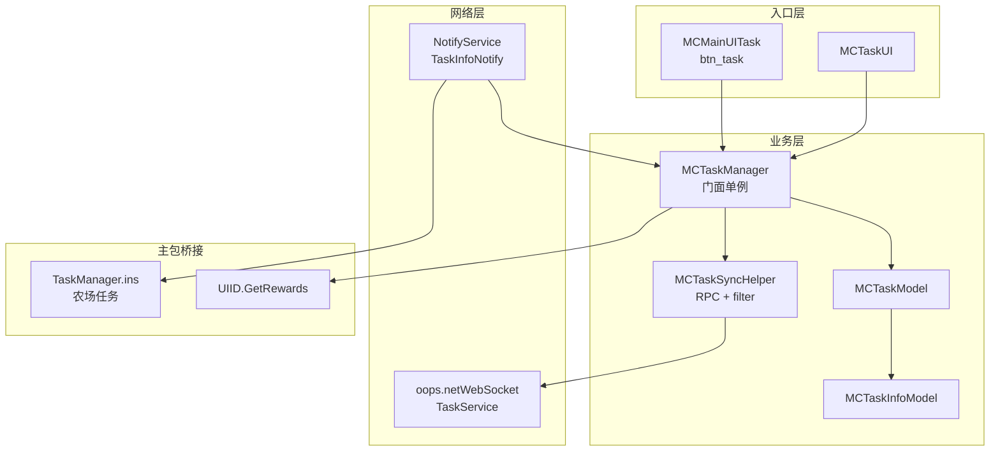
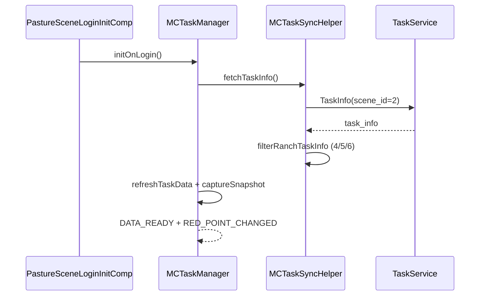
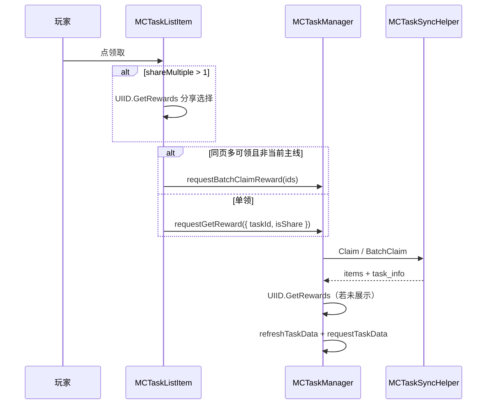
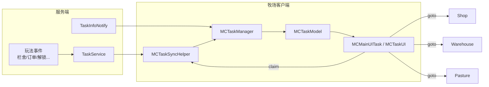

# 牧场任务系统 功能文档

> **模块定位**：牧场（大农场）专属任务体系。与农场 `TaskManager` **完全独立**（独立 Manager / Model / Event），共用主包 `TaskService`（taskpb）与 `NotifyService` 桥接；拉列表固定 `scene_id = 2`（`GLOBAL_SCENE_ID_BIG_FARM`）。
>
> **核心原则**：任务进度由**服务端玩法事件驱动**（客户端 `ClientReportProgress` 对家园条件关闭）；UI 只读 `MCTaskModel`；跳转走 `MCTaskManager.gotoOtherSystem`。
>
> **最后整理**：2026-09-24

---

## 目录

1. [功能概览](#1-功能概览)
2. [架构与分层](#2-架构与分层)
3. [目录与文件清单](#3-目录与文件清单)
4. [UI 注册与预制体](#4-ui-注册与预制体)
5. [数据模型](#5-数据模型)
6. [网络协议与 RPC](#6-网络协议与-rpc)
7. [完整链路（时序）](#7-完整链路时序)
8. [事件总线](#8-事件总线)
9. [条件类型与跳转](#9-条件类型与跳转)
10. [业务规则](#10-业务规则)
11. [外部联动](#11-外部联动)
12. [与农场任务的隔离](#12-与农场任务的隔离)
13. [常见问题与调试](#13-常见问题与调试)
14. [扩展指南](#14-扩展指南)

---

## 1. 功能概览

### 1.1 玩家可见能力

| 能力 | 说明 |
|---|---|
| **主界面任务条** | `btn_task`：展示当前进行中主线描述 + 进度；红点；可领光效 |
| **任务面板** | `MCTaskUI`：成长 / 日常 Tab（或合并布局：主线 + 日常） |
| **前往 / 领取** | 列表项 `btnGoto` / `btnGet`；同页多可领时批量领取 |
| **分享翻倍** | `share_multiple > 1` 时先弹农场共用 `UIID.GetRewards` |
| **完成飘字** | `DOING → CAN_GET_REWARD` 且 `is_show_text` → `MCTaskCompleteFloat` |
| **奖励预览** | 列表横向滚动展示 `rewards` + `activity_rewards` |
| **日常活跃点** | 日常任务显示 `reward_point`（**无活跃宝箱领取**，actives 被过滤） |

### 1.2 任务类型（牧场只用 4 / 5 / 6）

| task_type | 枚举 | 说明 |
|---|---|---|
| 4 | `HOMESTEAD_GROWTH_TASK` | 家园成长（主线链） |
| 5 | `HOMESTEAD_DAILY_TASK` | 家园每日 |
| 6 | `HOMESTEAD_SIDE_QUEST` | 家园支线 |
| 1–3 | 农场成长/日常/支线 | **RPC 过滤掉**，不落地 |

### 1.3 生命周期

```
进入牧场登录
  → PastureSceneLoginInitComp: MCTaskManager.initOnLogin()
  → 订阅 PopUIOpen / TASK_INFO_NOTIFY
  → TaskInfo(scene_id=2)

离开牧场
  → MCBoot.onDestroy: MCTaskManager.leave()
  → sessionEpoch++、model.reset()、取消订阅
```

登录顺序（`PastureSceneLoginInitComp`）：Warehouse → Shop → Illustrated → **Task** → Order

### 1.4 默认布局

`MCTaskManager.useMergeLayout = true`（默认）：

- 面板隐藏成长/日常 Tab，使用 `EMCTaskPage.All`
- 展示：**主线 + 日常**（**不展示支线**）
- 红点：主线可领 + 日常可领（**不含支线**）

---

## 2. 架构与分层



### 2.1 职责划分

| 层级 | 类 | 职责 |
|---|---|---|
| **门面** | `MCTaskManager` | 登录/离开、拉取、领奖、跳转、红点、完成飘字 |
| **Sync** | `MCTaskSyncHelper` | TaskInfo / Claim / BatchClaim / ClientReport；过滤 4/5/6 |
| **列表数据** | `MCTaskModel` | growth / side / daily 三组；排序；红点计数 |
| **单条任务** | `MCTaskInfoModel` | 协议 → 展示字段；状态判定 |
| **主界面入口** | `MCMainUITask` | 任务条 + 打开面板 + 主线快捷领奖 |
| **面板** | `MCTaskUI` / `MCSubTaskUI` / `MCTaskListItem` | Tab / 列表 / 按钮 |

> **约定**：业务**不直接**打 WebSocket；View **不直接**改 Model，通过 Manager 请求。

---

## 3. 目录与文件清单

### 3.1 核心代码（`gui/task/`）

```
gui/task/
├── MCTaskManager.ts              # 门面单例
├── MCTaskSyncHelper.ts           # RPC + filterRanchTaskInfo
├── model/
│   ├── MCTaskEnum.ts             # 事件 / 状态 / scene_id / isRanchTaskType
│   ├── MCTaskTypes.ts            # 协议类型别名
│   ├── MCTaskModel.ts            # 三组任务列表 + 排序 + 红点
│   └── MCTaskInfoModel.ts        # 单条任务模型
└── view/
    ├── MCMainUITask.ts           # 主界面 btn_task 入口
    ├── MCTaskUI.ts               # 任务面板主壳
    ├── MCSubTaskUI.ts            # 成长/日常/合并子列表
    ├── MCTaskListItem.ts         # 单条任务行
    ├── MCTaskAwardItem.ts        # 奖励道具格
    └── MCTaskCompleteFloat.ts    # 完成飘字
```

### 3.2 生命周期集成

| 文件 | 职责 |
|---|---|
| `scene/login/PastureSceneLoginInitComp.ts` | `initOnLogin()` |
| `core/view/MCBoot.ts` | `leave()` |
| `gui/main-ui/MCMainUI.ts` | `ensureTaskEntry()` 预加载入口 |
| `script/network/service/impl/NotifyService.ts` | decode → `GameEvent.TASK_INFO_NOTIFY` |

### 3.3 配置 / 枚举

| 路径 | 职责 |
|---|---|
| `mcRes/mcconfig/MCTask.json` | 导表（策划/服务端对齐；**运行时以 RPC 为准**） |
| `script/mcconfig/MCTaskConfig.ts` | `IMCTaskConfig` 加载器 |
| `script/mcconfig/mcConfigEnumDef.ts` | `mcTaskType` / `mcTaskCondType` 枚举源 |

### 3.4 跳转依赖

| 文件 | 用途 |
|---|---|
| `scene/unit/util/UnitFocusNavigateHelper.ts` | 聚焦建筑 + 开二级面板 |
| `gui/shop/model/MCShopEnum.ts` | `MCShopCategory.Cub` |
| `script/mc/MCUIConfig.ts` | MCUIID 注册 |

---

## 4. UI 注册与预制体

| MCUIID | 数值 | Prefab | Layer | 说明 |
|---|---|---|---|---|
| `MCTask` | **10023** | `gui/prefab/task/MCTaskUI` | PopUp + mask | 任务面板 |
| `MCTaskCompleteFloat` | **10024** | `gui/prefab/task/task_complete_float` | PopUp, mask=false | 完成飘字 |

**非 MCUIID 但任务 UI 使用**：

| 资源 | 路径 | 说明 |
|---|---|---|
| 主界面入口 | `gui/prefab/task/btn_task.prefab` | 嵌入 `McMainUI`，非独立 UIID |
| 列表项 | `item_tasklist*.prefab` | 成长/日常/合并样式 |
| 子布局 | `sub_maintask.prefab` / `sub_task_merge.prefab` | |
| 可领光效 | `extraRes/gui/prefab/task/task_light_main` | 主界面动态加载 |
| 领奖弹窗 | 主包 `UIID.GetRewards` | 复用农场奖励展示 |

---

## 5. 数据模型

### 5.1 MCTaskInfoModel（单条任务）

来源：协议 `taskpb.Task` → `init()`

| 字段 | 协议来源 | 说明 |
|---|---|---|
| `id` | `id` | 任务 id |
| `taskType` | `task_type` | 4/5/6 |
| `taskCondType` | `cond_type` | 条件类型（见 §9） |
| `desc` | `desc` | 展示文案（**权威**） |
| `params` / `paramsList` | `params[]` | 跳转参数（如商店 itemId） |
| `progress` / `totalProgress` | `progress` / `total_progress` | 进度 |
| `isUnlock` | `is_unlocked` | 是否解锁 |
| `_isClaimed` | `is_claimed` | 是否已领 |
| `rewards` | `rewards` + `activity_rewards` | 经 `ItemManager.getItemsByData` |
| `shareMultiple` | `share_multiple` | 分享翻倍倍数 |
| `rewardPoint` | `reward_point` 或首奖 count | 日常活跃点展示 |
| `isShowText` | `is_show_text` | 是否弹完成飘字 |
| `groupId` / `prevTaskId` | `group` / `prev_task_id` | 链式任务 |

### 5.2 MCTaskStatus 判定

| 状态 | 值 | 条件 |
|---|---|---|
| `LOCKED` | 0 | `!is_unlocked` |
| `DOING` | 1 | 已解锁、未领、进度不足 |
| `CAN_GET_REWARD` | 2 | `progress >= total_progress` 且未领 |
| `CLAIMED` | 3 | `is_claimed` |

### 5.3 MCTaskModel 分组

| 字段 | 来源 | 说明 |
|---|---|---|
| `mainTaskData` | `growth_tasks` | 成长主线列表 |
| `sideTaskData` | `side_tasks` | 支线 |
| `dailyTaskData` | `daily_tasks` | 日常 |
| `dailyRefreshTime` | `daily_refresh_time` 或本地算次日 0 点 | 日常刷新倒计时 |

**排序规则**（`sortTasksByRule`）：

```
可领 → 进行中 → 锁定 → 已领；同态 id 升序
```

**主线选取**（`getMainTask`）：优先返回第一个 可领/进行中/锁定 的成长任务，否则最后一条。

### 5.4 filterRanchTaskInfo

`MCTaskSyncHelper.filterRanchTaskInfo`：

- 只保留 `task_type` 4/5/6
- `actives` / 活跃宝箱相关字段**清空**（牧场侧不做活跃领奖）
- 兼容 `tasks[]` 扁平列表或分组列表

### 5.5 Session 保护

- `sessionEpoch`：登录/离开时递增
- `requestTaskData` 用 epoch 丢弃过期回包
- `leave()` 清空快照、红点、clientReportUiId

---

## 6. 网络协议与 RPC

### 6.1 服务定义

```
ServiceName.TaskService = "gamepb.taskpb.TaskService"
MC_TASK_SCENE_ID = 2  // BIG_FARM
```

传输：`oops.netWebSocket.sendMsg`，超时 **15s**。

### 6.2 RPC 一览

| RPC | Method | Request | 调用方 | 用途 |
|---|---|---|---|---|
| 拉任务列表 | `TaskInfo` | `{ scene_id: 2 }` | `fetchTaskInfo()` | 全量任务 |
| 单条领奖 | `ClaimTaskReward` | `{ id, do_shared }` | `claimReward()` | 领取 + 可选分享 |
| 批量领奖 | `BatchClaimTaskReward` | `{ ids[] }` | `batchClaim()` | 同页多可领 |
| 客户端上报 | `ClientReportProgress` | `{ task_id, progress }` | `clientReport()` | **家园条件已关闭** |

**未使用**：`ClaimDailyReward`（日/周活跃宝箱）

### 6.3 领奖回包与刷新策略

```
ClaimTaskReward / BatchClaimTaskReward
  → mergeRewards(items + compensated_items)
  → 未展示过则 oops.gui.open(UIID.GetRewards)
  → refreshTaskData(reply.task_info)   // 若有
  → requestTaskData()                  // 再拉一次保证一致
```

### 6.4 Notify 推送

```
服务端 TaskInfoNotify
  → NotifyService decode
  → TaskManager.ins.onTaskInfoNotify (农场)
  → GameEvent.TASK_INFO_NOTIFY(task_info)
  → MCTaskManager.onTaskInfoNotify
      → 含 4/5/6 才 refreshTaskData({ checkFloat: true })
```

### 6.5 错误码

| gamepb.GameError | Toast |
|---|---|
| `TaskProgressNotEnough` (1008001) | 进度不足，暂不可领取 |
| `TaskAlreadyClaimed` (1008002) | 奖励已领取 |
| `TaskNotUnlocked` (1008003) | 任务尚未解锁 |

---

## 7. 完整链路（时序）

### 7.1 登录拉取



### 7.2 打开任务面板

```
MCMainUITask.btnTask
  → oops.gui.openAsync(MCUIID.MCTask)
  → MCTaskUI.onAdded → initView → requestTaskData()
  → DATA_READY → MCSubTaskUI 刷新列表
```

### 7.3 前往（Goto）

```
MCTaskListItem.onClickBtnGoto
  → CLOSE_TASK_UI（关面板）
  → MCTaskManager.gotoOtherSystem(condType, params)
  → 见 §9 跳转表
```

### 7.4 领取奖励



### 7.5 完成飘字

```
refreshTaskData({ checkFloat: true })
  → 对比快照：DOING → CAN_GET_REWARD
  → task.isShowText === true
  → open MCTaskCompleteFloat { task, taskType }
  → 2s 动画后自动关闭
```

触发源：`TaskInfoNotify`、领奖后重拉（带 checkFloat）。

---

## 8. 事件总线

### 8.1 MCTaskEvent（牧场专用）

| 事件 | 常量 | Payload | 订阅方 |
|---|---|---|---|
| `DATA_READY` | `MC_TASK_DATA_READY` | `extraData?` | MCMainUITask, MCSubTaskUI, MCTaskUI |
| `CLOSE_TASK_UI` | `MC_CLOSE_TASK_UI` | — | MCTaskUI（关闭面板） |
| `RED_POINT_CHANGED` | `MC_TASK_RED_POINT_CHANGED` | `count` | MCMainUITask 红点 |
| `TASK_COMPLETE_FLOAT` | `MC_TASK_COMPLETE_FLOAT` | — | **已定义未 dispatch** |

### 8.2 主包事件（订阅）

| 事件 | 来源 | 处理 |
|---|---|---|
| `GameEvent.TASK_INFO_NOTIFY` | NotifyService | `onTaskInfoNotify` |
| `GameEvent.PopUIOpen` | 打开 UI | `onPopUIOpen`（clientReport 预留，当前未启用） |

---

## 9. 条件类型与跳转

### 9.1 牧场条件枚举（101–125）

| 值 | 枚举 | 中文 |
|---|---|---|
| 101 | `UNLOCK_REGION` | 解锁地块区域 |
| 102 | `BUILD_FACILITY` | 建造建筑 |
| 103 | `UPGRADE_FACILITY` | 升级建筑 |
| 104 | `HAVE_FACILITY_COUNT` | 拥有 X 建筑 N 座 |
| 105 | `HAVE_FACILITY_LEVEL` | 拥有 X 建筑 N 等级 |
| 106 | `UPGRADE_FACILITY_TIMES` | 升级 X 建筑 N 次 |
| 107 | `ADOPT_ANIMAL` | 领养 X 幼崽 N 个 |
| 108 | `ADD_ANIMAL_FEED_SELF` | 给牧草机添加 N 份食材 |
| 109 | `MIDWIFERY_ANIMAL_SELF` | 生产 N 次 |
| 110 | `HARVEST_PRODUCT` | 收获 X 产物 N 次 |
| 111 | `SELL_PRODUCT` | 出售 X 产物 N 次 |
| 112 | `MIDWIFERY_ANIMAL_FRIEND` | 帮助好友生产 N 次 |
| 113 | `STEAL_ANIMAL_PRODUCT` | 偷取动物产物 N 次 |
| 114 | `CLEAN_RANCH_SELF` | 清理牧场 N 次 |
| 115 | `CLEAN_RANCH_FRIEND` | 帮助好友清理牧场 N 次 |
| 116 | `MISCHIEF_FRIEND` | 对好友家园使坏 N 次 |
| 117 | `FINISH_ORDER` | 完成 N 次订单 |
| 118 | `HARVEST_MAIN_PRODUCT` | 收获主产物 N 次 |
| 119 | `HARVEST_SUB_PRODUCT` | 收获副产物 N 次 |
| 120 | `HARVEST_ANY_PRODUCT` | 收获 N 次（主副都算） |
| 121 | `SELL_ANY_PRODUCT` | 出售 N 次 |
| 122 | `GIFT_ANIMAL_FEED_FRIEND` | 给好友赠送 N 次牧草 |
| 123 | `FINISH_SPECIFIED_ORDER` | 完成指定订单 ID |
| 124 | `FINISH_QUALITY_ORDER` | 完成 N 次 X 品质订单 |
| 125 | `UNLOCK_PLOT_COUNT` | 解锁 N 个新地块 |

另有通用条件 `BUY_ITEM(7)` 等（跨场景）。

### 9.2 gotoOtherSystem 跳转表

| 条件 | 跳转 |
|---|---|
| 102–106 | `UnitFocusNavigateHelper` → `MODULE_TYPE_MAIN_CITY` → 主城 |
| 117 | → `MODULE_TYPE_ORDER_BRAND` → 订单栏 |
| 7 (`BUY_ITEM`), 107 | `MCUIID.MCShop` `{ categoryId: Cub, itemId }` |
| 111 | `MCUIID.MCWarehouse` |
| 112, 113, 115, 116 | `MCUIID.MCFriendUI` |
| 108 | → `MODULE_TYPE_FEED_MACHINE` → `MCAddGrassUI` |
| 101, 109, 110, 114, **118–125, default** | Toast：`"请在牧场中完成该任务"` |

> **缺口**：118–125、122 赠送牧草等条件**尚无专用跳转**，走 default toast。详见 [牧场牧草机.md](./牧场牧草机.md) §14.3。

### 9.3 客户端上报（已关闭）

```typescript
// MCTaskEnum.ts
isClientReportCond(_condType) => false  // 家园条件由服务端驱动
```

`onPopUIOpen` / `setClientReportUiId` 逻辑保留但未激活。

---

## 10. 业务规则

### 10.1 红点

| 模式 | 计数 |
|---|---|
| `useMergeLayout = true`（默认） | 主线可领 + 日常可领 |
| 非合并 | 成长(含支线) + 日常 |

变化时才派发 `RED_POINT_CHANGED`（与上次 count 比较）。

### 10.2 批量领取

`MCTaskListItem.onClickBtnGet`：

- **当前主线任务**：始终单领
- **其它**：同页（Growth/Daily/All）所有可领 id → `requestBatchClaimReward`

### 10.3 分享翻倍

- `shareMultiple > 1`：先 `UIID.GetRewards`（`GetRewardsShowType.ShareMoreRewards`）
- 用户选择是否分享 → `do_shared` 传给 `ClaimTaskReward`

### 10.4 主界面任务条

| 状态 | 点击 btnMainTask |
|---|---|
| 主线可领 | 直接领奖（含分享流程） |
| 进行中 | `gotoOtherSystem` |
| 展示 | `getDoingTask()` 或主线描述 + 进度 |

### 10.5 日常刷新倒计时

`MCSubTaskUI` 使用 `TimeUtil.getSecondsUntilNextMidnight()`（本地午夜），**非严格**用服务端 `daily_refresh_time`（有值时会写入 Model）。

### 10.6 配置表 vs 运行时

- **展示字段**（desc / progress / rewards）以 **RPC 回包为准**
- `MCTask.json` 供策划/服务端对齐；mcboot 任务代码**不直接读表**

**配置 ID 段（参考）**：

| ID 段 | task_type | 用途 |
|---|---|---|
| 300001–300037 | 4 | 牧场成长主线 |
| 400001–400006 | 5 | 牧场日常 |
| — | 6 | 支线（表暂无，代码支持 side_tasks） |

---

## 11. 外部联动

| 模块 | 联动方式 | 文档 |
|---|---|---|
| **商店** | goto 107/7 → `MCShop(Cub, itemId)` | [牧场商店.md](./牧场商店.md) |
| **仓库** | goto 111 → `MCWarehouse` | [牧场仓库.md](./牧场仓库.md) |
| **牧草机** | goto 108 → 聚焦 + `MCAddGrassUI` | [牧场牧草机.md](./牧场牧草机.md) |
| **订单栏** | goto 117 → 聚焦 + `MCOrderBoard` | — |
| **栏舍交互** | 109/110/114 等 toast 引导场景内操作 | [栏舍动物交互.md](./栏舍动物交互.md) |
| **地块解锁** | 101/125 toast；实际解锁走 TileMap | [建筑升级地块解锁与加速.md](./建筑升级地块解锁与加速.md) |
| **建筑升级** | 102–106 → 主城 | 同上 |
| **好友** | 112/113/115/116 → `MCFriendUI` | — |
| **道具 Tips** | `MCTaskAwardItem` → `MCItemTips` | — |
| **聚焦导航** | `UnitFocusNavigateHelper` 派发 `UnitEvent.UnitTap` | [建筑与动物气泡.md](./建筑与动物气泡.md) |

---

## 12. 与农场任务的隔离

| 对比项 | 农场 | 牧场 |
|---|---|---|
| Manager | `TaskManager`（主包） | `MCTaskManager` |
| 事件 | `TaskEvent` | `MCTaskEvent` |
| task_type | 1/2/3 | 4/5/6 |
| scene_id | 农场场景 | **2（BIG_FARM）** |
| 活跃宝箱 | 有 | **过滤为空** |
| 领奖 UI | `UIID.GetRewards` | **共用** |
| Notify | 同一条 `TASK_INFO_NOTIFY` | 各管各的过滤 |

**禁止**：`game/farm/**` import 牧场任务；牧场不改农场 `TaskManager`。

---

## 13. 常见问题与调试

### 13.1 任务列表为空

- 查 `TaskInfo` 回包是否含 task_type 4/5/6
- 查 `initOnLogin` 是否调用；`initialized` 是否为 true
- 查网络超时（15s）日志：`[MCTask] !!! TaskInfo 超时`

### 13.2 进度不更新

- 家园条件**不走** ClientReport；依赖服务端玩法事件 + Notify
- 查 `NotifyService` 是否派发 `TASK_INFO_NOTIFY`
- 查 `onTaskInfoNotify` 是否因无 4/5/6 被过滤

### 13.3 点击前往无反应 / 只有 toast

- 条件是否在 goto 表内；118–125 等走 default
- 查 `params` 是否正确（商店 itemId 等）

### 13.4 领奖失败

- 对照错误码 1008001–1008003
- 查是否已领 / 未解锁 / 进度不足

### 13.5 完成飘字不出现

- 需 `is_show_text === true`
- 需状态快照对比 `DOING → CAN_GET_REWARD`
- 首次拉取只 capture 快照，不飘字

### 13.6 调试日志

```
[MCTask] >>> / <<< TaskInfo | ClaimTaskReward | BatchClaimTaskReward
[MCTask] 拉取失败 / 领奖失败 / 上报进度失败
[MCTaskModel.updateTaskData] taskInfo为空
```

---

## 14. 扩展指南

### 14.1 新增 goto 条件

在 `MCTaskManager.gotoOtherSystem` 的 `switch` 增加 case：

```typescript
case mcTaskCondType.GIFT_ANIMAL_FEED_FRIEND:
    // 需客态拜访 + 聚焦牧草机
    UnitFocusNavigateHelper.focusAndOpenByType(mcModuleType.MODULE_TYPE_FEED_MACHINE);
    break;
```

### 14.2 新增任务类型

1. 服务端下发新 `task_type`
2. `isRanchTaskType()` 扩展
3. `filterRanchTaskInfo` 增加分支
4. `MCTaskModel` / UI Tab 按需扩展

### 14.3 启用客户端上报（若产品需要）

1. `isClientReportCond` 对特定 cond 返回 true
2. `MCMainUITask` 已有 `setClientReportUiId` 钩子
3. `onPopUIOpen` 触发 `reportProgress`

### 14.4 原则

- RPC 只加在 `MCTaskSyncHelper`
- View 通过 `MCTaskManager` 请求，不直打 WebSocket
- 跳转集中 `gotoOtherSystem`，不散落各 View
- 领奖后**务必**再拉 `TaskInfo(scene_id=2)`

---

## 附录：核心类速查

```typescript
// 生命周期
MCTaskManager.ins.initOnLogin()
MCTaskManager.ins.leave()
MCTaskManager.ins.requestTaskData({ checkFloat? })

// 领奖
MCTaskManager.ins.requestGetReward({ taskId, isShare?, hasShownShareRewards?, isMergeLayout? })
MCTaskManager.ins.requestBatchClaimReward({ taskIds, isShare?, isMergeLayout? })

// 跳转
MCTaskManager.gotoOtherSystem(condType, params)

// 数据
MCTaskManager.ins.model.getMainTask()
MCTaskManager.ins.model.getDailyTask()
MCTaskManager.ins.model.getRedDotCountWithoutSideTasks()

// RPC
MCTaskSyncHelper.fetchTaskInfo()          // scene_id=2
MCTaskSyncHelper.filterRanchTaskInfo(info)

// 打开 UI
oops.gui.open(MCUIID.MCTask)
oops.gui.open(MCUIID.MCTaskCompleteFloat, { task, taskType })

// 常量
MC_TASK_SCENE_ID = 2
MCTaskManager.useMergeLayout = true
```

---

## 附录：数据流总图


