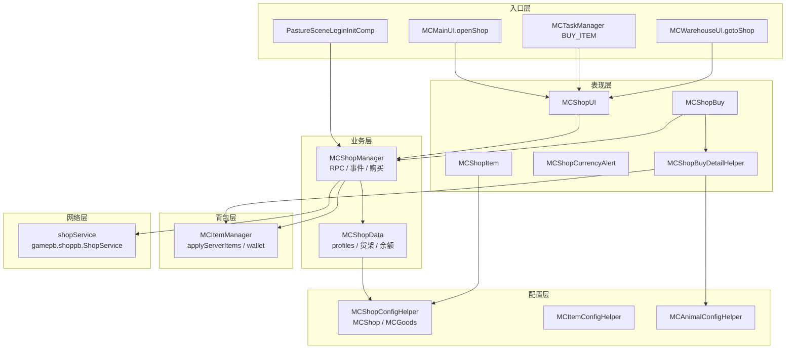
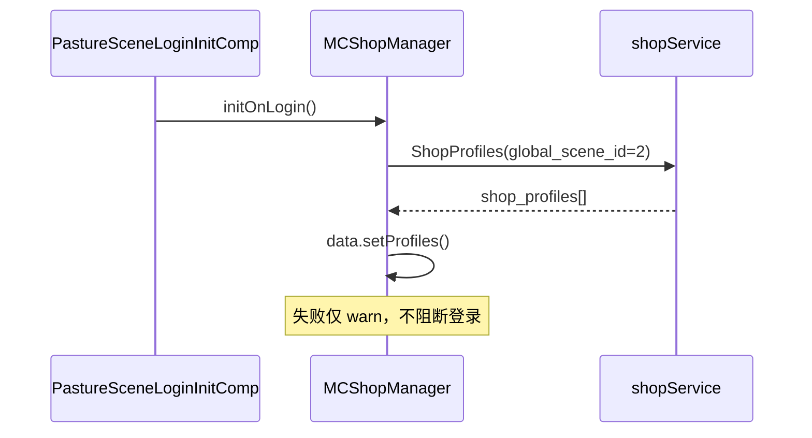
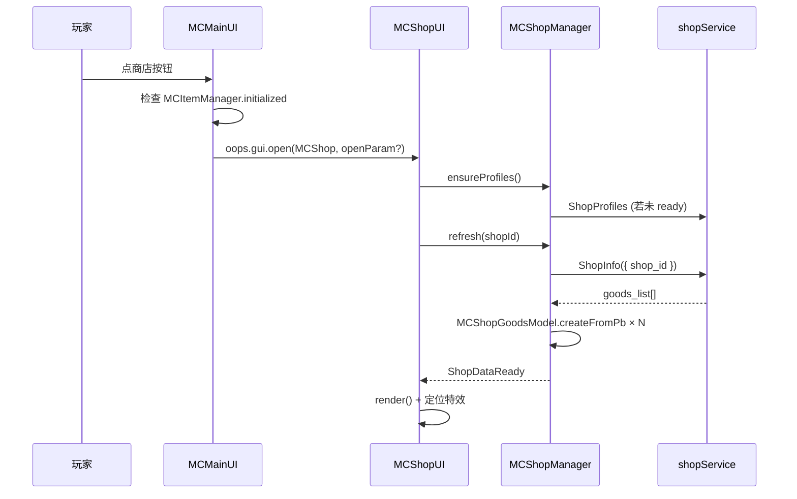
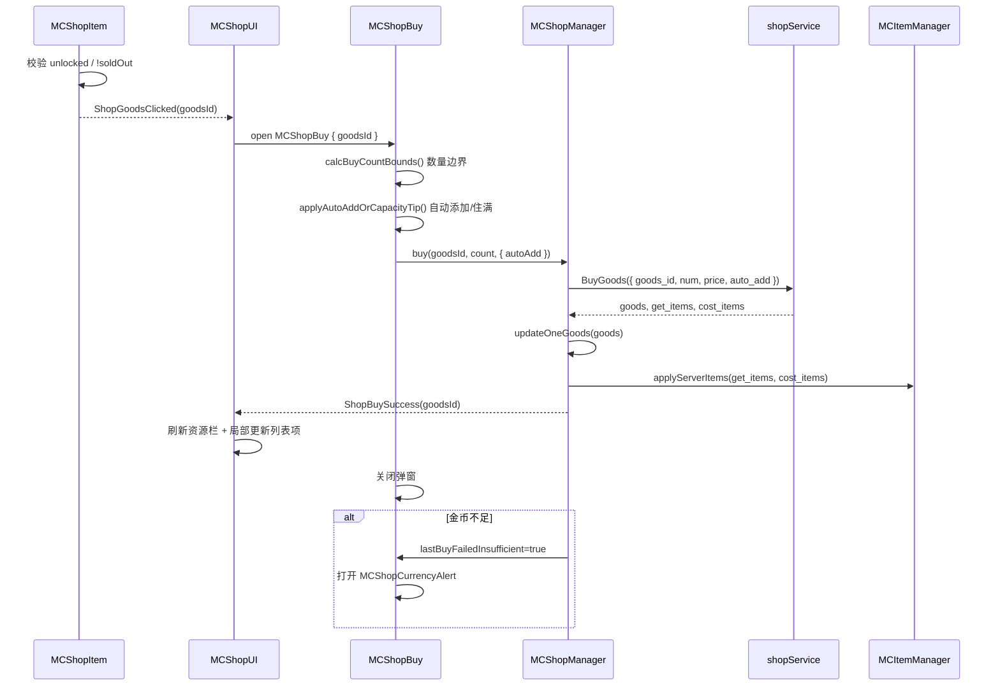

# 牧场商店（MC Shop）功能文档

> **模块定位**：牧场 Tab 商店（幼崽 / 饲料），与农场商店（`client/assets/script/game/shop/**`）**完全独立实现**，与主城**设施商店**（`MCFacilityShopConfig` / `homesteadpb`）也是两套系统。
>
> **场景 ID**：`GLOBAL_SCENE_ID_BIG_FARM = 2`（ShopProfiles 请求参数）
>
> **最后整理**：2026-09-24

---

## 目录

1. [功能概览](#1-功能概览)
2. [架构与分层](#2-架构与分层)
3. [目录与文件清单](#3-目录与文件清单)
4. [UI 注册与预制体](#4-ui-注册与预制体)
5. [数据模型](#5-数据模型)
6. [网络协议与 RPC](#6-网络协议与-rpc)
7. [完整链路（时序）](#7-完整链路时序)
8. [事件总线](#8-事件总线)
9. [业务规则](#9-业务规则)
10. [配置表](#10-配置表)
11. [外部联动](#11-外部联动)
12. [与农场商店的隔离](#12-与农场商店的隔离)
13. [常见问题与调试](#13-常见问题与调试)
14. [扩展指南](#14-扩展指南)

---

## 1. 功能概览

### 1.1 玩家可见能力

| 能力 | 说明 |
|---|---|
| **分页浏览** | 幼崽商店 / 饲料商店 Tab；页签结构优先服务端 `ShopProfiles`，本地 MCShop 配置兜底 |
| **货架列表** | 商品图标、名称、价格、剩余可购、窝/棚类型、品阶、解锁/售罄态 |
| **资源栏** | 顶部货币条，读 `MCItemManager` 钱包与各货币道具数量（不走农场 GlobalData） |
| **购买确认** | 弹窗调数量、看总价、限购提示；幼崽展示属性区（MCAnimalCubInfo） |
| **自动添加** | 幼崽→窝/棚、饲料→牧草机，勾选后 `BuyGoods.auto_add=true` |
| **住满提示** | 窝/棚无空位时提示「已住满」，但仍可买 1 只进仓库 |
| **任务定位** | 打开时滚动到指定 `itemId` 并挂特效 |
| **金币不足** | 弹 `MCShopCurrencyAlert`，可跳转仓库出售 |

### 1.2 入口

| 入口 | 代码位置 | 说明 |
|---|---|---|
| **主界面按钮** | `MCMainUI.openShop()` | 当前**主入口**；需 `MCItemManager.initialized` |
| **任务跳转** | `MCTaskManager` → `BUY_ITEM` / `ADOPT_ANIMAL` | 打开幼崽商店 + `itemId` 定位 |
| **仓库空态** | `MCWarehouseUI.gotoShop()` | 关仓库 → 开商店 |
| **仓库底部** | `MCWarehouseBottomSell` | 空出售列表 → 跳转商店 |
| **栏舍交互面板** | `MCPastureInteractPanel.onClickGoShop()` | 清面板 → 开商店 |
| **预加载** | `PasturePreload` | 预热 `MCShop` / `MCShopBuy` 预制 |

### 1.3 生命周期

```
进入牧场登录
  → PastureSceneLoginInitComp: MCShopManager.initOnLogin()
  → fetchProfiles(true) 预拉 ShopProfiles（失败不阻断）

打开商店 UI
  → MCShopUI.onEnable: ensureProfiles() + refresh(shopId)

离开牧场
  → MCBoot.onDestroy: MCShopManager.leave()
  → 解绑事件 + data.reset()
```

---

## 2. 架构与分层



### 2.1 职责划分（重要）

| 层级 | 类 | 职责 |
|---|---|---|
| **商店业务** | `MCShopManager` | ShopProfiles / ShopInfo / BuyGoods RPC、事件、错误处理 |
| **商店 UI 状态** | `MCShopData` | profiles、当前货架、页签 id、展示用钱包余额 |
| **货架模型** | `MCShopGoodsModel` | 协议 GoodsInfo + 配置表组装 |
| **购买详情** | `MCShopBuyDetailHelper` | 幼崽属性、数量边界（栏舍空位 / 仓库容量 / 金币） |
| **背包落地** | `MCItemManager` | 购买回包 `applyServerItems(get_items, cost_items)` |
| **商店表现** | `MCShopUI` 等 View | 只读 Manager/Data，**不直接打 RPC** |

> **约定**：商店模块**没有**独立的 `*SyncHelper`；RPC 集中在 `MCShopManager` 内完成。当前 MC 商店**仅购买**，出售走仓库 `MCWarehouseSell`。

---

## 3. 目录与文件清单

### 3.1 核心代码（本目录）

```
gui/shop/
├── MCShopManager.ts                   # 业务中枢（RPC / 事件 / 生命周期）
├── model/
│   ├── MCShopData.ts                  # 运行时状态
│   ├── MCShopEnum.ts                  # 页签 id / 事件 / 打开参数 / 错误码
│   ├── MCShopGoodsModel.ts            # 货架商品模型
│   └── MCShopAutoAddConfig.ts         # 「自动添加到设施」规则表
├── helper/
│   └── MCShopBuyDetailHelper.ts       # 购买弹窗详情 + 数量边界计算
└── view/
    ├── MCShopUI.ts                    # 主界面
    ├── MCShopItem.ts                  # 货架列表项
    ├── MCShopBuy.ts                   # 购买确认弹窗
    └── MCShopCurrencyAlert.ts         # 金币不足提示
```

### 3.2 配置辅助

| 路径 | 职责 |
|---|---|
| `config/MCShopConfigHelper.ts` | MCShop / MCGoods 只读查询、解锁等级解析 |
| `config/MCItemConfigHelper.ts` | 道具名/图标/类型/max_own/max_count |
| `config/MCAnimalConfigHelper.ts` | 幼崽属性、窝/棚类型、预计收入等 |

### 3.3 协议 / 服务

| 路径 | 职责 |
|---|---|
| `service/protocol/.../shoppb/shop.ts` | ShopService RPC 定义 |
| `service/protocol/.../corepb/common.ts` | `Item` 结构（购买回包） |
| `service/index.ts` | 导出 `shopService = ShopServiceClientImpl` |

### 3.4 主包桥接

| 路径 | 职责 |
|---|---|
| `script/mc/MCUIConfig.ts` | UIID 10010~10012 + prefab 路径 |

### 3.5 资源

| 路径 | 内容 |
|---|---|
| `mcRes/gui/prefab/shop/MCShopUI.prefab` | 主界面 |
| `mcRes/gui/prefab/shop/MCShopBuy.prefab` | 购买弹窗 |
| `mcRes/gui/prefab/shop/MCShopCurrencyAlert.prefab` | 金币不足 |
| `mcRes/gui/prefab/shop/MCShopItem.prefab` | 列表项 |
| `mcRes/gui/prefab/shop/ShopOpenEffect.prefab` | 任务定位特效 |
| `mcRes/mcconfig/MCShop.json` | 商店页签配置 |
| `mcRes/mcconfig/MCGoods.json` | 商品静态配置 |

---

## 4. UI 注册与预制体

注册于主包 `MCUIConfig.ts`（bundle 均为 `mcRes`）：

| UIID | 枚举值 | Prefab | Layer |
|---|---|---|---|
| `MCShop` | 10010 | `gui/prefab/shop/MCShopUI` | PopUp + mask |
| `MCShopBuy` | 10011 | `gui/prefab/shop/MCShopBuy` | Dialog + mask |
| `MCShopCurrencyAlert` | 10012 | `gui/prefab/shop/MCShopCurrencyAlert` | Dialog + mask |

### 4.1 打开参数

```typescript
// MCShopUI — IMCShopUIOpenParam
{
    categoryId?: number;       // 初始商店 id（= MCShop.id）；缺省取第一个页签
    openSource?: MCShopOpenSource;  // 预留
    itemId?: number;           // 定位滚动 + 挂特效的道具 id
    aniItems?: number[];       // 多道具特效
}

// MCShopBuy
{ goodsId: number }           // 商品配置 id（MCGoods.id / GoodsInfo.id）
```

### 4.2 MCShopUI 主要节点

| 节点 / 组件 | 用途 |
|---|---|
| `shopTab` (TabComp) | 页签切换（幼崽 / 饲料） |
| `scrollViewEx` (ListComp) | 货架循环列表 |
| `source` (SourceComp) | 货币资源栏（禁用农场默认监听，改读 MC 背包） |
| `openEffectPrefab` | 任务定位高亮特效 |
| `imgNull` | 空货架占位 |
| `block` | 打开过程输入阻挡（默认关闭） |

### 4.3 MCShopBuy 主要节点

| 节点 / 组件 | 用途 |
|---|---|
| `numComp` (MCNumberSlider) | 购买数量滑条 |
| `cubInfo` (MCAnimalCubInfo) | 幼崽属性展示区 |
| `txtDesc` / `descNode` | 非幼崽道具描述 |
| `nodeTips` / `txtTips` | 窝/棚住满提示 |
| `nodeAuto` / `toggleAuto` | 自动添加到设施勾选 |
| `imgGod` | 货币图标 |
| `txtBuyMax` | 限购后缀 `/剩余可购` |

---

## 5. 数据模型

### 5.1 MCShopGoodsModel（货架商品）

来源：`model/MCShopGoodsModel.ts`

| 字段 | 来源 | 说明 |
|---|---|---|
| `goodsId` | 协议 `GoodsInfo.id` | 商品配置 id |
| `categoryId` | 请求 shop_id | 所属商店（5=幼崽, 6=饲料） |
| `itemId` | 协议 / MCGoods | 发放的道具 id |
| `itemCount` | 协议 / MCGoods | 单次购买发放数量 |
| `name/iconRes/assetName` | MCItemInfo | 展示字段 |
| `itemType` | MCItemInfo.type | 道具类型 |
| `price` | **协议权威** | 单价 |
| `priceId` | MCGoods | 货币道具 id（默认 1001 金币） |
| `boughtCount` | 协议 `bought_num` | 已购数量 |
| `limitCount` | 协议 `limit_count` | 限购；≤0 不限购 |
| `oneBuyCount` | MCGoods | 单次购买上限 |
| `unlocked` | 协议 `unlocked` | 是否解锁 |
| `unlockLevel` | 协议 conds / 配置 conds | 解锁等级 |

**组装方式**：

```typescript
// 运行时权威：协议 + 配置补全
MCShopGoodsModel.createFromPb(GoodsInfo, shopId)

// 本地兜底（协议未返回时）
MCShopGoodsModel.createFromConfig(IMCGoodsConfig, boughtCount, playerLevel)
```

**关键 getter**：

```typescript
remainingCount  // 剩余可购；不限购时受 oneBuyCount 约束
soldOut         // limitCount - boughtCount <= 0
isCub           // itemType === MCItemType.Cub
husbandryTypeName  // 窝 / 棚（幼崽专用）
layerNum        // 品阶（MCItemInfo.layer）
```

**列表排序**（`MCShopData.updateGoods`）：

```
已解锁优先 → unlockLevel 升序 → order 升序
```

### 5.2 MCShopData（UI 状态）

| 字段 | 说明 |
|---|---|
| `profiles` | ShopProfiles 回包 |
| `profilesReady` | 是否已成功拉取 profiles |
| `curGoodsList` | 当前 Tab 货架列表 |
| `categoryId` | 当前商店 id |
| `walletBalance` | 展示用金币（同步 MCItemManager） |

**页签来源**（`pastureCategories` getter）：

1. **优先**：`ShopProfiles` 下发的 shop_id / shop_name（服务端新增商店可直接成为 Tab）
2. **兜底**：本地 `MCShopConfigHelper.getPastureCategories()`（固定 id=5 幼崽, id=6 饲料）

### 5.3 MCShopManager 状态

| 字段 | 说明 |
|---|---|
| `lastBuyFailedInsufficient` | 上次购买是否金币不足（供 MCShopBuy 弹 Alert） |
| `profilesPromise` | 防并发重复 ShopProfiles |

---

## 6. 网络协议与 RPC

### 6.1 服务定义

- **服务名**：`gamepb.shoppb.ShopService`
- **客户端实例**：`shopService`（`service/index.ts`）

### 6.2 RPC 一览

| RPC | 请求 | 响应 | 调用方 | 用途 |
|---|---|---|---|---|
| `ShopProfiles` | `{ global_scene_id: 2 }` | `{ shop_profiles[] }` | `fetchProfiles()` | 页签列表 |
| `ShopInfo` | `{ shop_id }` | `{ goods_list[] }` | `loadShopData()` | 某商店货架 |
| `BuyGoods` | 见下 | 见下 | `doBuy()` | 购买 |

#### ShopProfile

```typescript
interface ShopProfile {
    shop_id: number;
    shop_name: string;
    shop_type: ShopType;
    global_scene_ids: number[];  // 空=全场景可见
}
```

#### GoodsInfo

```typescript
interface GoodsInfo {
    id: number;              // 商品 id（= MCGoods.id）
    bought_num: number;      // 已购数量
    price: number;           // 单价（运行时权威）
    limit_count: number;     // 限购数量
    unlocked: boolean;       // 是否解锁
    item_id: number;         // 道具 id
    item_count: number;      // 单次发放数量
    conds: Cond[];           // 解锁条件（如 MIN_LEVEL）
    is_display_countdown: boolean;
    end_time: number;        // 下架时间
}
```

#### BuyGoodsRequest

```typescript
interface BuyGoodsRequest {
    goods_id: number;    // 商品 id
    num: number;         // 购买数量
    price: number;       // 单价校验（前后端配置一致性）
    auto_add: boolean;   // 自动添加到设施（窝/棚/牧草机）
}
```

#### BuyGoodsReply

```typescript
interface BuyGoodsReply {
    goods?: GoodsInfo;       // 更新后的商品信息（bought_num 等）
    get_items: Item[];       // 获得的道具
    cost_items: Item[];      // 消耗的道具（金币等）
}
```

### 6.3 推送（未接入）

协议已生成 `GoodsUnlockNotify { goods_list: GoodsInfo[] }`，但当前 MC 侧**未见 Notify 注册处理**。商品解锁变更依赖重新打开商店或手动 `refresh()`。

### 6.4 错误处理

| 错误码 | 常量 | 行为 |
|---|---|---|
| `1004008` | `MC_SHOP_ERR_SCENE_NOT_MATCH` | toast「该商店在当前场景不可用」+ 强制重拉 profiles |
| 金币不足 | RpcError message 含「金币/货币/不足」 | `lastBuyFailedInsufficient=true` → 弹 MCShopCurrencyAlert |

### 6.5 数据一致性策略

| 场景 | 策略 |
|---|---|
| **页签权威** | 优先 `ShopProfiles(BIG_FARM)`；未就绪时用本地 MCShop 兜底 |
| **货架权威** | `ShopInfo` 回包的 `GoodsInfo`（价格 / 已购 / 解锁） |
| **展示补全** | 名称 / 图标 / 类型 / one_buy_count 从 MCGoods + MCItemInfo 补 |
| **购买落地** | `MCItemManager.applyServerItems(get_items, cost_items)` |
| **货架局部更新** | BuyGoods 回包 `goods` → `updateOneGoods()`，UI 只刷新对应格子 |
| **并发 Tab 切换** | `MCShopUI.generation` 丢弃过期 refresh 回调 |

---

## 7. 完整链路（时序）

### 7.1 登录预拉



### 7.2 打开商店



### 7.3 切换 Tab

```
用户点 Tab
  → MCShopUI.refreshCategory(shopId)
  → MCShopManager.refresh(shopId)
  → ShopInfo RPC
  → ShopDataReady → render()
```

### 7.4 点击商品 → 购买



### 7.5 购买成功 Toast 规则

| 条件 | Toast 文案 |
|---|---|
| `autoAdd=true` | `购买成功：{name}×{grant}，已自动添加` |
| 幼崽 + 非 autoAdd | `成功购买{n}个{name}，已存入仓库` |
| 其他 | `购买成功：{name}×{grant}` |

其中 `grant = itemCount × count`。

### 7.6 任务定位打开

```
MCTaskManager (BUY_ITEM / ADOPT_ANIMAL)
  → oops.gui.open(MCShop, { categoryId: Cub, itemId })
  → MCShopUI.applyLocateParam()
  → render() 后 scrollTo(index)
  → 0.2s 后在目标格子挂 ShopOpenEffect，3s 后清除
```

---

## 8. 事件总线

### 8.1 MCShopEvent

| 事件 | 派发方 | 订阅方 | 说明 |
|---|---|---|---|
| `RequestShopData` | 外部 / Manager | MCShopManager | 间接 refresh |
| `ShopProfilesReady` | Manager | （预留） | profiles 就绪 |
| `ShopDataReady` | Manager | MCShopUI | 货架就绪，整表重绘 |
| `ShopBuyGoods` | 外部 / Manager | MCShopManager | 间接 doBuy |
| `ShopBuySuccess` | Manager | MCShopUI | 购买成功，局部刷新 |
| `ShopGoodsClicked` | MCShopItem | MCShopUI | 打开购买弹窗 |

### 8.2 MCItemEvent（商店 UI 监听）

| 事件 | 订阅方 | 说明 |
|---|---|---|
| `WalletChanged` | MCShopUI, MCShopManager | 同步资源栏 / data.walletBalance |
| `ItemsChanged` | MCShopUI | 刷新非金币货币数量 |

---

## 9. 业务规则

### 9.1 固定页签

| shop_id | 枚举 | 名称 | 售卖内容 |
|---|---|---|---|
| 5 | `MCShopCategory.Cub` | 幼崽 | 幼崽道具（MCItemType.Cub） |
| 6 | `MCShopCategory.Feed` | 饲料 | 饲料道具（MCItemType.Feed） |

### 9.2 购买数量边界

#### 非幼崽

```
max = min(货架剩余, one_buy_count, 金币可买)
defaultNum = 1
```

#### 幼崽（`MCShopBuyDetailHelper.calcBuyCountBounds`）

```
a = 同类型窝/棚空栏位（AnimalHelper.countFreeSlotsByHusbandry）
b = 仓库剩余容量（getCubWarehouseRemain）
c = 金币可买数量 floor(wallet / price)
d = one_buy_count（配置单次上限）

滑条上限 max = min(b, c, d, 货架剩余)
默认数量 defaultNum = min(a, b, c, d)，≤0 时回落为 1
isFull = (a === 0)  // 窝/棚住满，但仍可买 1 进仓
```

**仓库容量计算**（`getCubWarehouseRemain`）：

```
ownRemain = max_own - 已拥有数量（若配置了 max_own）
stackRoom = 已有堆叠的空位之和
gridRoom = stackRoom + 空格子数 × max_count
b = min(ownRemain, gridRoom)
```

### 9.3 自动添加到设施

规则表 `MC_SHOP_AUTO_ADD_RULES`（`MCShopAutoAddConfig.ts`）：

| key | 匹配 | 文案 | BuyGoods.auto_add |
|---|---|---|---|
| `cub_to_ranch` | `MCItemType.Cub` | 自动放入窝/棚 | true |
| `feed_to_grass_machine` | `MCItemType.Feed` | 自动添加到牧草机 | true |

**UI 互斥规则**（`MCShopBuy.applyAutoAddOrCapacityTip`）：

1. 窝/棚住满 → 只显示 `nodeTips`（「您的{窝/棚}已住满」）
2. 否则命中自动添加规则 → 只显示 `nodeAuto`，**默认勾选**
3. 否则两者都隐藏

### 9.4 列表项交互限制

| 状态 | 点击行为 |
|---|---|
| 未解锁 | toast「商品尚未解锁」 |
| 售罄 | toast「商品已售罄」 |
| 正常 | 打开购买弹窗 |

### 9.5 资源栏

- 禁用农场 `SourceComp` 默认监听（`source.enabled = false`）
- 通过 `applyMcSourceAmounts()` 读 `MCItemManager`：
  - 金币 → `data.walletBalance`
  - 点券 / 金豆 / 钻石 / 其它货币 → `getItemAllCount(itemId)`
- 各 Tab 显示的货币 id 由 `MC_SHOP_TAB_SOURCE_PRICE_IDS` 配置（当前幼崽/饲料均只显示金币）

---

## 10. 配置表

### 10.1 MCShop（商店页签）

路径：
- JSON：`mcRes/mcconfig/MCShop.json`
- TS：`script/mcconfig/MCShopConfig.ts`

| 字段 | 说明 |
|---|---|
| `id` | 商店 id（5=幼崽, 6=饲料） |
| `type` | 商店类型文案 |
| `name` | 页签显示名 |
| `order` | 排序 |

### 10.2 MCGoods（商品表）

路径：
- JSON：`mcRes/mcconfig/MCGoods.json`
- TS：`script/mcconfig/MCGoodsConfig.ts`

| 字段 | 说明 |
|---|---|
| `id` | 商品 id（= GoodsInfo.id / goodsId） |
| `shop_id` | 所属商店 |
| `item_id` | 发放道具 id |
| `item_count` | 单次购买发放数量 |
| `price_id` | 货币道具 id |
| `price_count` | 单价（运行时以协议 price 为准） |
| `limit_count` | 限购数量 |
| `one_buy_count` | 单次购买上限 |
| `conds` | 解锁条件，如 `最低等级:3` |

### 10.3 MCItemInfo（道具表）

购买展示依赖字段：`name`、`desc`、`type`、`layer`、`icon_res`、`asset_name`、`max_count`、`max_own`

### 10.4 MCAnimal（动物表）

幼崽购买弹窗属性：`growth_time`、`produce_time`、`husbandry_type`、产量、价值、经验等（经 `MCAnimalConfigHelper` 读取）

### 10.5 音效

| 枚举 | 用途 |
|---|---|
| `mcAudioType.SHOP_BUY_SUCC` | 购买成功 |
| `mcAudioType.COM_CLICK` | 点击商品 |
| `mcAudioType.LV_2_UI_CLOSE` | 关闭购买弹窗 |

---

## 11. 外部联动

### 11.1 仓库（MCItemManager）

| 场景 | 联动 |
|---|---|
| 打开商店前 | `MCMainUI.openShop()` 检查 `MCItemManager.initialized` |
| 购买成功 | `applyServerItems(get_items, cost_items)` 更新背包 + 钱包 |
| 幼崽容量 | `MCShopBuyDetailHelper.getCubWarehouseRemain()` |
| 金币不足 | `MCShopCurrencyAlert.gotoWarehouse()` → 关商店 → 开仓库 |

### 11.2 栏舍 / 动物

- `AnimalHelper.countFreeSlotsByHusbandry()` — 幼崽购买数量上限中的栏舍空位
- `auto_add=true` 时服务端直接将幼崽放入窝/棚或饲料放入牧草机

### 11.3 任务

```typescript
// MCTaskManager.gotoOtherSystem()
case mcTaskCondType.BUY_ITEM:
case mcTaskCondType.ADOPT_ANIMAL:
    oops.gui.open(MCUIID.MCShop, {
        categoryId: MCShopCategory.Cub,
        itemId: Number(params.split(":")[0]) || 0,
    });
```

### 11.4 仓库 → 商店

- `MCWarehouseUI.gotoShop()` — 关仓库开商店
- `MCWarehouseBottomSell` — 空态「去商店」

### 11.5 栏舍交互面板

- `MCPastureInteractPanel.onClickGoShop()` — 材料不足等场景跳转商店

### 11.6 共用组件

- `MCAnimalCubInfo` — 幼崽属性展示，仓库底部幼崽详情也复用 `MCShopBuyDetailHelper.buildFromCubItemId()`

---

## 12. 与农场商店的隔离

| 对比项 | 农场商店 | 牧场商店 |
|---|---|---|
| 代码路径 | `script/game/shop/**` | `remote/mc/mcboot/script/gui/shop/**` |
| Manager | 农场 ShopControl 等 | `MCShopManager` |
| 场景 | 旧农场 | `GLOBAL_SCENE_ID_BIG_FARM = 2` |
| UIID | 主包 UIID | `MCUIID` 10010+ |
| 资源 bundle | extraRes | mcRes |
| 钱包来源 | GlobalData / ItemManager | `MCItemManager` |

**设施商店**（`MCFacilityShopConfig` + `homesteadpb`）是主城建筑购买，与本文档 Tab 商店无关。

**禁止**：改动 `game/farm/**` 或 `game/shop/**`；牧场不得 import 农场商店模块。

---

## 13. 常见问题与调试

### 13.1 「商店初始化中，请稍后」

- 原因：`MCItemManager.initialized === false`
- 商店依赖背包初始化完成（资源栏读钱包）
- 查：`MCWarehouseManager.initOnLogin()` 是否成功

### 13.2 页签为空 / 只有一个 Tab

- 查：`ShopProfiles` 回包是否包含 BIG_FARM 场景商店
- 失败时会 fallback 到本地 MCShop（固定 5/6）
- 日志：`[MCShopManager] ShopProfiles 请求/回包`

### 13.3 购买后背包没更新

- 查：`BuyGoods` 回包 `get_items` / `cost_items`
- 查：`MCItemManager.applyServerItems()` 是否正常
- 幼崽 auto_add 可能直接进栏舍，不进背包

### 13.4 价格不一致 / 购买失败

- `BuyGoods` 请求带 `price` 字段做前后端校验
- 货架展示价以 `ShopInfo` 回包为准，与 MCGoods 配置不一致时以协议为准

### 13.5 商品解锁态不刷新

- `GoodsUnlockNotify` **尚未接入** MC Notify 处理
- 临时方案：关闭重开商店或切 Tab 触发 `ShopInfo` 重拉

### 13.6 调试日志

```
[MCShopManager] ShopProfiles 请求/回包
[MCShopManager] ShopInfo 请求/回包
[MCShopManager] BuyGoods 请求/回包
[MCShopUI] load failed / switch category failed
[MCShopBuy] buy aborted
```

---

## 14. 扩展指南

### 14.1 新增商店页签

1. 服务端 `ShopProfiles` 下发新 `shop_id`（客户端会自动成为 Tab）
2. 本地 MCShop.json 补充对应行（兜底 + order 排序）
3. MCGoods.json 补充该 shop_id 下的商品
4. 若需特殊资源栏货币，扩展 `MC_SHOP_TAB_SOURCE_PRICE_IDS`

### 14.2 新增商品类型 / 购买弹窗样式

1. 在 `MCShopBuy.applyDetail()` 按 `MCItemType` 分派展示
2. 数量边界逻辑扩展 `MCShopBuyDetailHelper.calcBuyCountBounds()`
3. 若需自动添加，在 `MC_SHOP_AUTO_ADD_RULES` 加规则

### 14.3 接入 GoodsUnlockNotify

1. 在 MC NotifyService（或等价分发层）decode `GoodsUnlockNotify`
2. 遍历 `goods_list` → `MCShopData.updateOneGoods(createFromPb())`
3. 派发 `ShopDataReady` 或局部刷新对应列表项

### 14.4 新增购买入口

```typescript
// 标准打开
oops.gui.open(MCUIID.MCShop, {
    categoryId: MCShopCategory.Feed,
    itemId: 12345,  // 可选定位
});

// 禁止在 View 层直接调 shopService
// 购买必须走 MCShopManager.buy()
```

---

## 附录：核心类速查

```typescript
// 业务入口
MCShopManager.ins.initOnLogin()           // 登录预拉 profiles
MCShopManager.ins.ensureProfiles()        // UI 打开前
MCShopManager.ins.refresh(shopId?)        // 拉货架
MCShopManager.ins.buy(goodsId, count, { autoAdd? })
MCShopManager.ins.leave()                 // 退出牧场清理

// 数据查询
MCShopManager.ins.data.pastureCategories  // 页签列表
MCShopManager.ins.data.curGoodsList         // 当前货架
MCShopManager.ins.data.getGoods(goodsId)
MCShopManager.ins.lastBuyFailedInsufficient

// 购买详情 / 数量
MCShopBuyDetailHelper.calcBuyCountBounds(goods, wallet, slots)
MCShopBuyDetailHelper.getRemainingSlots(husbandryTypeName)
MCShopBuyDetailHelper.getCubWarehouseRemain(cubItemId)
MCShopBuyDetailHelper.buildFromCubItemId(cubItemId)

// 自动添加
resolveShopAutoAddRule(itemId, itemType)

// 打开 UI
oops.gui.open(MCUIID.MCShop, openParam)
oops.gui.open(MCUIID.MCShopBuy, { goodsId })
oops.gui.open(MCUIID.MCShopCurrencyAlert)
```

---

## 附录：与仓库文档的交叉引用

| 主题 | 仓库文档 | 商店文档 |
|---|---|---|
| 背包权威 | `MCItemManager` / `GetBag` | 购买落地 `applyServerItems` |
| 幼崽容量 | 仓库 `maxNum/curNum` | `getCubWarehouseRemain()` |
| 金币 | 出售获得 | 购买消耗 + 不足跳转仓库 |
| 任务 | `SELL_PRODUCT` → 仓库 | `BUY_ITEM` → 商店 |
| UI 互跳 | 空态「去商店」 | Alert「去仓库」 |

仓库详细文档见：[牧场仓库.md](./牧场仓库.md)
