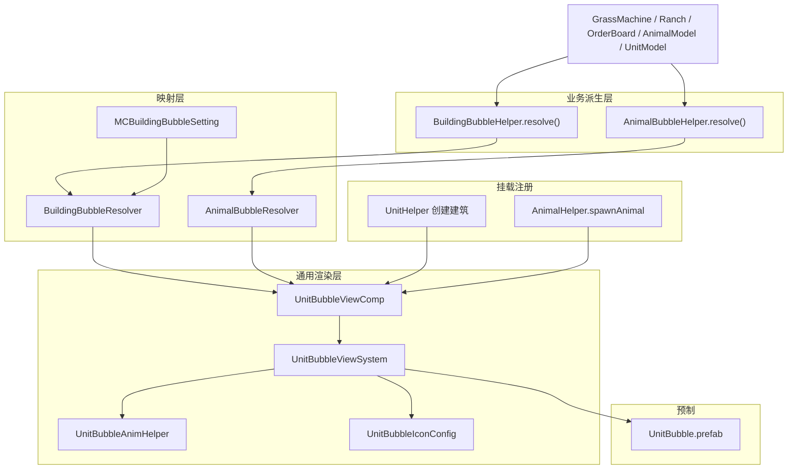

# 牧场建筑气泡 & 动物气泡 功能文档

> **模块定位**：牧场场景内 Unit 头顶状态提示系统。建筑与动物共用一套 **UnitBubble** 渲染管线，业务状态由各自的 Helper 派生，经 Resolver 映射为图标 / 文本 / 红点。
>
> **核心原则**：气泡**纯展示**，无 Button / 点击事件；玩家交互走 Unit 手势系统（建筑 Tap）或 Animal 节点 TOUCH_END（动物 Tap）。
>
> **最后整理**：2026-09-24

---

## 目录

1. [功能概览](#1-功能概览)
2. [架构与分层](#2-架构与分层)
3. [目录与文件清单](#3-目录与文件清单)
4. [状态枚举与优先级](#4-状态枚举与优先级)
5. [渲染管线](#5-渲染管线)
6. [数据来源与刷新触发](#6-数据来源与刷新触发)
7. [聚焦态切换规则](#7-聚焦态切换规则)
8. [用户点击与交互链路](#8-用户点击与交互链路)
9. [与各业务模块集成](#9-与各业务模块集成)
10. [资源与预制体](#10-资源与预制体)
11. [显示开关与压制规则](#11-显示开关与压制规则)
12. [易混淆的「气泡」概念](#12-易混淆的气泡概念)
13. [常见问题与调试](#13-常见问题与调试)
14. [扩展指南](#14-扩展指南)

---

## 1. 功能概览

### 1.1 建筑气泡（Building Bubble）

挂在**建筑 Unit** 头顶，汇总该建筑的待办状态。同一建筑**只显示一个**最高优先级气泡。

| 状态 | 适用建筑 | 图标 | 说明 |
|---|---|---|---|
| `UpgradeComplete` | 全部可升级建筑 | 竣工 ✓ | **全局最高优先级**；点击建筑领取 |
| `OrderSubmittable` | 订单栏 | 订单 + 红点 | `submittableCount` 驱动 redNum |
| `GrassExhausted` | 牧草机 | 牧草耗尽 | `FeedMachineStatus.EXHAUSTED` |
| `GrassLow` | 牧草机 | 牧草偏低 | `FeedMachineStatus.LOW` |
| `RanchCanHarvest` | 栏舍 | 可收获 | 主产物可出栏 / 副产物架可收取 |
| `RanchCanSteal` | 栏舍（客态） | 可偷取 | 副产物架可偷 |
| `RanchCanProduce` | 栏舍 | 可交付 | 有动物 `canDeliver` |
| `RanchCanClean` | 栏舍 | 可清理 | 有蚊子/便便 |

### 1.2 动物气泡（Animal Bubble）

挂在**动物实体**头顶，展示个体状态。仅当**所属栏舍处于聚焦态**时显示。

| 状态 | 图标 | 说明 |
|---|---|---|
| `CanHarvest` | 可收获 | `model.canHarvest` |
| `Delivering` | 交付中 | 图标 + Label 倒计时 |
| `Hungry` | 饥饿 | `grassBlocked` 且牧草池耗尽 |
| `CanDeliver` | 可交付 | `model.canDeliver`，可拖入产房 |

> **不在动物气泡内**：副产物「可收取 / 可偷取」挂在栏舍**交互面板** `node_product`，不从动物派生。

### 1.3 聚焦态下的职责切换

```
未聚焦栏舍 → 栏舍建筑气泡汇总全场状态（收获/偷取/生产/清理/缺草）
聚焦栏舍后 → 建筑气泡隐藏，各动物个体气泡接管
```

---

## 2. 架构与分层



### 2.1 职责划分

| 层级 | 类 | 职责 |
|---|---|---|
| **业务派生** | `BuildingBubbleHelper` / `AnimalBubbleHelper` | 从 ECS Comp 纯函数派生枚举状态 |
| **映射** | `BuildingBubbleResolver` / `AnimalBubbleResolver` | 枚举 → `UnitBubbleViewState`（iconKey / labelText / redNum） |
| **挂点** | `BuildingBubbleAnchorResolver` / `AnimalBubbleAnchorResolver` | 返回预制挂点 Node |
| **显示组件** | `UnitBubbleViewComp` | 节点引用、resolver、dirty 标记 |
| **渲染系统** | `UnitBubbleViewSystem` | 加载预制、节流刷新、动画、压制 |
| **设置** | `MCBuildingBubbleSetting` | 建筑气泡显示开关（动物不受影响） |

> **约定**：Helper / Resolver **不碰节点**；System **不做业务判定**。

---

## 3. 目录与文件清单

### 3.1 通用渲染层（本目录 `common/bubble/`）

| 文件 | 职责 |
|---|---|
| `UnitBubbleViewComp.ts` | ECS 显示组件：resolver、dirty、节点引用 |
| `UnitBubbleViewSystem.ts` | 通用渲染 System：预制加载、1s 节流、聚焦压制、动画 |
| `UnitBubbleTypes.ts` | `UnitBubbleViewState`、`UnitBubbleStateResolver`、`UnitBubbleAnchorResolver` |
| `UnitBubbleIconConfig.ts` | iconKey → 纹理路径映射 |
| `UnitBubbleAnimHelper.ts` | 出现 / 隐藏 / 换图 / idle 浮动动画 |

### 3.2 建筑气泡（`building/bubble/` + `building/util/`）

| 文件 | 职责 |
|---|---|
| `BuildingBubbleState.ts` | 建筑气泡状态枚举 |
| `BuildingBubbleHelper.ts` | 从 Comp 派生 `BuildingBubbleState` |
| `BuildingBubbleResolver.ts` | 状态 → 显示 + 读 `MCBuildingBubbleSetting` |
| `BuildingBubbleAnchorResolver.ts` | 挂点 → `BuildingRootComp.bubble` |
| `MCBuildingBubbleSetting.ts` | LocalSet 开关 + 全场刷新 |
| `BuildingRootComp.ts` | 预制内 `bubble` 挂点节点 |

### 3.3 动物气泡（`animal/bubble/` + `animal/config/` + `animal/util/`）

| 文件 | 职责 |
|---|---|
| `AnimalBubbleState.ts` | 动物气泡状态枚举 |
| `AnimalBubbleHelper.ts` | 从 `AnimalModelComp` 派生状态 |
| `AnimalBubbleResolver.ts` | 状态 → 显示（含交付倒计时 labelText） |
| `AnimalBubbleAnchorResolver.ts` | 挂点 → `AnimalViewComp.getStateAnchor()` |
| `AnimalViewComp.ts` | 聚焦时 `refreshInteract()` → bindTap + markDirty |

### 3.4 挂载与刷新触发

| 文件 | 职责 |
|---|---|
| `unit/util/UnitHelper.ts` | 建筑创建时挂 `UnitBubbleViewComp` + Building resolver |
| `animal/util/AnimalHelper.ts` | 动物生成时挂 `UnitBubbleViewComp` + Animal resolver |
| `grassmachine/util/GrassMachineDataHelper.ts` | 牧草机数据落地 → markDirty |
| `orderboard/util/OrderBoardDataHelper.ts` | 订单栏数据落地 → markDirty |
| `animal/util/RanchDataHelper.ts` | 栏舍/动物数据落地 → markStateDirty |
| `unit/util/FacilitySyncHelper.ts` | 升级态投影 → markDirty |
| `common/progress/MCTimedProgressController.ts` | 竣工 READY → markDirty；Tap 领取升级 |

### 3.5 系统注册

| 文件 | 职责 |
|---|---|
| `core/system/MCPastureSystem.ts` | 注册 `UnitBubbleViewSystem` |
| `core/view/MCBoot.ts` | `MCBuildingBubbleSetting.init()/dispose()` |

---

## 4. 状态枚举与优先级

### 4.1 BuildingBubbleState 优先级

`BuildingBubbleHelper.resolve(entity)` 判定顺序：

```
1. UpgradeComplete          ← 全局最高，压过一切业务气泡
2. 按 Comp 类型分支：
   ├─ OrderBoardModelComp   → OrderSubmittable / None
   ├─ GrassMachineModelComp → GrassExhausted > GrassLow > None
   └─ RanchModelComp        → 见下表（聚焦中返回 None）
```

**栏舍分支**（未聚焦时）：

```
RanchCanHarvest > RanchCanSteal > RanchCanProduce > RanchCanClean > None
```

栏舍聚焦判定：`RanchModelComp.tryGet(UnitFocusComp.getFocusedUnit())?.ranchInstId === ranch.ranchInstId`

### 4.2 AnimalBubbleState 优先级

`AnimalBubbleHelper.resolve(model)` 判定顺序（**前提：栏舍已聚焦**）：

```
CanHarvest > Delivering > Hungry > CanDeliver > None
```

未聚焦 → 一律 `None`。

**饥饿判定**：

```typescript
// AnimalHelper.isHungry
model.grassBlocked && AnimalHelper.isGrassPoolExhausted()
```

### 4.3 状态 → 图标映射

| BuildingBubbleState | iconKey | 特殊字段 |
|---|---|---|
| UpgradeComplete | `common.complete` | — |
| GrassExhausted | `building.grass_exhausted` | — |
| GrassLow | `building.grass_low` | — |
| RanchCanHarvest | `animal.can_harvest` | — |
| RanchCanSteal | `animal.can_steal` | — |
| RanchCanProduce | `animal.can_deliver` | — |
| RanchCanClean | `building.can_clean` | — |
| OrderSubmittable | `building.order_submittable` | `redNum = submittableCount` |

| AnimalBubbleState | iconKey | 特殊字段 |
|---|---|---|
| CanHarvest | `animal.can_harvest` | — |
| Hungry | `animal.hungry` | — |
| CanDeliver | `animal.can_deliver` | — |
| Delivering | `animal.delivering` | `labelText = 剩余秒数`、`hideBg = true`（无背景） |

---

## 5. 渲染管线

### 5.1 UnitBubbleViewState（业务 → 显示层接口）

```typescript
interface UnitBubbleViewState {
    visible: boolean;
    iconKey: string;           // UnitBubbleIconConfig 映射纹理
    labelText?: string;        // 倒计时等；有值时显示 Label 节点
    redNum?: number;           // 右上角红点；不传不驱动
    debugReason?: string;
}
```

### 5.2 刷新流程

```
数据变更
  → Comp.markDirty()                    // elapsedMs 推满，下一帧立即刷
  → UnitBubbleViewSystem.update()
      ├─ shouldSuppressVisibility()?    // 聚焦/编辑压制 → hideBubble
      ├─ ensureBubbleNode()             // 异步加载 UnitBubble.prefab
      ├─ 节流：dirty 或 elapsedMs >= 1000ms
      └─ refreshState()
          → stateResolver(entity)       // Building/Animal Resolver
          → applyLabelText / applyRedNum / applyIcon
          → UnitBubbleAnimHelper        // 出现/换图/隐藏动画
```

### 5.3 节流与立即刷新

| 机制 | 说明 |
|---|---|
| **默认节流** | `BUBBLE_REFRESH_INTERVAL_MS = 1000`（交付倒计时每秒更新） |
| **markDirty()** | 将 `elapsedMs = MAX_SAFE_INTEGER`，下一帧强制刷新 |
| **聚焦切换** | `UnitEnterFocus/ExitFocus` 等事件 → markDirty |

### 5.4 预制结构

`UnitBubble.prefab`（bundle: `mcRes`，路径: `unit/prefab/UnitBubble`）：

| 子节点 | 组件 | 用途 |
|---|---|---|
| `Icon` | Sprite | 状态图标 |
| `Label` | Label | 倒计时 / 数量（默认隐藏） |
| `RedPointComp` | RedPointComp | 右上角红点 |

动画：`unit/anim/anim_unit_bubble.anim`（idle 浮动）

### 5.5 挂点约定

| 类型 | 挂点来源 | 说明 |
|---|---|---|
| **建筑** | `BuildingRootComp.bubble` | 预制编辑器绑定，无运行时遍历 |
| **动物** | `AnimalViewComp.getStateAnchor()` | 与 Body 同级，不受翻转影响 |

---

## 6. 数据来源与刷新触发

### 6.1 建筑气泡数据链

```
UnitModelComp + MCBuildingRepository
  └─ upgradeState / upgradeEndTime → UpgradeComplete

OrderBoardModelComp
  └─ submittableCount → OrderSubmittable (+ redNum)

GrassMachineModelComp
  └─ status (FeedMachineStatus) → GrassExhausted / GrassLow

RanchModelComp
  ├─ hasCollectableShelf() / animal.canHarvest → RanchCanHarvest
  ├─ hasStealableShelf() → RanchCanSteal
  ├─ animal.canDeliver → RanchCanProduce
  └─ hasCleanableHazards(gid) → RanchCanClean

UnitFocusComp.getFocusedUnit() → 栏舍聚焦时建筑气泡 None
```

### 6.2 动物气泡数据链

```
AnimalModelComp
  ├─ canHarvest → CanHarvest
  ├─ deliveringUntilMs → Delivering (+ labelText)
  ├─ grassBlocked + 牧草池耗尽 → Hungry
  └─ canDeliver → CanDeliver

RanchModelComp.grassEmptyAtMs / grassAmount ← RanchDataHelper
UnitFocusComp ← 聚焦事件 → AnimalViewComp.refreshInteract()
```

### 6.3 markDirty 调用点汇总

| 触发源 | 文件 / 方法 |
|---|---|
| 栏舍/动物数据落地 | `RanchDataHelper.markStateDirty()` |
| 牧草机数据 | `GrassMachineDataHelper.applyFacilityGrass/applyDetail` |
| 订单栏数据 | `OrderBoardDataHelper.applyFacilityOrderBoard/applySummary` |
| 升级态投影 | `FacilitySyncHelper.syncUnitUpgradeProjection` |
| 升级竣工 READY | `MCTimedProgressController.promoteLocalReadyIfDue` |
| 聚焦/编辑切换 | `UnitBubbleViewSystem` 监听 UnitEvent |
| 动物聚焦切换 | `AnimalViewComp.refreshInteract()` |
| 设置开关变更 | `MCBuildingBubbleSetting.refreshAllBuildingBubbles()` |
| 动物生成 | `AnimalHelper.spawnAnimal()` |
| 建筑创建 | `UnitHelper` entityEnter → markDirty |

---

## 7. 聚焦态切换规则

```mermaid
stateDiagram-v2
    [*] --> Unfocused: 进入牧场
    Unfocused --> RanchFocused: 点击栏舍 → enterFocus
    RanchFocused --> Unfocused: 退出聚焦

    state Unfocused {
        note right of Unfocused
            栏舍建筑气泡：汇总状态
            动物气泡：全部隐藏
        end note
    }

    state RanchFocused {
        note right of RanchFocused
            栏舍建筑气泡：None（让位）
            动物气泡：按个体状态显示
        end note
    }
```

### 7.1 建筑气泡压制（UnitBubbleViewSystem）

| 条件 | 建筑气泡 | 动物气泡 |
|---|---|---|
| 任意建筑聚焦中 | **隐藏** | resolver 自行控制（聚焦栏舍内显示） |
| 建筑编辑模式 | **隐藏** | 不受影响 |
| `MCBuildingBubbleSetting.isVisible() == false` | **隐藏**（UpgradeComplete 除外） | 不受影响 |

---

## 8. 用户点击与交互链路

> 气泡本身**无点击处理器**。玩家点击的是 Unit / Animal 实体。

### 8.1 建筑点击

```
TileMapTouchEvent
  → UnitGestureCentralController（菱形反查归属 unit）
  → UnitEvent.UnitTap（多监听者并行）

分支 A — 升级竣工领取（MCTimedProgressController.onUnitTap）：
  若 isBuildingUpgradeClaimable → FacilitySyncHelper.completeUpgrade()
  → 刷新建筑 + 打开 BuildingUpgradeSuccess
  → 气泡 UpgradeComplete 消失

分支 B — 聚焦/开面板（UnitFocusSystem.onUnitTap）：
  若 UpgradeComplete → return（已由分支 A 处理）
  按 UNIT_INTERACT_MAP：
    ├─ 牧草机 → MCAddGrassUI（OpenPanel，不聚焦）
    ├─ 订单栏 → MCOrderBoard + Focus
    └─ 栏舍 → MCPastureInteractPanel + Focus
  → UnitEnterFocus → 建筑气泡隐藏，动物 refreshInteract
```

### 8.2 动物点击（仅栏舍聚焦时）

```
点击动物本体：
AnimalViewComp.bindTap()（聚焦时才绑定 TOUCH_END）
  → AnimalEvent.AnimalTap
  → MCPastureInteractPanel.onAnimalTap
  → toggleAnimal 选中 + 打开 AnimalDetailsTipsUI（PopUp 详情面板）

点击动物气泡：
UnitBubbleViewSystem 绑在气泡节点上的 TOUCH_END
  → UnitBubbleViewComp.tapHandler（由 AnimalSpawnSystem 注入）
  → AnimalBubbleTapHelper.onBubbleTap（实时重派生状态，可收获/可交付才继续）
  → op 框架完整模板（校验 / 协议 / 在途去重 / 特效 + 奖励飞行统一处理）
     ├─ 可收获 → MCPastureHarvestAnimalPickedOp
     │            （HarvestRanch op=PICKED 点名单只出栏，产出架不动）
     └─ 可交付 → MCPastureTriggerProduceOp（单只开轮生产）
```

气泡触摸分两种情况：有 tapHandler（动物气泡）时阻断冒泡——气泡是实体
视图的子节点，不阻断会冒泡到动物根节点同时触发 AnimalTap；无 tapHandler
（建筑气泡）时 preventSwallow 放行触摸，下层建筑手势不受遮挡影响；
监听随气泡节点销毁自动释放。

### 8.3 与气泡状态的对应操作

| 气泡状态 | 用户操作路径 |
|---|---|
| UpgradeComplete | 点击建筑或气泡 → 领取竣工 |
| GrassExhausted/Low | 点击牧草机或气泡 → MCAddGrassUI |
| OrderSubmittable | 点击订单栏 → MCOrderBoard |
| RanchCanHarvest 等 | 点击栏舍 → 聚焦 → 交互面板操作 |
| CanHarvest | 点击动物气泡 → 单只出栏（op=PICKED） |
| CanDeliver | 点击动物气泡 → 该动物单只开轮生产 |
| Delivering | 无操作（倒计时态） |

建筑气泡点击由 BuildingBubbleTapHelper 转发 UnitEvent.UnitTap，
等价于点击建筑本体（竣工领取 / 打开面板 / 客态门控均复用本体点击路径）；
注入点在 UnitHelper.attachCompsByType，所有挂气泡的建筑统一注入。

---

## 9. 与各业务模块集成

### 9.1 牧草机

- **数据**：`GrassMachineModelComp.status`
- **气泡**：`GrassExhausted` / `GrassLow`
- **刷新**：`GrassMachineDataHelper` → markDirty
- **操作**：点击 → `MCAddGrassUI`
- 详见：[牧场牧草机.md](./牧场牧草机.md)

### 9.2 栏舍 / 动物

- **未聚焦**：建筑气泡汇总（收获/偷取/生产/清理/缺草）
- **聚焦后**：动物个体气泡（收获/交付/饥饿/交付中）
- **副产物**：交互面板 `node_product`，非气泡
- **刷新**：`RanchDataHelper.applyRanches` → markStateDirty
- **操作**：聚焦 → `MCPastureInteractPanel`；动物 Tap → `AnimalDetailsTipsUI`
- 详见：[栏舍动物交互.md](./栏舍动物交互.md)

### 9.3 订单栏

- **数据**：`OrderBoardModelComp.submittableCount`
- **气泡**：`OrderSubmittable` + redNum
- **刷新**：`OrderBoardDataHelper` → markDirty
- **操作**：点击 → Focus + `MCOrderBoard`

### 9.4 建筑升级

- **数据**：`MCBuildingRepository` + `UnitModelComp.upgradeState/upgradeEndTime`
- **判定**：`MCTimedProgressService.isBuildingUpgradeClaimable()`
- **气泡**：`UpgradeComplete`（**不受显示开关限制**）
- **进行中**：走 `MCTimedProgressController` 进度条 HUD
- **竣工可领**：进度条消失，改走头顶气泡
- **点击**：`MCTimedProgressController.onUnitTap` → `completeUpgrade()`
- 详见：[建筑升级地块解锁与加速.md](./建筑升级地块解锁与加速.md)

### 9.5 收获

| 场景 | 气泡 | 操作入口 |
|---|---|---|
| 未聚焦栏舍 | `RanchCanHarvest`（建筑级） | 点击栏舍 → 面板一键/单项收获 |
| 聚焦栏舍 | `CanHarvest`（动物级） | 点击动物 / 拖拽 / 面板操作 |
| RPC 回执 | — | `RanchDataHelper` 刷新 → markStateDirty |

---

## 10. 资源与预制体

### 10.1 预制与动画

| 路径 | 用途 |
|---|---|
| `mcRes/unit/prefab/UnitBubble.prefab` | 通用头顶气泡 |
| `mcRes/unit/anim/anim_unit_bubble.anim` | idle 浮动 |

### 10.2 图标纹理（`mcRes/res/texture/bubble/`）

| 文件 | iconKey |
|---|---|
| `icon_bubble_harvest.png` | `animal.can_harvest` |
| `icon_bubble_hungry.png` | `animal.hungry` |
| `icon_bubble_deliver.png` | `animal.can_deliver` |
| `icon_bubble_delivering.png` | `animal.delivering` |
| `icon_bubble_steal.png` | `animal.can_steal` |
| `icon_bubble_collect.png` | `animal.can_collect` |
| `icon_bubble_grass_exhausted.png` | `building.grass_exhausted` |
| `icon_bubble_grass_low.png` | `building.grass_low` |
| `icon_bubble_clear.png` | `building.can_clean` |
| `icon_bubble_order.png` | `building.order_submittable` |
| `icon_bubble_complete.png` | `common.complete` |
| `icon_bubble_bg.png` | 背景 |

映射定义：`UnitBubbleIconConfig.ts` → `getUnitBubbleIconPath(iconKey)`

---

## 11. 显示开关与压制规则

### 11.1 MCBuildingBubbleSetting

- 读取主包 `LocalSetManager.getMcBuildingBubbleVisible()`
- 监听 `GameEvent.McBuildingBubbleVisibilityChanged`
- 切换后立即 `refreshAllBuildingBubbles()`（遍历场景 Unit markDirty）
- **`UpgradeComplete` 不受开关影响**（`BuildingBubbleResolver` 内判断）

### 11.2 动物气泡

- **无**独立显示开关
- 仅由「栏舍是否聚焦」+ 个体状态决定

---

## 12. 易混淆的「气泡」概念

| 名称 | 类型 | 路径 | 说明 |
|---|---|---|---|
| **UnitBubble** | 场景头顶状态 | 本文档 | 建筑/动物共用，纯展示 |
| **AnimalDetailsTipsUI** | PopUp 详情面板 | `gui/animalinteractive/` | 点击动物后弹出，**不是**头顶气泡 |
| **RegionCompleteBubbleHelper** | 地块解锁竣工 | `scene/tilemap/util/` | 复用 UnitBubble 预制 + `common.complete` |
| **AnimalLabBubble.prefab** | 动物实验室 GUI | `gui/prefab/animalLab/` | 独立 GUI 气泡 |
| **MCPastureMachineDetail(10014)** | 历史命名 | 复用仓库 UI | 与气泡无关 |

---

## 13. 常见问题与调试

### 13.1 气泡不显示

1. 查 `UnitBubbleViewComp` 是否挂载（建筑：`UnitHelper`；动物：`AnimalHelper.spawnAnimal`）
2. 查挂点：`BuildingRootComp.bubble` 或 `AnimalViewComp.getStateAnchor()` 是否有效
3. 查 `stateResolver` 返回 `visible: false`
4. 建筑：是否被聚焦压制 / 编辑模式 / 显示开关关闭
5. 动物：栏舍是否处于聚焦态
6. 查预制加载日志：`[UnitBubbleView] 预制加载失败`

### 13.2 气泡状态不对

1. 查对应 ModelComp 数据是否已落地（RanchDataHelper / GrassMachineDataHelper 等）
2. 查是否调用了 `markDirty()`（否则最多等 1s 节流）
3. 栏舍：未聚焦看 `BuildingBubbleHelper.resolveRanch`；聚焦看 `AnimalBubbleHelper.resolve`

### 13.3 聚焦后建筑气泡仍显示

- 栏舍聚焦判定：`focused.ranchInstId === ranch.ranchInstId`
- 非栏舍建筑（牧草机/订单栏）在任意聚焦时都会被 `shouldSuppressVisibility` 隐藏

### 13.4 升级竣工气泡点击无反应

- 领取由 `MCTimedProgressController.onUnitTap` 处理，需 `isAtSelfHome()`
- `UnitFocusSystem` 对 UpgradeComplete 会 return，不重复开面板

### 13.5 调试日志关键字

```
[UnitBubbleView] 预制加载失败 / 图标加载失败 / 未配置图标路径
[BuildingBubbleAnchorResolver] bubble 未赋值
[BuildingBubbleHelper] / [AnimalBubbleHelper]（业务层一般无日志，可在 resolve 加断点）
[MCTimedProgress] promoteLocalReadyIfDue
```

---

## 14. 扩展指南

### 14.1 新增建筑气泡状态

1. 在 `BuildingBubbleState` 增加枚举值
2. 在 `BuildingBubbleHelper.resolve()` 对应分支加入判定逻辑
3. 在 `BuildingBubbleIconConfig` 增加 iconKey + 纹理
4. 在 `BuildingBubbleResolver` 增加 case 映射
5. 确保数据落地处调用 `UnitBubbleViewComp.markDirty()`

### 14.2 新增动物气泡状态

1. 在 `AnimalBubbleState` 增加枚举值
2. 在 `AnimalBubbleHelper.resolve()` 按优先级插入
3. 配置 iconKey + `AnimalBubbleResolver` case
4. 若需倒计时，在 Resolver 中填 `labelText`

### 14.3 新增可气泡建筑类型

1. 创建 Unit 时在 `UnitHelper` 确保挂 `UnitBubbleViewComp` + Building resolver
2. 建筑预制 `BuildingRootComp.bubble` 挂点必须赋值
3. 在 `BuildingBubbleHelper.resolve()` 增加 Comp 类型分支

### 14.4 原则

- **不改 UnitBubbleViewSystem 业务逻辑**；新状态走 Helper + Resolver
- 气泡可点击：通用层（UnitBubbleViewSystem）只做触摸监听与回调派发，
  具体行为由挂载方注入 `UnitBubbleViewComp.tapHandler`（与 resolver 同款注入模式），
  动物侧入口收敛在 AnimalBubbleTapHelper；本体手势交互保留
- 副产物/复杂列表走交互面板，不走头顶气泡

---

## 附录：核心类速查

```typescript
// 业务派生
BuildingBubbleHelper.resolve(entity: ecs.Entity): BuildingBubbleState
AnimalBubbleHelper.resolve(model: AnimalModelComp): AnimalBubbleState
AnimalBubbleHelper.isRanchFocused(model: AnimalModelComp): boolean
AnimalHelper.isHungry(model): boolean

// 映射
BuildingBubbleResolver.resolve(entity): UnitBubbleViewState
AnimalBubbleResolver.resolve(entity): UnitBubbleViewState

// 点击
AnimalBubbleTapHelper.onBubbleTap(entity) — 动物气泡点击分派（CanHarvest 出栏 / CanDeliver 开轮）
UnitBubbleViewComp.tapHandler — 点击回调注入位（动物侧由 AnimalSpawnSystem 注入）

// 挂点
BuildingBubbleAnchorResolver.resolve(entity): Node | null
AnimalBubbleAnchorResolver.resolve(entity): Node | null

// 显示层
UnitBubbleViewComp.markDirty()
UnitBubbleViewSystem — 注册于 MCPastureSystem

// 设置
MCBuildingBubbleSetting.isVisible()
MCBuildingBubbleSetting.refreshAllBuildingBubbles()

// 常量
UNIT_BUBBLE_PREFAB_PATH = "unit/prefab/UnitBubble"
BUBBLE_REFRESH_INTERVAL_MS = 1000
```

---

## 附录：类关系总图

```
                    MCPastureSystem
                          │
                          ▼
                 UnitBubbleViewSystem
                    │ throttle 1s
                    │ suppress focus/edit
                    ▼
            UnitBubbleViewComp ◄──── markDirty()
                    │
         stateResolver │ anchorResolver
              │                │
    ┌─────────┴──┐      ┌─────┴──────┐
    ▼            ▼      ▼            ▼
Building     Animal  Building    Animal
Resolver     Resolver Anchor     Anchor
    │            │   Resolver    Resolver
    ▼            ▼
Building     Animal
Helper       Helper
    │            │
    ▼            ▼
ModelComps   AnimalModelComp
             RanchModelComp
                    │
                    ▼
            UnitBubble.prefab (mcRes)
```
