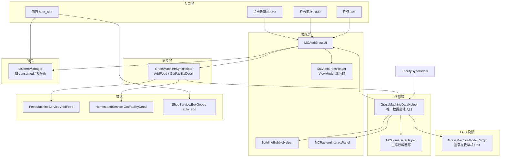
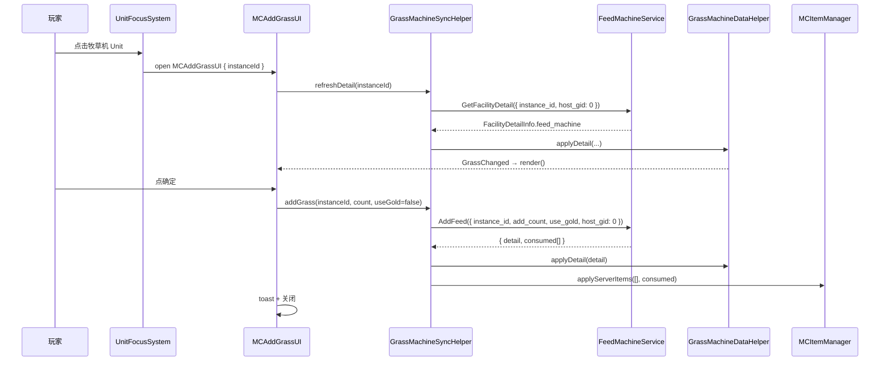

# 牧场牧草机（MC Grass Machine）功能文档

> **模块定位**：牧场全局牧草存储与消耗设施。玩家向牧草机投入「牧草」道具，供全场动物消耗；是栏舍「缺草」状态的根源供给。
>
> **命名约定**：协议层仍称 `FeedMachine` / `FeedMachineService`（homesteadpb）；客户端业务统一称 **GrassMachine** / **牧草机**。
>
> **最后整理**：2026-09-24

---

## 目录

1. [功能概览](#1-功能概览)
2. [架构与分层](#2-架构与分层)
3. [目录与文件清单](#3-目录与文件清单)
4. [UI 注册与预制体](#4-ui-注册与预制体)
5. [数据模型](#5-数据模型)
6. [网络协议与 RPC](#6-网络协议与-rpc)
7. [完整链路（时序）](#7-完整链路时序)
8. [事件总线](#8-事件总线)
9. [业务规则](#9-业务规则)
10. [配置表](#10-配置表)
11. [外部联动](#11-外部联动)
12. [与相关系统的边界](#12-与相关系统的边界)
13. [常见问题与调试](#13-常见问题与调试)
14. [扩展指南](#14-扩展指南)

---

## 1. 功能概览

### 1.1 玩家可见能力

| 能力 | 说明 |
|---|---|
| **添加牧草（主态）** | 从仓库消耗牧草道具，投入自家牧草机 |
| **赠送牧草（客态）** | 在好友家向好友牧草机赠送牧草（仓库有草用草，无草用金币） |
| **容量与进度** | 弹窗展示 `当前/上限` 进度条；拟添加量深绿闪烁预览 |
| **预计可用时间** | 读协议 `remaining_secs`；`-1`=充足，`0`=永不耗尽，>0=倒计时 |
| **升级牧草机** | 主态非满级时弹窗内「升级」→ `MCBuildingLevelUp` |
| **去商店买草** | 主态仓库无草时，确定按钮变「去商店」 |
| **栏舍 HUD** | 栏舍交互面板左下角展示牧草机等级图标 + 剩余时间条 |
| **建筑气泡** | 牧草耗尽 / 即将耗尽时在场景建筑上显示气泡 |
| **商店 auto_add** | 购买饲料勾选「自动添加到牧草机」，服务端直投（不经 AddFeed） |

### 1.2 入口

| 入口 | 代码位置 | 说明 |
|---|---|---|
| **点击场景牧草机** | `UnitInteractType` → `OpenPanel` → `MCAddGrassUI` | **主入口** |
| **栏舍面板左下角** | `MCPastureGrassMachineEntry.onClickMachine()`（MCGrassEntry.prefab Button 绑定） | 快捷打开同一弹窗 |
| **任务跳转** | `MCTaskManager` → `ADD_ANIMAL_FEED_SELF(108)` | 聚焦并打开牧草机面板 |
| **商店 Empty 模式** | `MCAddGrassUI` → `goShop` | 跳转饲料商店 |

### 1.3 投草路径对比

| 路径 | 触发 | 客户端 RPC | 道具来源 |
|---|---|---|---|
| **手动添加** | 点击牧草机 → 确定 | `AddFeed` | 仓库牧草道具 |
| **客态金币赠送** | 好友家无草 → 确定 | `AddFeed(use_gold=true)` | 访客金币 |
| **商店 auto_add** | 购买饲料勾选自动添加 | **无**（`BuyGoods.auto_add=true`） | 商店扣费，服务端直投 |

> 仓库**没有**「直接使用牧草到牧草机」的 Use 流程；唯一手动入口是点击建筑或栏舍 HUD。

---

## 2. 架构与分层



### 2.1 职责划分（重要）

| 层级 | 类 | 职责 |
|---|---|---|
| **RPC 封装** | `GrassMachineSyncHelper` | 唯一打 `AddFeed` / `GetFacilityDetail` 的入口；防并发 `_pending` |
| **数据落地** | `GrassMachineDataHelper` | 协议 → Comp → 事件；主态回写 `MCHomeDataComp` |
| **ECS 投影** | `GrassMachineModelComp` | 纯数据，挂牧草机 Unit |
| **UI ViewModel** | `MCAddGrassHelper` | 模式判定 / 数量边界 / 文案（纯函数，不发 RPC） |
| **UI 表现** | `MCAddGrassUI` | 弹窗渲染、进度条、确认提交 |
| **背包扣减** | `MCItemManager` | `AddFeed` 成功后 `applyServerItems([], consumed)` |

> **约定**：交互层**不直接改 Comp**；只发 RPC，等回执由 `GrassMachineDataHelper.applyDetail` 覆盖。

---

## 3. 目录与文件清单

### 3.1 核心模块（本目录 `scene/grassmachine/`）

```
scene/grassmachine/
├── config/
│   └── GrassMachineEvent.ts           # GrassChanged 事件
├── model/
│   └── GrassMachineModelComp.ts       # ECS 投影组件
└── util/
    ├── GrassMachineDataHelper.ts      # 唯一数据落地入口
    └── GrassMachineSyncHelper.ts      # RPC 封装
```

### 3.2 UI 层（`gui/grassmachine/`）

```
gui/grassmachine/
├── MCAddGrassUI.ts                    # 添加/赠送牧草弹窗
└── helper/
    └── MCAddGrassHelper.ts            # ViewModel 纯函数 + MC_GRASS_ITEM_ID
```

### 3.3 场景集成

| 路径 | 职责 |
|---|---|
| `scene/unit/util/UnitHelper.ts` | 创建 `MODULE_TYPE_FEED_MACHINE` Unit 时 `add(GrassMachineModelComp)` |
| `scene/unit/config/UnitInteractType.ts` | 点击牧草机 → `OpenPanel` → `MCAddGrassUI` |
| `scene/unit/config/UnitConfig.ts` | `isGrassMachineFacility()` / `getFacilityCapacity()` |
| `scene/unit/util/FacilitySyncHelper.ts` | 设施同步 → `GrassMachineDataHelper.applyFacilityGrass` |
| `scene/unit/util/FacilityNotifyHelper.ts` | 设施推送落地（含牧草机升级） |
| `scene/unit/bll/UnitFocusSystem.ts` | `OpenPanel` 打开二级面板并传 `instanceId` |
| `scene/unit/util/UnitFocusNavigateHelper.ts` | 任务聚焦并打开面板 |
| `scene/pasture/view/pasture-panel/MCPastureGrassMachineEntry.ts` | 栏舍左下角牧草机 HUD + 点击入口（挂 node_grassmachine） |
| `scene/building/util/BuildingBubbleHelper.ts` | 牧草耗尽/低量气泡 |
| `scene/building/bubble/BuildingBubbleState.ts` | `GrassExhausted` / `GrassLow` 枚举 |
| `core/util/MCHomeDataHelper.ts` | 主态 `updateFacilityGrass()` 权威回写 |
| `core/util/MCWorldEnterHelper.ts` | 家园切换 → `GrassMachineDataHelper.bumpEpoch()` |

### 3.4 协议 / 服务

| 路径 | 职责 |
|---|---|
| `service/index.ts` | `mcGrassMachineService = FeedMachineServiceClientImpl` |
| `service/protocol/.../homesteadpb/homestead.ts` | `FeedMachineDetail` / `AddFeed` / `FeedMachineService` |
| `service/protocol/.../animalpb/animal.ts` | `GrassInfo`（栏舍牧草池只读投影） |

### 3.5 资源

| 路径 | 内容 |
|---|---|
| `mcRes/gui/prefab/grassmachine/MCAddGrassUI.prefab` | 添加牧草弹窗 |
| `mcRes/unit/prefab/buildings/GrassMachine_1~3.prefab` | 三级牧草机场景预制 |
| `mcRes/res/texture/building/GrassMachine/` | 建筑贴图 |
| `mcRes/res/texture/bubble/icon_bubble_grass_*.png` | 耗尽/低量气泡图标 |

---

## 4. UI 注册与预制体

| UIID | 枚举值 | Prefab | 脚本 |
|---|---|---|---|
| `MCAddGrassUI` | **10016** | `gui/prefab/grassmachine/MCAddGrassUI` | `MCAddGrassUI.ts` |

注册于 `script/mc/MCUIConfig.ts`（bundle: `mcRes`，Layer: PopUp + mask）。

### 4.1 打开参数

```typescript
interface IMCAddGrassUIArgs {
    unitId?: number;       // 本地 Unit id
    configId?: number;     // 设施配置 id
    instanceId?: number;   // 后台实例 id（必填，业务权威）
}
```

由 `UnitFocusSystem.openSecondaryPanel` 或栏舍面板传入。

### 4.2 MCAddGrassUI 主要节点

| 节点 | 用途 |
|---|---|
| `txtCapacityVal` | 存量文案 `cur/cap` |
| `imgCapacityBar` | 当前存量条（浅绿） |
| `imgCapacityAddBar` | 拟添加量条（深绿闪烁） |
| `txtTime` | 预计可用时间 |
| `txtItemNum` | 仓库拥有牧草数 |
| `numComp` | 数量滑条 |
| `nodeTips` / `txtTips` | 状态提示（空/满/住满） |
| `nodeCost` | 客态金币消耗行 |
| `btnUpgrade` | 升级入口（主态非满级） |
| `btnSure` | 确定 / 去商店 |

---

## 5. 数据模型

### 5.1 GrassMachineModelComp（ECS 投影）

挂载在牧草机 Unit 上，纯数据组件：

| 字段 | 来源 | 说明 |
|---|---|---|
| `instanceId` | FacilityInfo | 后台设施实例 id |
| `grassCount` | `FeedMachineDetail.feed_count` | 当前牧草存量 |
| `capacity` | FacilityInfo.capacity / 配置表 | 存量上限 |
| `consumeRate` | `FeedMachineDetail.consume_rate` | 消耗速率 |
| `remainingSecs` | `FeedMachineDetail.remaining_secs` | **-1**=未养殖/充足，**0**=永不耗尽，**>0**=剩余秒数 |
| `status` | `FeedMachineDetail.status` | 枚举见下 |
| `facilityLevel` | FacilityInfo.level | 设施等级 |
| `facilityConfigId` | FacilityInfo.facility_id | 配置 id（7001001~7001003） |
| `hostGid` | 当前画面归属 | **0**=自己，**>0**=好友 |
| `revision` | 本地 | 每次写入 +1 |

### 5.2 FeedMachineStatus（协议枚举）

| 值 | 枚举 | 含义 | 气泡 |
|---|---|---|---|
| 0 | `UNKNOWN` | 未知 | 无 |
| 1 | `EXHAUSTED` | 牧草耗尽 | `GrassExhausted` |
| 2 | `LOW` | 即将耗尽 | `GrassLow` |
| 3 | `SUFFICIENT` | 充足 | 无 |

### 5.3 MCAddGrassMode（弹窗模式）

| 模式 | 条件 | UI 行为 |
|---|---|---|
| `Normal` | 有草且未满 | 滑条添加/赠送，确定可用 |
| `Empty` | 主态无草且未满 | 提示去商店，按钮「去商店」 |
| `Full` | 已满 | 提示已满/无法赠送，确定禁用 |
| `GuestBuyGold` | 客态无草且未满 | 滑条 + 金币消耗行，`use_gold=true` |

ViewModel 由 `MCAddGrassHelper.build(instanceId)` 组装。

### 5.4 主客态与纪元号

| 规则 | 说明 |
|---|---|
| **主态** `hostGid=0` | 可回写 `MCHomeDataComp.updateFacilityGrass()`；可升级 |
| **客态** `hostGid>0` | 只刷当前画面渲染；`AddFeed.host_gid` 必传主人 gid |
| **纪元号 `_epoch`** | 家园切换时 `bumpEpoch()`；过期 RPC 回包丢弃 |

---

## 6. 网络协议与 RPC

### 6.1 服务定义

| 服务 | 客户端实例 | RPC |
|---|---|---|
| `gamepb.homesteadpb.FeedMachineService` | `mcGrassMachineService` | `AddFeed` |
| `gamepb.homesteadpb.HomesteadService` | `mcHomeService` | `GetFacilityDetail` |

### 6.2 AddFeed（投草唯一 RPC）

**Request**：

```typescript
interface AddFeedRequest {
    instance_id: number;   // 牧草机实例 id
    add_count: number;     // 添加数量（>0；协议注释 0=自动填满，客户端始终传明确数量）
    use_gold: boolean;     // 仓库不足时是否用金币补齐
    host_gid: number;      // 0=自己；非0=访客添加到指定主人牧草机
}
```

**Reply**：

```typescript
interface AddFeedReply {
    detail?: FeedMachineDetail;  // 更新后的牧草机详情
    consumed: Item[];              // 实际消耗的道具（牧草或金币）
}
```

**FeedMachineDetail**：

```typescript
interface FeedMachineDetail {
    feed_count: number;       // 当前牧草数量（从 animal GrassPool 实时获取）
    consume_rate: number;     // 消耗速率（颗/天），0=无消耗
    remaining_secs: number;   // 预计剩余秒数；注意客户端 -1 语义见 Comp 注释
    is_owner: boolean;        // 当前请求者是否为主人
    status: FeedMachineStatus;
}
```

### 6.3 GetFacilityDetail（打开弹窗刷新）

**Request**：`{ instance_id, host_gid }`（0=自己，非0=访客查好友）

**Reply**：`FacilityDetailInfo` 含 `feed_machine`、`capacity`、`level`、`facility_id`

打开弹窗时调用，因存量会随时间消耗，需拉最新详情。

### 6.4 被动下发（FacilityInfo.feed_machine）

以下路径携带 `FacilityInfo.feed_machine`，由 `GrassMachineDataHelper.applyFacilityGrass` 落地：

- 登录 `AllCells` 全量
- `FacilityNotify` 增量推送
- `FacilitySyncHelper.applyServerFacility`

### 6.5 栏舍牧草池（GrassInfo — 只读）

`animalpb.GrassInfo` 投影在 `RanchModelComp`，字段：

```typescript
interface GrassInfo {
    amount: number;        // 储量（牧草颗数）
    empty_at_ms: number;   // 耗尽墙钟毫秒（0=无消耗）
}
```

协议注释：**投草入口在 FeedMachineService.AddFeed**，不是栏舍 RPC。栏舍面板 HUD 会结合 `GrassInfo.empty_at_ms` 与 `FeedMachineDetail.remaining_secs` 展示倒计时。

### 6.6 防并发与过期回包

| 机制 | 说明 |
|---|---|
| `_pending Set` | 同一 `instanceId` 的 `AddFeed` 在途时跳过重复请求 |
| `_epoch` | 家园切换递增；`applyDetail` 校验 epoch + hostGid |
| `generation` | `MCAddGrassUI` 异步代次，丢弃过期 render |

---

## 7. 完整链路（时序）

### 7.1 点击场景牧草机 → 添加牧草（主态）



### 7.2 栏舍面板快捷入口

```
MCPastureGrassMachineEntry.onClickMachine()
  → 查 MODULE_TYPE_FEED_MACHINE 第一个 Unit
  → oops.gui.open(MCAddGrassUI, { instanceId, unitId, configId })
  → 后续同 7.1
```

### 7.3 客态赠送牧草（好友家）

```
watchGid > 0
  → MCAddGrassMode.GuestBuyGold（仓库无草时）
  → addGrass(instanceId, count, useGold=true)
  → AddFeedRequest.host_gid = watchGid
  → 扣访客金币；服务端 SS 转发到主人 Actor
  → toast「本次赠送{n}牧草进入{好友名}的牧草机」
```

### 7.4 商店购买 auto_add

```
MCShopBuy 勾选「自动添加到牧草机」
  → MCShopManager.buy(..., autoAdd=true)
  → shopService.BuyGoods({ auto_add: true })
  ← 服务端直接将饲料放入牧草机
  → MCItemManager.applyServerItems(get_items, cost_items)
  → 客户端不调 AddFeed；靠 FacilityNotify / 下次打开刷新 Comp
```

规则定义：`MCShopAutoAddConfig.ts` → `feed_to_grass_machine`，匹配 `MCItemType.Feed`。

### 7.5 主态仓库无草 → 去商店

```
MCAddGrassMode.Empty
  → btnSure 文案「去商店」
  → onClickSure: close → open MCShop { categoryId: Feed }
```

### 7.6 登录 / 设施同步（被动）

```
AllCells / FacilityNotify
  → FacilitySyncHelper.applyServerFacility(unit, facility)
  → GrassMachineDataHelper.applyFacilityGrass(unit, facility)
  → writeComp + (主态) MCHomeDataHelper.updateFacilityGrass
  → GrassMachineEvent.GrassChanged
  → BuildingBubbleHelper / MCPastureGrassMachineEntry / MCAddGrassUI 刷新
```

### 7.7 任务跳转（条件 108）

```
MCTaskManager → ADD_ANIMAL_FEED_SELF
  → UnitFocusNavigateHelper.focusAndOpenByType(MODULE_TYPE_FEED_MACHINE)
  → 聚焦牧草机 + 打开 MCAddGrassUI
```

> 条件 `GIFT_ANIMAL_FEED_FRIEND(122)` 已在 `mcConfigEnumDef` 定义，**任务跳转 handler 尚未接入**（需客态拜访好友后打开赠送弹窗）。

---

## 8. 事件总线

### 8.1 GrassMachineEvent

| 事件 | 常量 | Payload | 订阅者 |
|---|---|---|---|
| `GrassChanged` | `"MCGrassMachineChanged"` | `instanceId, hostGid` | `MCAddGrassUI`, `MCPastureGrassMachineEntry` |

派发时机：`applyFacilityGrass` / `applyDetail` 写入 Comp 后。

### 8.2 关联事件（非本模块派发）

| 事件 | 来源 | 与牧草机关系 |
|---|---|---|
| `AnimalEvent.GrassChanged` | 栏舍牧草池 | 栏舍 HUD 倒计时联动 |
| `MCItemEvent.ItemsChanged` | 背包变更 | 弹窗刷新拥有数量 |
| `MCWorldEventMessage.MC_HOST_AT_HOME_CHANGED` | 家园切换 | 触发 `bumpEpoch` |

---

## 9. 业务规则

### 9.1 添加数量边界

**主态 Normal**：

```
addMax = min(仓库拥有量, 剩余容量)
defaultNum = addMax（默认加满）
```

**客态 Normal**：

```
addMax = min(仓库拥有量, 剩余容量)
defaultNum = 1
```

**客态 GuestBuyGold**：

```
addMax = 剩余容量
defaultNum = 1
useGold = true
单价 = MCGoods(Feed商店) 中牧草 item 的 price_count / item_count
```

### 9.2 进度条展示

- 浅绿条 = 当前存量占比
- 深绿条 = `(当前 + 拟添加) / 容量`，有拟添加量时闪烁
- 存量为 0 时 `txtCapacityVal` 变红

### 9.3 预计可用时间文案

| remainingSecs | 展示 |
|---|---|
| `< 0` | 「当前牧草充足」（绿色） |
| `= 0` 且有存量 | 按协议格式化；grasCount=0 → 「0时0分」 |
| `> 0` | 「预计可用：{N天H时 / H时M分}」 |

栏舍 HUD（`MCPastureGrassMachineEntry.buildRemainDisplay`）额外支持 `GrassInfo.empty_at_ms` 墙钟倒计时。

### 9.4 升级规则

- 弹窗 `btnUpgrade`：仅主态 + 非满级（`getNextFacilityId > 0`）显示
- 点击 → `MCBuildingLevelUp { unit }`
- 升级后容量变更：`FacilityNotifyHelper` 落地 → `applyFacilityGrass` 刷新 capacity

### 9.5 三级牧草机容量

| facility_id | 等级 | capacity |
|---|---|---|
| 7001001 | Lv.1 | 10,000 |
| 7001002 | Lv.2 | 15,000 |
| 7001003 | Lv.3 | 35,000 |

---

## 10. 配置表

### 10.1 MCFacilityConfig（设施表）

路径：`mcRes/mcconfig/MCFacilityConfig.json`

| 字段 | 牧草机相关 |
|---|---|
| `facility_id` | 7001001 / 7001002 / 7001003 |
| `module_type` | `MODULE_TYPE_FEED_MACHINE` (= 8) |
| `capacity` | 10000 / 15000 / 35000 |
| `prefab_path` | `unit/prefab/buildings/GrassMachine_{1,2,3}` |
| `next_facility_id` | 升级链 |

### 10.2 MCItemInfo（牧草道具）

| 字段 | 值 |
|---|---|
| `id` | **1027**（`MC_GRASS_ITEM_ID`） |
| `type` | 101（Feed / 饲料） |
| `name` | 牧草 |

解析逻辑：`MCAddGrassHelper.resolveGrassItemId()` 优先按名称「牧草」匹配，兜底 1027。

### 10.3 MCGoods（商店价格）

| 字段 | 示例 |
|---|---|
| `id` | 10001 |
| `shop_id` | 6（Feed 商店） |
| `item_id` | 1027 |
| `price_count` | 60（金币单价基准） |

客态金币补草单价 = `price_count / item_count`。

### 10.4 MCTask（任务）

| 条件 id | 枚举 | 说明 |
|---|---|---|
| 108 | `ADD_ANIMAL_FEED_SELF` | 给牧草机添加牧草 → 已接入跳转 |
| 122 | `GIFT_ANIMAL_FEED_FRIEND` | 给好友赠送牧草 → **枚举已定义，跳转未接入** |

### 10.5 mcConfigEnumDef

```typescript
mcModuleType.MODULE_TYPE_FEED_MACHINE = 8
mcTaskCondType.ADD_ANIMAL_FEED_SELF = 108
mcTaskCondType.GIFT_ANIMAL_FEED_FRIEND = 122
```

---

## 11. 外部联动

### 11.1 仓库（MCItemManager）

| 场景 | 联动 |
|---|---|
| 弹窗展示 | `getItemAllCount(1027)` 显示拥有量 |
| AddFeed 成功 | `applyServerItems([], reply.consumed)` 扣牧草 |
| 客态金币 | `walletBalance` 校验 + 扣金币 |
| 空草引导 | → 饲料商店购买 |

### 11.2 商店（MCShop）

| 场景 | 联动 |
|---|---|
| `auto_add` 规则 | `MCShopAutoAddConfig.feed_to_grass_machine` |
| 购买 UI | `MCShopBuy` 默认勾选「自动添加到牧草机」 |
| 空草跳转 | `MCAddGrassUI` → `MCShop(Feed)` |

详见：[牧场商店.md](./牧场商店.md)

### 11.3 栏舍（Pasture / Animal）

| 场景 | 联动 |
|---|---|
| 栏舍 HUD | 左下角牧草机图标 + 时间条 + 点击开弹窗 |
| 牧草池 `GrassInfo` | 只读；投草仍走 AddFeed |
| 监听 | `GrassMachineEvent.GrassChanged` + `AnimalEvent.GrassChanged` |

### 11.4 建筑系统

| 场景 | 联动 |
|---|---|
| 气泡 | `GrassExhausted` / `GrassLow` |
| 升级 | `MCBuildingLevelUp` |
| 设施同步 | `FacilitySyncHelper` / `FacilityNotifyHelper` |
| 主态权威 | `MCHomeDataHelper.updateFacilityGrass` |

### 11.5 罐头桶（Feed Bucket）— 无直接耦合

罐头桶（`MCFeedbucketAddUI` / `FeedBucketSyncHelper`）用于给**单只动物**使用罐头加速，与牧草机投草是**并行独立**的两套系统，无交叉调用。

---

## 12. 与相关系统的边界

| 系统 | 关系 |
|---|---|
| **牧草机（本文档）** | 全局牧草池存储；投草 RPC = `AddFeed` |
| **栏舍 GrassInfo** | 只读投影；展示倒计时；不接收投草 RPC |
| **仓库 Use** | 牧草道具**不能**在仓库里 Use 到牧草机 |
| **商店 auto_add** | 服务端直投牧草机；客户端不调 AddFeed |
| **罐头桶** | 单动物加速；与牧草机无关 |
| **MCPastureMachineDetail(10014)** | 历史命名，复用仓库 UI 预制；**与牧草机弹窗无关** |
| **建筑仓库** | homesteadpb BuildingItemInfo；放置前建筑列表；无关 |

---

## 13. 常见问题与调试

### 13.1 打开弹窗显示「牧草机数据异常」

- `instanceId` 未传入或 `GrassMachineModelComp` 未挂载
- 查：Unit 创建时 `UnitHelper` 是否为 `MODULE_TYPE_FEED_MACHINE` 加了 Comp
- 查：`GetFacilityDetail` 回包是否含 `feed_machine`

### 13.2 AddFeed 失败 / 无反应

- 同一 instanceId 有在途请求（`_pending`）会被跳过
- 查日志：`[GrassMachineSync] AddFeed 失败`
- 客态：确认 `host_gid` 是否正确传递

### 13.3 切换好友家后数据错乱

- 查 `_epoch` 是否在家园切换时 `bumpEpoch`
- 过期回包应被丢弃，日志：`[GrassMachine] 丢弃过期回包`

### 13.4 商店 auto_add 后弹窗存量未变

- auto_add 不经 AddFeed，依赖 `FacilityNotify` 或重新打开弹窗 `refreshDetail`
- 若 Notify 未到达，手动关闭重开即可拉最新

### 13.5 气泡与栏舍 HUD 不一致

- 气泡读 `GrassMachineModelComp.status`
- 栏舍 HUD 还参考 `GrassInfo.empty_at_ms`
- 两者数据源不同，短暂不一致可接受，以重新同步后为准

### 13.6 调试日志关键字

```
[GrassMachineSync] AddFeed / GetFacilityDetail
[GrassMachine] 纪元号递增 / 丢弃过期回包 / 丢弃不属于当前画面
[MCAddGrassUI] 未取到牧草机实例 id
[MCHomeData] updateFacilityGrass
```

---

## 14. 扩展指南

### 14.1 新增投草入口

1. 打开 `MCAddGrassUI` 并传入正确 `instanceId`
2. **禁止**直接改 `GrassMachineModelComp` 或直打 `mcGrassMachineService`
3. 购买类直投走商店 `auto_add`，手动投草走 `GrassMachineSyncHelper.addGrass`

### 14.2 新增 auto_add 目标

在 `MC_SHOP_AUTO_ADD_RULES` 增加规则即可，不改 `MCShopBuy` 骨架。

### 14.3 接入任务 122（好友赠送）

```typescript
case mcTaskCondType.GIFT_ANIMAL_FEED_FRIEND:
    // 需先确保在好友家（watchGid > 0）
    UnitFocusNavigateHelper.focusAndOpenByType(mcModuleType.MODULE_TYPE_FEED_MACHINE);
    break;
```

### 14.4 新增牧草机等级

1. `MCFacilityConfig.json` 增加 facility 行 + `next_facility_id` 链
2. 新增 `GrassMachine_N.prefab` 与贴图
3. 服务端同步容量与升级逻辑

---

## 附录：核心类速查

```typescript
// RPC（唯一入口）
GrassMachineSyncHelper.addGrass(instanceId, addCount, useGold)
GrassMachineSyncHelper.refreshDetail(instanceId)

// 数据落地
GrassMachineDataHelper.applyFacilityGrass(unit, facility)
GrassMachineDataHelper.applyDetail(instanceId, detail, capacity, hostGid, epoch, ...)
GrassMachineDataHelper.getComp(instanceId)
GrassMachineDataHelper.getCurrentHostGid()
GrassMachineDataHelper.findUnit(instanceId)

// UI ViewModel
MCAddGrassHelper.build(instanceId)
MCAddGrassHelper.calcGoldCost(count, unitPrice)
MCAddGrassHelper.formatAvailableTime(vm)
MC_GRASS_ITEM_ID = 1027

// 打开 UI
oops.gui.open(MCUIID.MCAddGrassUI, { instanceId, unitId, configId })

// 设施判定
isGrassMachineFacility(configId)
getFacilityCapacity(configId)
getNextFacilityId(configId)
```

---

## 附录：与仓库 / 商店文档的交叉引用

| 主题 | 仓库 | 商店 | 牧草机 |
|---|---|---|---|
| 牧草道具 id | Feed 页签展示 1027 | Feed 商店售卖 | 消耗目标 |
| 获得牧草 | ItemNotify 入仓 | 购买 / auto_add | — |
| 消耗牧草 | — | — | AddFeed.consumed |
| 空草引导 | — | ← MCAddGrass Empty | → MCShop Feed |

- 仓库文档：[牧场仓库.md](./牧场仓库.md)
- 商店文档：[牧场商店.md](./牧场商店.md)
