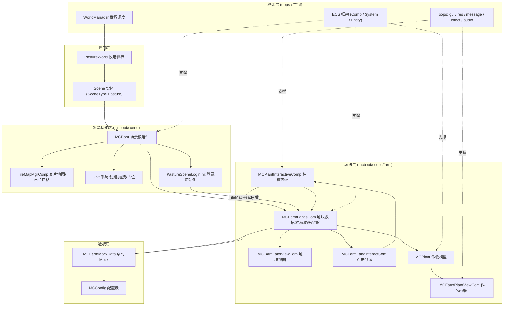
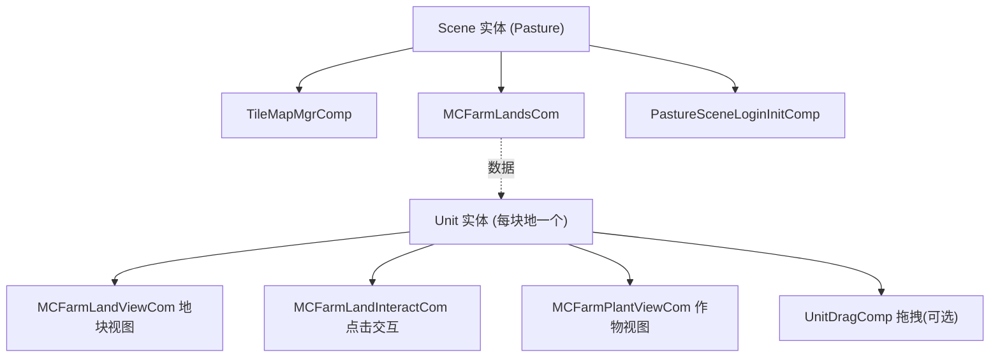
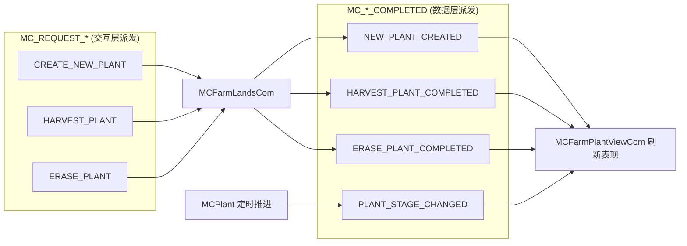
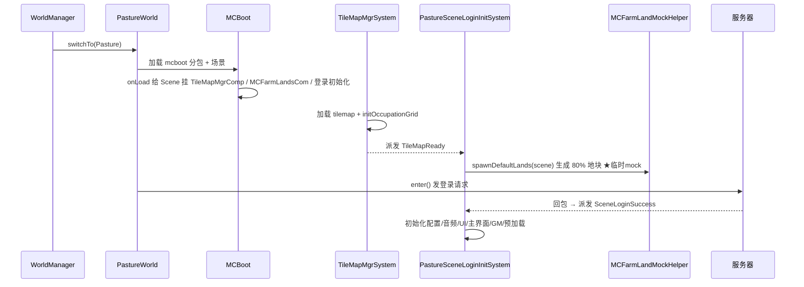
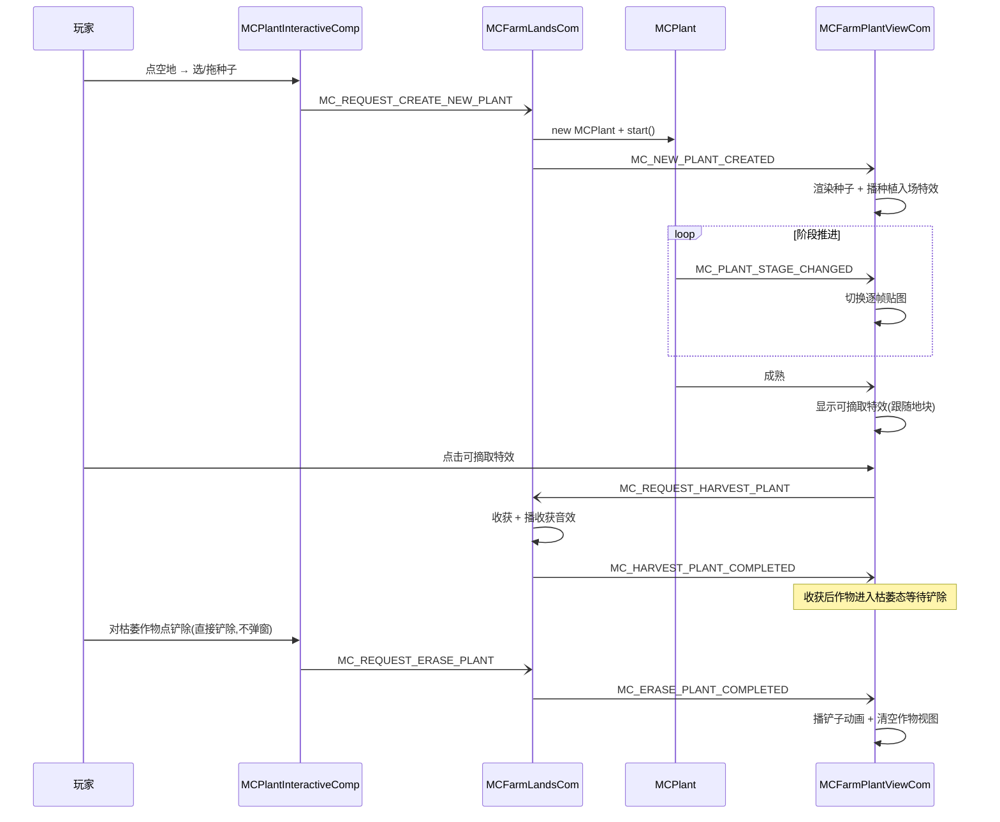

# 牧场（MC / Pasture）模块 —— 开发帮助文档

> 文档索引见同目录 [README.md](./README.md)。

## 目录

1. [模块定位与设计目标](#1-模块定位与设计目标)
2. [系统架构与分层](#2-系统架构与分层)
3. [目录结构](#3-目录结构)
4. [核心设计：事件驱动与表现/数据分离](#4-核心设计事件驱动与表现数据分离)
5. [子系统职责与扩展点](#5-子系统职责与扩展点)
6. [运行流程（时序图）](#6-运行流程时序图)
7. [还原农场进度](#7-还原农场进度)
8. [待完成事项](#8-待完成事项)
9. [数据正式化（接服务器）](#9-数据正式化接服务器)
10. [GM 工具](#10-gm-工具)
11. [快速上手](#11-快速上手)

---

## 1. 模块定位与设计目标

牧场（MC）是一个**独立分包** `remote/mc`，基于 `PastureWorld` + **oops ECS** 架构运行，与旧农场（farm，主包 `client/assets/script/game/farm/`）**并行、互不干扰**。

**设计目标与原则**：

| 原则 | 含义 | 落地方式 |
|---|---|---|
| **表现层对齐农场** | 玩家看到/听到的表现（贴图、特效、动画、音效、手感）严格复刻农场 | 直接复用农场真实资源与规则，不自造素材 |
| **数据层可插拔** | 当前数据为客户端 Mock，正式功能应由服务器回包驱动 | 事件驱动解耦，替换数据源不动表现层（见[第 4 节](#4-核心设计事件驱动与表现数据分离)、[第 9 节](#9-数据正式化接服务器)） |
| **最小侵入扩展** | 新玩法以「加组件 / 加事件监听」方式接入，避免改动既有闭环 | ECS 组件化 + `oops.message` 事件总线 |

**当前主玩法闭环**（已跑通）：


**整体流程示意（农场实拍）**：

| 场景切换（农场 ⇄ 牧场） | 种植循环（种植→生长→收获） |
|:---:|:---:|
|  | <span style="display:inline-block;width:520px;height:1057px;overflow:hidden;"></span> |

> 上图为农场实际表现，牧场以此为**还原基准**（见[第 7 节](#7-还原农场进度)）。
> 两张动图已统一显示尺寸（520×1057）；种植循环 GIF 做了**上下视觉裁剪**以对齐场景切换长宽比（≈2.03），原始 GIF 文件未改动。

### 代码位置总览

| 路径 | 内容 |
|---|---|
| `client/assets/remote/mc/mcboot/script/` | 牧场分包代码（**核心**，本文档主体） |
| `client/assets/script/world/PastureWorld.ts` | 牧场世界类 |
| `client/assets/script/mcconfig/` | 牧场配置映射与枚举（`mcConfigEnumDef.ts` 等） |
| `client/assets/script/mc/MCUIConfig.ts` | 牧场 UI 注册与 UIID |
| `client/assets/remote/mc/mcRes/mcconfig/*.json` | 牧场配置数据 |

---

## 2. 系统架构与分层



**分层要点**：

- **场景基建层**（tilemap / unit / login）与**玩法层**（farm）解耦：基建层只负责「铺地图、管占位、创建 Unit、驱动登录初始化」，不含农场玩法语义；玩法可整体替换而不动基建。
- **Scene 实体挂全局组件**（`MCFarmLandsCom`、`TileMapMgrComp`、登录初始化），**Unit 实体挂单块地组件**（地块视图 / 交互 / 作物视图 / 可选拖拽），通过 `landId` 关联。



---

## 3. 目录结构

```
mcboot/
├─ docs/                                 # 功能文档与配图（见 README.md 索引）
└─ script/
   ├─ core/MCBoot.ts                     # 场景根组件，onLoad 给 Scene 挂 ECS 组件
   ├─ MCMainUI.ts                        # 牧场主界面（GM 按钮等）
   ├─ preload/PasturePreload.ts          # 资源预加载
   ├─ scene/
   │  ├─ login/
   │  │  ├─ PastureSceneLoginInitComp.ts # 登录初始化 Comp/System（自动生成地块入口）
   │  │  └─ PastureGMInitMgr.ts          # GM 指令注册
   │  ├─ tilemap/
   │  │  ├─ TileMapMgrComp.ts            # tilemap 管理：图层/占位网格/坐标转换/TileMapReady
   │  │  ├─ TileHelper.ts                # tilemap 静态工具（screenToTile/占位/落座判定）
   │  │  └─ worldToTile.ts               # 世界坐标 → tile 反查
   │  ├─ unit/
   │  │  ├─ UnitHelper.ts                # Unit 创建/拖拽/移除
   │  │  ├─ UnitDragComp.ts              # 长按拖拽 + 占位落座
   │  │  └─ UnitViewComp.ts / Unit.ts / UnitType.ts / UnitEvent.ts
   │  └─ farm/
   │     ├─ MCFarmEnum.ts                # 事件枚举 MCFarmEventMessage + LandStatus 等
   │     ├─ MCFarmMockData.ts            # 【mock】种子背包 / 作物构造 / 资源路径规则
   │     ├─ MC_PLANT_DESIGN.md           # 种植系统分期设计文档（作物业务细节）
   │     ├─ land/
   │     │  ├─ MCLandData.ts             # MCLandData / MCLandCell（含 plant 字段）
   │     │  ├─ MCFarmLandsCom.ts         # 地块数据管理 + 种植/收获/铲除逻辑 + System
   │     │  ├─ MCFarmLandViewCom.ts      # 地块视图（土地 spine）
   │     │  ├─ MCFarmLandInteractCom.ts  # 轻点分派（开面板/收获/提示）
   │     │  └─ MCFarmLandMockHelper.ts   # 【mock】造地块（spawnAllLands/spawnDefaultLands）
   │     └─ plant/
   │        ├─ MCPlantInteractiveComp.ts # 种植/操作交互面板（拖拽+短按+铲除）
   │        ├─ MCPlant.ts                # 作物数据模型（阶段推进定时器）
   │        └─ MCFarmPlantViewCom.ts     # 作物视图（逐帧贴图/种植/成熟/收获/铲除表现）
```

---

## 4. 核心设计：事件驱动与表现/数据分离

这是牧场模块**最重要的设计约束**，也是后续扩展与接服务器的基础。

### 4.1 请求 / 完成 双段事件模型

所有「会改变地块或作物状态」的操作都拆成**请求事件**与**完成事件**两段：

- 交互层（面板 / 点击）只派发 `MC_REQUEST_*`，**不直接改数据**；
- 数据层 `MCFarmLandsCom` 监听请求 → 改数据 → 派发 `MC_*_COMPLETED`；
- 视图层 `MCFarmPlantViewCom` 只监听完成事件刷新表现。



### 4.2 为什么这样设计

- **接服务器零改视图**：正式化时只需把 `MCFarmLandsCom` 对 `MC_REQUEST_*` 的处理从「直接改数据」改为「发协议 → 回包后改数据 + 派发 `*_COMPLETED`」，视图层完全不动。
- **表现可独立还原农场**：视图层只关心「收到某完成事件该播什么表现」，可逐个对齐农场而不牵动数据逻辑。

### 4.3 事件清单

| 事件 | 派发方 | 监听方 | 状态 |
|---|---|---|---|
| `ScenePrefabLoadSuccess` | 场景预制加载 | TileMapMgrSystem | ✅ |
| `TileMapReady` | TileMapMgrSystem | PastureSceneLoginInitSystem | ✅ |
| `SceneLoginSuccess` | 登录 System | PastureSceneLoginInitSystem | ✅ |
| `MC_REQUEST_CREATE_NEW_PLANT` | 种植面板 | MCFarmLandsCom | ✅ |
| `MC_NEW_PLANT_CREATED` | MCFarmLandsCom | MCFarmPlantViewCom | ✅ |
| `MC_PLANT_STAGE_CHANGED` | MCPlant | MCFarmPlantViewCom | ✅ |
| `MC_REQUEST_HARVEST_PLANT` | 交互/可摘取特效 | MCFarmLandsCom | ✅ |
| `MC_HARVEST_PLANT_COMPLETED` | MCFarmLandsCom | MCFarmPlantViewCom | ✅ |
| `MC_REQUEST_ERASE_PLANT` | 操作面板 | MCFarmLandsCom | ✅ |
| `MC_ERASE_PLANT_COMPLETED` | MCFarmLandsCom | MCFarmPlantViewCom | ✅ |
| `MC_REQUEST_FERTILIZE_PLANT` / `MC_FERTILIZE_PLANT_COMPLETED` | - | - | 🚧 枚举已定义，表现未完全对齐 |
| 浇水 / 除草 / 杀虫 / 变异 / 多地块 相关 | - | - | ⬜ 枚举已留，逻辑未接 |

---

## 5. 子系统职责与扩展点

### 5.1 TileMap 系统（`scene/tilemap/`）✅
- **TileMapMgrComp/System**：监听 `ScenePrefabLoadSuccess` → 异步加载 tilemap → 取 **Base 层**尺寸初始化 `occupationGrid`（全 FREE）→ 派发 `TileMapReady`。
- **坐标换算**：`tileToWorld(col,row)`、`worldToTile(worldPos)`（正交换算，已实现）、`TileHelper.screenToTile`（屏幕→tile，种植/拖拽落点用）。
- **占位管理**：`setOccupation` / `clearOccupation` / `isAreaFree` / `showOperationRegion`。
  - ⚠️ **约定**：`showOperationRegion` / `setOccupation` / `clearOccupation` 以「左下角行」为 startRow 向 row 递减方向展开；`isAreaFree` 用相反约定（最小 row 向递增展开），调用方 `UnitDragComp` 已换算兼容。**扩展多格地块时注意此语义差异。**

### 5.2 Unit 系统（`scene/unit/`）✅（拖拽为最小闭环）
- **UnitHelper**：`createUnit` / `addTiledUnit`（固定）/ `addDraggableUnit`（可拖拽）/ `removeUnit` / `getUnitsByType`。
- **UnitDragComp/System**：长按进入拖拽 → Operation 层显示占位预览（空闲/占用）→ 落座判定 → 成功吸附并写占位 / 失败回退。
- **扩展点**：建造消耗、二次确认、地形/归属/解锁规则（策划案未定，预留）。

### 5.3 地块系统（`scene/farm/land/`）✅
- **MCLandData / MCLandCell**：运行时单元含 `id` / `landStage`(LandStatus) / `config` / `plant: MCPlant|null`。
- **MCFarmLandsCom/System**（数据 + 玩法逻辑核心）：
  - 数据：`initFillCells` / `getCellById` / `getLandById` / `removeCellById` / `resetData`。
  - `createPlant`：校验解锁+无作物 → `buildPlantMock` → `new MCPlant + start()` → 派发 `MC_NEW_PLANT_CREATED`。
  - `harvestPlant`：校验成熟 → 收获 → 播收获音效（`confAudioType.ACT_GET`，对齐农场）→ 作物转枯萎态。
  - `erasePlant`：`dispose` 作物 → 清空 cell → 派发 `MC_ERASE_PLANT_COMPLETED`。
  - System `entityEnter` 监听 `MC_REQUEST_CREATE_NEW_PLANT` / `HARVEST` / `ERASE`。
- **MCFarmLandViewCom**：地块土地 spine 渲染。
- **MCFarmLandInteractCom.onTap**：成熟→请求收获；生长中→toast；空地→开种植面板。
- **MCFarmLandMockHelper**【mock】：`spawnAllLands` / `spawnDefaultLands`（默认 80%）/ `removeLandById` / `clearAllLands`。

### 5.4 种植/操作交互面板（`plant/MCPlantInteractiveComp.ts`）✅
复刻农场 `PlantInteracitveComp` 手感，**双套事件模型**：canvas 层负责拖拽实时落点种植，种子格子层负责短按种植。
- 铲除交互：**枯萎阶段（DEAD）直接铲除、不弹确认框**；未枯萎才弹 `tips.confirm` 二次确认（对齐农场 `performErasing`）。
- 关闭：`commonClose`（缓存复用）；`onAdded` 每次 `resetTouchState` 防状态残留。

### 5.5 作物系统（`plant/`）✅
- **MCPlant**（数据）：`setTimeout` 按 `phases` 逐阶段推进，每步派发 `MC_PLANT_STAGE_CHANGED`；提供 `isMature` / `isDead` / `reduceGrowTime` 等。作物业务细节见 `../script/scene/farm/MC_PLANT_DESIGN.md`。
- **MCFarmPlantViewCom/System**（表现，对齐农场）：按完成事件刷新表现，含逐帧贴图、种植入场特效、成熟可摘取特效、收获表现、铲除铲子动画（详见[第 7 节](#7-还原农场进度)）。`resetVersion` 处理异步/节点复用过期。

---

## 6. 运行流程（时序图）

### 6.1 进入牧场初始化



> `TileMapReady`（触发地块生成）与 `SceneLoginSuccess`（配置初始化）是**两条独立异步流**；地块生成不读配置表，无竞态。

### 6.2 种植 → 生长 → 收获 → 铲除



---

## 7. 还原农场进度

> 目标：牧场玩家的**表现体验**与旧农场一致。下表记录各表现点的还原状态与实现位置。

| 表现点 | 农场参考 | 牧场实现 | 状态 |
|---|---|---|---|
| 作物逐阶段贴图 | `PlantComp` 逐帧贴图 | `MCFarmPlantViewCom.renderPlant` | ✅ |
| 种植入场特效 | `effect_planting` | `MCFarmPlantViewCom.playPlantEffect` | ✅ |
| 成熟可摘取特效 | `playMatureEffect` 小星星 | `MCFarmPlantViewCom.playMatureEffect` | ✅ |
| **可摘取特效跟随地块移动** | 特效挂作物节点 | 改为 `createParticleEffectNodeWithRootNode` 挂 plantNode 子节点 + 触摸冒泡拦截 | ✅ |
| 收获后转枯萎态 | 收获→DEAD 等待铲除 | `MC_PLANT_STAGE_CHANGED` 渲染枯萎，不直接清空 | ✅ |
| **收获音效** | `confAudioType.ACT_GET` | `MCFarmLandsCom.harvestPlant` 成功后播放 | ✅ |
| **铲除铲子动画** | `FarmMapComp.onErasePlantCompleted`（高端机 spine / 低端机序列帧） | `MCFarmPlantViewCom.playEraseEffect`（`LodManager` 分级） | ✅ |
| **枯萎直接铲除不弹窗** | `performErasing`：DEAD 直接铲除 | `MCPlantInteractiveComp.doErase`：DEAD 直接派发铲除 | ✅ |
| 浇水/施肥表现 | 农场浇水/施肥特效 | 事件枚举已留，表现未完全对齐 | 🚧 |
| 生长升级音效 | `playPlatLvUpAudio` | 未接 | ⬜ |
| 作物本体成熟动画 clip | `anim_plant_maturation` | 曾接入后移除（引入坐标形变），待重评估 | ⬜ |

---

## 8. 待完成事项


- **田间管理**：浇水 / 施肥 / 干旱 / 害虫 / 杂草（事件枚举已留，逻辑与表现未接）。施肥 `reduceGrowTime` 已有数据逻辑，表现待对齐农场。
- **进阶玩法**：变异（黄金/冰霜）、多地块作物、稀有作物 spine 表现、偷菜、一键收获/种植。
- **表现补齐**：施肥/浇水特效、生长升级音效（农场 `playPlatLvUpAudio`）、成熟动画 clip 重评估。
- **好友社交关系链**：好友列表 / 添加 / 删除 / 拜访他人牧场等关系链数据与管理。
- **好友交互表现**：访问好友牧场、偷菜 / 帮浇水施肥 / 点赞等交互的动画、特效与音效表现（以农场社交玩法为准复刻）。
- **好友后台接入**：好友关系链、交互结果、奖励结算等由服务器回包驱动，按[第 9 节](#9-数据正式化接服务器)事件驱动模型接入，替换客户端 mock。
- **数据正式化**：见[第 9 节](#9-数据正式化接服务器)（**最重要**）。
- **GM 补齐**：缺「生成指定索引地块」指令（用于补 `spawnDefaultLands` 未生成的 20%）。
- **引导系统**：牧场不接引导。

> 未做功能，农场主包 `client/assets/script/game/farm/` 均有成熟实现，复刻时**以农场为准**。

---

## 9. 数据正式化（接服务器）

当前所有数据均为**客户端 Mock**，代码中临时逻辑均带 `⚠️ 临时 mock` 注释，便于检索清理。

| 临时 mock | 位置 | 正式方向 |
|---|---|---|
| 自动生成 80% 地块 | `PastureSceneLoginInitSystem` 监听 `TileMapReady` → `spawnDefaultLands` | 服务器回包地块数据；移除此监听即可 |
| 地块数据构造 | `MCFarmLandMockHelper.buildFillLandData` | 服务器地块列表 |
| 种子背包 | `MCFarmMockData.getSeeds` / `consume` | `ItemManager` 真实背包 |
| 作物构造 & 阶段时长 | `MCFarmMockData.buildPlantMock` | 服务器种植数据 + 配置真实时长 |
| 种植/收获/铲除 | 本地 `createPlant`/`harvestPlant`/`erasePlant` 直接改数据 | 走服务器请求-回包 |

> **接后端要点**：把 `MCFarmLandsCom` 对 `MC_REQUEST_*` 的处理由「直接改数据」改为「发协议 → 回包后改数据 + 派发 `*_COMPLETED`」。因事件驱动已解耦（[第 4 节](#4-核心设计事件驱动与表现数据分离)），**视图层无需改动**。

---

## 10. GM 工具（`scene/login/PastureGMInitMgr.ts`）

| 分类 | 名称 | 参数 | 说明 |
|---|---|---|---|
| 农场 | 场景跳转测试 | 0=农场 / 1=牧场 | 切世界 |
| 场景协议测试 | 获取场景信息 / 设置默认场景 | - / 1 | 协议测试 |
| 场景单位测试 | 增加/生成拖拽/移除 场景单位 | json | Unit 测试 |
| 地块测试 | 生成全部地块 | - | `spawnAllLands` 全量 |
| 地块测试 | 删除指定地块 | `{"index":"1"}` | `removeLandById` |
| 地块测试 | 清理全部地块 | - | `clearAllLands` |

> ⚠️ 缺「生成指定索引地块」指令，如需补 `spawnDefaultLands` 未生成的 20% 可新增。

---

## 11. 快速上手

### 11.1 跑起来（5 分钟）

1. 用 Cocos Creator 打开工程 `e:/20260612_svn_14954_nqp/client`。
2. 运行到预览 / 真机。
3. 点主界面 **GM 按钮** → 「农场 / 场景跳转测试」参数填 `1` → 进入牧场。
4. 进牧场后应**自动铺出连续 80% 地块**。
5. **点空地** → 弹种植面板 → **点/拖种子** → 看到 `toast("种植了xxx")`。
6. 等作物逐阶段长大 → 成熟后出现**可摘取特效** → **点击收获**（有收获音效）→ 作物转枯萎 → **铲除**（枯萎直接铲除、播铲子动画）清空地块。

### 11.2 常见调试

| 想做的事 | 怎么做 |
|---|---|
| 补满 100% 地块 | GM → 地块测试 → 生成全部地块 |
| 删某块地 / 清空重来 | GM → 地块测试 → 删除指定 / 清理全部 |
| 改生长速度 | `MCFarmMockData` 里阶段时长 |
| 换作物贴图 | 确认 plant 包有对应 `model/v4/...` 资源 |

### 11.3 改动前必读

- **表现层不要自造**：作物/特效/音效资源规则严格对齐农场，改动前先对照农场 `game/farm/view/PlantComp.ts`、`actor/Plant.ts`、`view/FarmMapComp.ts`。
- **接服务器**：从[第 9 节](#9-数据正式化接服务器)入手；事件驱动已解耦，视图层通常无需改。
- **新增玩法**：优先参考农场主包同名实现，以「加组件 / 加事件监听」方式接入。
